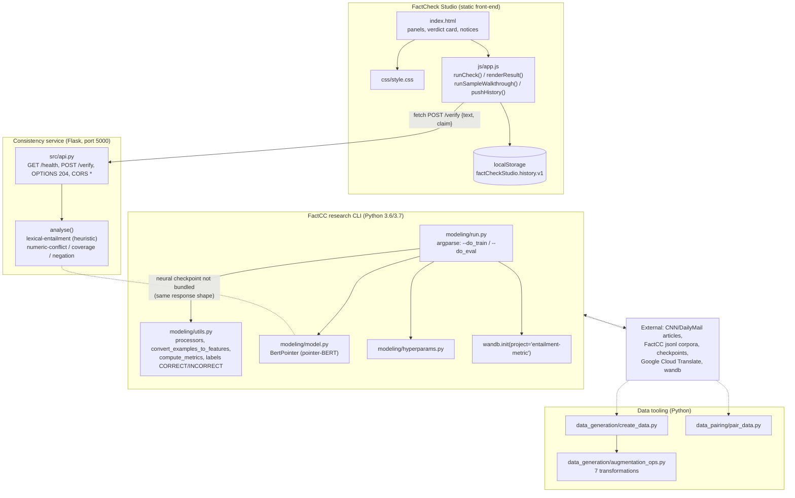
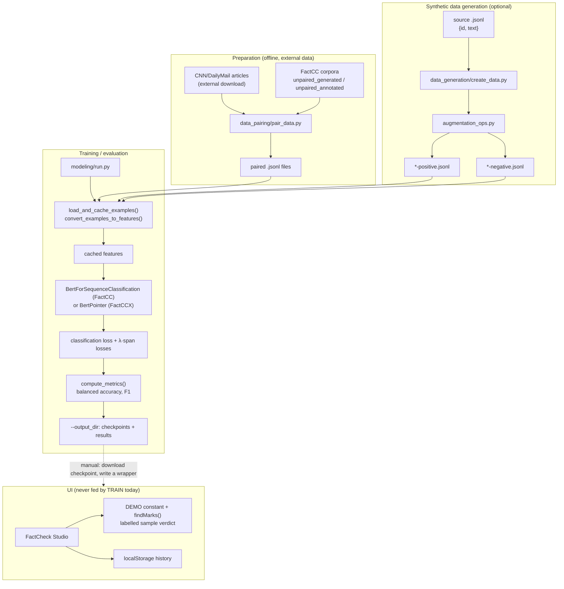

# PROJECT OVERVIEW — FactCheck Studio (`abstractive-text-summarizer`)

A developer-facing deep dive into the FactCheck Studio work: what the upstream FactCC research code actually does, how the static front-end relates to it, and exactly where the boundary between "implemented" and "not available" lies.

---

## Project Summary

| Field | Value |
|---|---|
| **Folder id** | `abstractive-text-summarizer` |
| **UI display name** | **FactCheck Studio** |
| **Upstream project** | FactCC — Salesforce Research (`https://github.com/salesforce/factCC`) |
| **Problem** | Abstractive summarisation metrics (ROUGE, etc.) do not measure whether a generated summary is *factually consistent* with its source document. |
| **Objective** | Provide a weakly-supervised model that (1) labels a summary sentence as factually consistent or not, (2) extracts the *supporting span* in the source, and (3) extracts the *inconsistent span* in the summary — plus an honest, static operator console that visualises the workflow without faking model output. |
| **Users** | NLP researchers re-running the FactCC experiments; engineers wrapping the model in a service; reviewers who need to see the workflow without a GPU. |
| **Expected output** | A binary label (`CORRECT` / `INCORRECT`) with metrics (balanced accuracy, F1) from `modeling/run.py`; a visually rendered verdict card with highlighted spans in the UI. |
| **Licence** | BSD-3-Clause (Salesforce.com, Inc., 2019) — `LICENSE.txt` |

---

## Problem Statement

Modern abstractive summarisers generate fluent text that may contradict its source. Traditional automatic metrics such as ROUGE compare surface overlap with reference summaries and say nothing about factual faithfulness. Manually annotating large corpora for factuality is prohibitively expensive, so datasets with human factuality labels are small and noisy.

The FactCC paper attacks this with **weak supervision**: instead of collecting human labels, it *manufactures* training data by applying rule-based transformations to source sentences (negation, entity swaps, date/number swaps, backtranslation, noise). The model then learns three related tasks jointly, and the auxiliary span-extraction tasks measurably help the main consistency classification.

On top of that research code base, this project adds a **static front-end** whose job is to make the workflow legible and — critically — to never pretend that a verdict exists when it does not.

---

## Proposed Solution

Two complementary halves in one repository:

1. **The research pipeline (real, runnable, heavy).**
   `modeling/run.py` trains or evaluates FactCC (`--model_type bert`) and FactCCX (`--model_type pbert`) over `jsonl` datasets. `data_generation/create_data.py` synthesises training pairs from raw documents. `data_pairing/pair_data.py` rejoins the released FactCC data with the original CNN/DailyMail articles.

2. **The FactCheck Studio desk (static, always works).**
   A vanilla HTML/CSS/JS console that lets an operator paste a source document and up to three claims, mark spans by hand, and watch the check history grow. **Run consistency check** calls the bundled Flask service (`src/api.py`, port 5000) whose deterministic **lexical-entailment engine** returns a `CORRECT`/`INCORRECT` verdict with supporting/inconsistent spans — labelled explicitly as heuristic, *not* a neural FactCC checkpoint. If the service is not running the page shows a **backend-unavailable** card with the start command; a clearly-labelled **Sample walkthrough** remains available for a no-backend demo.

The design principle throughout is *honesty over impressiveness*: every model-dependent affordance is explicitly marked as requiring a backend, and every illustrative number is labelled as such.

---

## Features and Capabilities

### Existing (verified in the code)

- **Consistency service** (`src/api.py`, Flask): `GET /health` and `POST /verify` implement a deterministic **lexical-entailment engine** (`analyse()` — numeric-conflict detection, token coverage, sentence Jaccard overlap, negation flip). Returns the FactCC label space (`CORRECT`/`INCORRECT`) plus supporting/inconsistent spans, and labels itself `model_checkpoint: false`.
- **Verdict card with four states** — empty, loading, backend-unavailable, result — switched by `showVerdictState()` in `js/app.js`.
- **Live check** (`runCheck()`): `fetch(API_BASE + "/verify")` renders the backend's real label, confidence and spans; a network error falls back to the backend-unavailable card with the start command.
- **Claim editor with up to 3 rows** (`MAX_CLAIMS = 3`), each with a text area, a focus selector and per-row span tools.
- **Three span categories**, colour-coded in the legend: *supporting span*, *inconsistent span*, and *user-marked span* (explicitly "your annotation, not a model output").
- **Sample walkthrough** (`DEMO` object + `runSampleWalkthrough()`): a hand-written source/claim pair, an `INCORRECT` label, an illustrative `0.91` confidence arc and offset-resolved span highlights — every render carries a "demo" banner.
- **Local check history**: `localStorage` key `factCheckStudio.history.v1`, capped at 100 entries, exportable as JSON, copyable, clearable.
- **API-contract & CLI reference panel** in the page footer: the real `jsonl` format, the real CLI invocation, and the `POST /verify` contract (now implemented by `src/api.py`).
- **Training / evaluation CLI** with 30+ argparse flags (see the README table), wandb logging, `--fp16`, multi-GPU friendly `local_rank` handling.
- **Seven claim augmentations** in `data_generation/augmentation_ops.py`: `SampleSentences`, `Backtranslation`, `PronounSwap`, `NERSwap` (+ `EntitySwap`, `NumberSwap`, `DateSwap`), `NegateSentences`, `AddNoise`.

### Future / not built

- A **neural** inference wrapper that loads a released FactCC/FactCCX checkpoint (the current service is the heuristic engine; loading the checkpoint needs the pinned 2020 stack).
- Loading a released checkpoint into the browser (WebGPU/WASM port of pointer-BERT) — not attempted.
- Automated evaluation reports inside the UI (metrics from `compute_metrics()` are not surfaced).
- Support for the `factcc_generated` task in the UI's task selector.

---

## System Architecture

Real components only — the front-end talks to the bundled service over HTTP; the neural CLI remains separate.



**Key architectural facts**

- The UI reaches a backend over HTTP: `js/app.js` calls `fetch(API_BASE + "/verify")` where `API_BASE = window.FACTCC_API_BASE || "http://127.0.0.1:5000"`. The service sends CORS `Access-Control-Allow-Origin: *`.
- `modeling/run.py` uses flat imports (`from model import BertPointer`, `from utils import ...`), so it must be executed in a way that puts `modeling/` on `sys.path` — running `python modeling/run.py` does this automatically because Python puts the script's directory first on the path.
- `data_generation/create_data.py` likewise does `import augmentation_ops as ops` and is intended to be run as a script from its own directory.

---

## Complete Project Workflow

### A. The static desk (what a user does in the browser)

1. **Open** `index.html` (directly or via `python -m http.server 8000`).
2. **Paste the source document** into Panel I → `updateSourceCounters()` refreshes the character/word counters; dropping a `.txt` file on the panel loads its contents.
3. **Enter up to three claims** in Panel II → `renderClaims()` / `renderClaimRow()` rebuild the rows; the focus `<select>` drives which claim the verdict card describes.
4. **Mark spans** → `addSelectionMark(index, type)` records the current textarea selection as a *supporting* or *inconsistent* mark; the chips under the row can be removed individually.
5. **Press "Run consistency check"** → `runCheck()` POSTs `{text, claim}` to `http://127.0.0.1:5000/verify` (via `API_BASE`). On success `renderResult()` shows the returned `CORRECT`/`INCORRECT` label, confidence and highlighted supporting/inconsistent spans, and pushes a `mode: "backend (lexical-entailment)"` history entry. On network failure it shows the backend-unavailable card with the exact `python src\api.py` start command. **Nothing is fabricated either way.**
6. **Press "Sample walkthrough"** → `runSampleWalkthrough()` fills the demo source/claim, resolves span offsets against the live text, renders the `INCORRECT` stamp + `0.91` arc, and pushes a `mode: "sample-walkthrough"` entry into the history with the note *"Illustrative demonstration data - not a model output. No checkpoint was executed."*
7. **Press "Reset desk"** → panels cleared, history kept, toast *"Desk reset (history kept)"*.
8. **Export** → `downloadJSON("factcc-studio-history.json", …)` writes the history with its per-entry mode.

### A2. The service (what the backend does)

1. **Start** `.venv\Scripts\python.exe src\api.py` → Flask listens on `127.0.0.1:5000`.
2. **`GET /health`** → readiness probe (`engine`, `model_checkpoint: false`).
3. **`POST /verify`** → validates `text`/`claim` (400 if missing) → `analyse()` computes numeric conflicts, token coverage, sentence overlap and a negation flip → returns the label, confidence, spans and diagnostics.
4. **`OPTIONS /verify`** → 204 CORS preflight; all responses carry `Access-Control-Allow-Origin: *`.

### B. The research pipeline (what a researcher does)

1. **Install** the pinned stack (`requirements.txt` + `wandb`) on Python 3.6/3.7 and `wandb login`.
2. **Acquire data**: download the generated/annotated corpora and the CNN/DailyMail articles, then `python data_pairing/pair_data.py <factcc-dir> <stories-dir>`.
3. **(Optional) Regenerate synthetic data**: `python data_generation/create_data.py <source.jsonl> --augmentations negation noise` → positive/negative `jsonl` pairs.
4. **Train or evaluate**:
   `python modeling/run.py --task_name factcc_annotated --do_eval --eval_all_checkpoints --do_lower_case --max_seq_length 512 --model_type bert --model_name_or_path bert-base-uncased --data_dir <DATA> --output_dir <CKPT>`.
5. **Inside `run.py`**: `main()` validates the flags → `processors[args.task_name]()` is instantiated → `load_and_cache_examples()` materialises the dataset (this is the slow pre-processing step) → the model is built (`BertForSequenceClassification` for FactCC, `BertPointer` for FactCCX) → training or evaluation loop runs → `compute_metrics()` returns the metric dict → results are written to `--output_dir`.
6. **Error handling**: an unknown `--task_name` raises `ValueError("Task not found: ...")`, missing data files raise `FileNotFoundError` from the processor, and a missing `wandb` install fails at import time before any work begins.

---

## Machine Learning or Algorithm Explanation

### The three jointly-trained tasks

FactCC is trained on *synthetically corrupted* claim/source pairs. A transformation is applied to a claim extracted from the source document; whether the transformation preserves factuality defines the label:

| Transformation | Effect on factuality | Label |
|---|---|---|
| `SampleSentences` | claims taken verbatim from the source | positive |
| `Backtranslation` | paraphrase via Google Translate (de → en) — usually preserves facts | positive |
| `PronounSwap`, `EntitySwap`, `NumberSwap`, `DateSwap` | replaces one entity in the claim with a different one found in the source | negative |
| `NegateSentences` | inserts a negation | negative |
| `AddNoise` | injects character-level noise | negative |

### The models

- **FactCC** (`--model_type bert`) is a plain BERT sequence classifier with two labels (`CORRECT`, `INCORRECT`). It is the "does it stay consistent?" head.
- **FactCCX** (`--model_type pbert`) is the **pointer-BERT** variant implemented in `modeling/model.py` as `BertPointer`. Instead of a classification head only, it decodes **span pointers** into the source (supporting span) and into the claim (inconsistent span). The pointer formulation avoids the need for a separate span-extraction architecture and keeps everything end-to-end.

### The objective

The training loss combines the main consistency classification with the auxiliary span losses, weighted by `--loss_lambda` (default `0.1`). The auxiliary tasks regularise the shared BERT encoder: the model must keep the evidence in mind to point at it, which improves the main decision.

### Evaluation

`compute_metrics()` in `modeling/utils.py` returns balanced accuracy and F1 for the annotated task. `processors` maps task names to processors (`factcc_generated` → synthetic training data, `factcc_annotated` → the human-annotated validation/test split), each of which supplies `get_train_examples()`, `get_dev_examples()`, `get_labels()` and its own feature conversion.

### What the UI shows instead

The static desk renders a **hand-authored** verdict. It is not an inference path — the numbers in it (`INCORRECT`, `0.91`) are constants in the `DEMO` object of `js/app.js`. The span highlights are computed by matching literal substrings in the live text (`findMarks()`), not by a model.

---

## File-by-File Code Guide

### Front-end (added layer)

| File | Key elements | Purpose |
|---|---|---|
| `index.html` | `#btn-run`, `#btn-sample`, `#verdict-backend`, `#verdict-result`, `#api-contract` | Page structure; the backend-unavailable notice; the real-data-format / live-contract reference panel |
| `js/app.js` | `DEMO`, `runCheck()`, `runSampleWalkthrough()`, `renderClaims()`, `addSelectionMark()`, `findMarks()`, `pushHistory()`, `downloadJSON()` | All client behaviour; `HISTORY_KEY = "factCheckStudio.history.v1"`; `MAX_CLAIMS = 3` |
| `css/style.css` | panel / stamp / arc / chip styles | Visual layer only, no logic |

### Research CLI (upstream Salesforce code)

| File | Key elements | Purpose |
|---|---|---|
| `modeling/run.py` | `main()`, `train()`, `evaluate()`, `load_and_cache_examples()`, `MODEL_CLASSES` / `MODEL_TYPES` | The single entry point. `wandb.init(project="entailment-metric")` at import; `processors` and `output_modes` imported from `utils` |
| `modeling/utils.py` | `processors`, `output_modes`, `convert_examples_to_features()`, `compute_metrics()` | Task registry, label space (`CORRECT`/`INCORRECT`), feature conversion, metrics |
| `modeling/model.py` | `BertPointer` | Pointer-BERT span extractor used by FactCCX |
| `modeling/hyperparams.py` | hyper-parameter defaults | Defaults for the BERT encoder |
| `modeling/scripts/factcc-*.sh`, `factccx-*.sh` | `*_PATH` variables to edit | Quickstart train / finetune / eval shell scripts |

### Data tooling (upstream)

| File | Key elements | Purpose |
|---|---|---|
| `data_generation/create_data.py` | `load_source_docs()`, `apply_transformation()`, `save_data()`, `main()` | Drives the augmentation pipeline over a `jsonl` source file |
| `data_generation/augmentation_ops.py` | `SampleSentences`, `NegateSentences`, `Backtranslation`, `PronounSwap`, `NERSwap`, `EntitySwap`, `NumberSwap`, `DateSwap`, `AddNoise` | The transformations themselves; `translate.Client()` for backtranslation; spaCy for NER |
| `data_pairing/pair_data.py` | `parse_story_file()`, `main()` | Re-joins FactCC examples with the CNN/DailyMail article texts |

### Configuration files

| File | Purpose |
|---|---|
| `requirements.txt` | Pinned 2019 stack (does **not** include `wandb`) |
| `LICENSE.txt` | BSD-3-Clause, Salesforce.com, Inc. |
| `project-metadata.json` | Provenance metadata (upstream URL, licence, declared entry point) |
| `.gitignore` | Ignores `__pycache__`, `**/wandb/`, `**/gen_data/` and similar local artefacts |

---

## Data Flow



**The dashed edge is the only possible connection between the two halves** — a user would have to write a wrapper service, point it at the checkpoint, and add a `fetch()` call. Nothing in the repository does this.

---

## Example Execution

### The static desk (illustrative)

1. Open the desk. The masthead reads **"Model: not loaded (backend required)"** and the verdict card shows the empty state: *"No check has been run on this desk yet."*
2. Paste this source document:

   > Mercury Transit Pharma said Wednesday that its experimental antibody therapy reduced tumor size by 47 percent in a Phase II trial involving 320 patients.

3. Add the claim *"Mercury Transit Pharma said the therapy shrank tumors by 47 percent."*
4. Press **Run consistency check** → the card flips to **"Verification requires the FactCC backend"** with the four setup steps. **No label, no confidence, no spans are produced.**
5. Press **Sample walkthrough** → the demo source/claim pair is written into the panels and the card renders:

   | Field | Rendered value | Nature |
   |---|---|---|
   | Binary label | `INCORRECT` | demo constant (`DEMO.label`) |
   | Confidence | `0.91` | demo constant, marked "(illustrative figure)" |
   | Claim in focus | Claim 1 | live UI state |
   | Source of data | "Hand-written demonstration pair, offsets resolved in-browser" | stated in the card |
   | Banner | "Sample walkthrough — illustrative data, not a model output" | always shown |

6. The history table gains one row with mode `sample`. **Download history JSON** produces `factcc-studio-history.json` whose `note` field describes the export; real backend runs are recorded with mode `backend (lexical-entailment)`.

### The CLI (illustrative command; not executed here)

```powershell
python modeling\run.py --task_name factcc_annotated --do_eval --eval_all_checkpoints `
  --do_lower_case --max_seq_length 512 --model_type bert `
  --model_name_or_path bert-base-uncased --data_dir <DATA_PATH> --output_dir <CKPT_PATH>
```

Expected behaviour on a machine with the pinned stack: the processor resolves `data-dev.jsonl` inside `--data_dir`, features are cached (slow on a large dataset), the checkpoint is loaded, predictions are made, `compute_metrics()` returns the metric dict and the results are written under `--output_dir`. **No HTTP response is produced — this is a batch script.**

---

## Dependencies and External Services

| Dependency / service | Why it matters | Required? |
|---|---|---|
| `pytorch_transformers==1.0.0` | Provides `BertForSequenceClassification`, `BertTokenizer`, `AdamW` and the optimisation utilities the CLI is written against | Yes, for the CLI |
| `torch==1.3.1` | Tensor backend for the encoder, pointer decoder and training loop | Yes, for the CLI |
| `spacy==2.2.3` (+ `en_core_web_sm`) | NER tagging for entity / number / date swapping; also tokenises claims during backtranslation | Yes, for the augmentations |
| `google-cloud-translate==1.6.0` | Backtranslation augmentation (`translate.Client()`); **billed** | Only for `backtranslation` |
| `wandb` | `modeling/run.py` calls `wandb.init()` at import time and `wandb.log()` during training | Yes, for the CLI (**not listed in `requirements.txt`**) |
| `apex==0.9.10dev` | NVIDIA mixed-precision training (`--fp16`) | Optional |
| `numpy`, `scipy`, `scikit_learn` | Numerical stack; `scikit_learn` provides the F1/accuracy helpers | Yes |
| `tqdm` | Progress bars in the training loop and the data generation | Yes |
| **CNN/DailyMail articles** (`https://cs.nyu.edu/~kcho/DMQA/`) | Original source stories the released FactCC data must be paired with | Yes, for the released corpora |
| **FactCC corpora** (`storage.googleapis.com/sfr-factcc-data-research/…`) | Generated and annotated training/validation data | Yes, for training/eval |
| **FactCC checkpoints** (`…/factcc-checkpoint.tar.gz`, `…/factccx-checkpoint.tar.gz`) | Pre-trained weights | Yes, for evaluation without training |
| **Weights & Biases account** | Dashboard for the training curves | Effectively yes (`wandb login`) |
| **Google Cloud project** | Only for the backtranslation augmentation | Optional |
| Browser (any modern engine) | Runs the static UI; uses only `localStorage`, `Blob` downloads and the clipboard API | Yes, for the UI |

---

## Current Limitations and Future Improvements

**Current limitations**

- The bundled service (`src/api.py`) is a **heuristic lexical engine**, not the neural FactCC model — it can miss paraphrase-level falsehoods.
- No checkpoint and no dataset in the repository; both are multi-GB external downloads, and loading a checkpoint needs the pinned 2020 stack.
- The dependency stack is pinned to 2019 and requires a Python 3.6/3.7 interpreter; `wandb` is missing from `requirements.txt`.
- The sample-walkthrough verdict is a constant; span highlighting is substring matching, not attention or pointer decoding.
- `data_generation` requires a spaCy model and (for backtranslation) a paid Google Cloud account.
- The `Model` dropdown in the UI is cosmetic; it changes no computation.
- History is per-browser `localStorage` (max 100 entries) with no server-side persistence.

**Future improvements**

- Write the `POST /verify` wrapper the UI already specifies, load the released checkpoint, and wire `js/app.js` to it with a clear "live backend" badge (mirroring the pattern used in the sibling fraud-detection project).
- Port the FactCC evaluation into the UI so `compute_metrics()` output is shown next to the verdict.
- Modernise the stack behind an adapter (`transformers` + `torch` ≥ 2.x) so the code runs on current Python, keeping the original scripts for reproducibility.
- Add `wandb` (and make it optional via `WANDB_MODE=offline`) to `requirements.txt`.
- Add a `--eval_file` mode so users can score a single `jsonl` file without the train/eval split machinery.

---

## Learning Outcomes

Working through this project teaches:

- **Weak supervision for factuality**: how synthetic, rule-based corruption of text can replace expensive human annotation while still teaching a model to localise the evidence.
- **Pointer networks**: how `BertPointer` turns span selection into a sequence of pointer positions decoded from BERT's hidden states, instead of a separate span classifier.
- **Auxiliary-task training**: why adding span-extraction heads with a small loss weight (`--loss_lambda 0.1`) improves the main consistency decision.
- **Multi-task dataset design**: how `processors` / `output_modes` in `modeling/utils.py` let one CLI serve two datasets with different labels and metrics.
- **Dataset engineering at scale**: the pairing problem between a released annotation set and its original articles, and the cost model of API-based backtranslation.
- **Honest interface design**: how a UI can be genuinely useful with no model present — by labelling demo output, showing the real setup steps, and separating "proposed contract" from "implemented contract" in the documentation itself.
- **Reproducibility hygiene**: pinning an old stack, capturing the environment in `environment`/`requirements` files, and recording which artefacts are external downloads.
