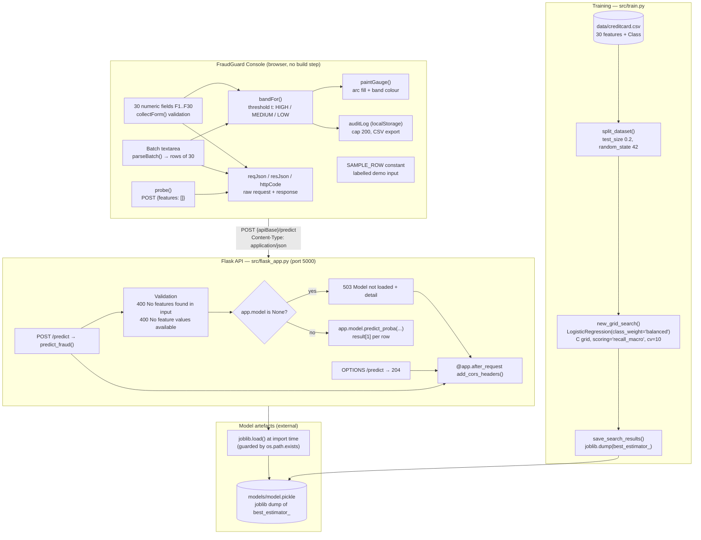
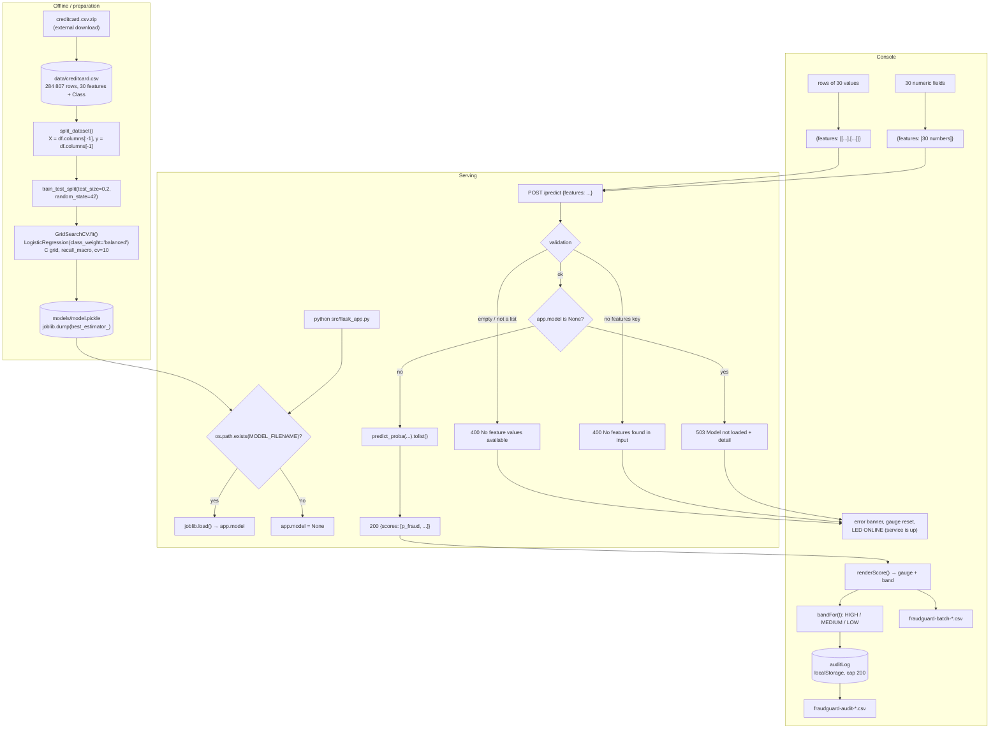

# PROJECT OVERVIEW — FraudGuard Console (`credit-card-fraud-detection`)

A developer-facing deep dive into the fraud-detection microservice and its security-operations console: the API contract, the training pipeline, the scoring semantics, and exactly why the checkout can serve requests but cannot yet return a score.

---

## Project Summary

| Field | Value |
|---|---|
| **Folder id** | `credit-card-fraud-detection` |
| **UI display name** | **FraudGuard Console** |
| **Upstream project** | fraud-detection — Cloud Academy (`https://github.com/cloudacademy/fraud-detection`) |
| **Problem** | Card transactions are overwhelmingly legitimate (~0.17 % fraud), so an untrained or mis-tuned classifier either misses fraud or buries the team in false positives. The decision threshold is a business decision, not a modelling artefact. |
| **Objective** | Serve a calibrated fraud probability per transaction over a small, well-specified HTTP API, and give an operator a console that scores single transactions and batches, bands the risk, and keeps an audit trail. |
| **Users** | Fraud analysts / SOC operators using the console; backend developers integrating `/predict` into a payment flow. |
| **Expected output** | `POST /predict` → `{"scores": [p_fraud, …]}` (probability of class 1), plus a LOW/MEDIUM/HIGH band and an audit-log entry in the console. |
| **Licence** | Apache License 2.0 — `LICENSE` in the project root |

---

## Problem Statement

Two hard facts shape this design.

**Imbalance.** In the classic credit-card transaction dataset, 284 807 transactions contain 492 frauds — 0.17 %. Accuracy is therefore meaningless: a model that always answers "legitimate" scores 99.83 %.

**Asymmetric cost.** Missing a fraud is far more expensive than investigating a false positive, so the model should be optimised for **recall**, and the *decision* of what score to act on should be separated from the model.

The upstream project already frames the task this way ("SMOTE vs class weights, precision-recall tradeoff and cost-aware thresholding"), and the shipped implementation follows the **class-weight** branch: `LogisticRegression(class_weight="balanced")` inside a `GridSearchCV` scored by **macro recall**, with the operational threshold living in the front-end.

---

## Proposed Solution

A two-part system:

1. **A small, strict Flask microservice** (`src/flask_app.py`, port 5000) exposing exactly one scoring route and one preflight route. It validates the payload, distinguishes "your request is wrong" (400) from "I am not ready" (503), and returns the fraud probability as a bare `scores` array.
2. **FraudGuard Console** (`index.html` + `js/app.js`) — a vanilla-JS operations console with a 30-field transaction form, a batch scorer, a risk gauge, an adjustable threshold and a browser-local audit log. It never computes a score itself: every number it renders comes from a live `POST /predict` response, and the demo row it offers is explicitly labelled as demo input.

The architectural choice worth highlighting: **the model is loaded lazily**. The service starts even when `models/model.pickle` is absent, and instead of crashing it answers `503 Model not loaded` with the exact remediation command. That single change is what turns "the repository does not work" into "the repository works, and tells you precisely what is missing".

---

## Features and Capabilities

### Existing (verified in the code)

- **Single and batch scoring in one route** — `predict_fraud()` inspects `features[0]`: a list means a batch of rows, a number means one row.
- **Strict, documented validation** — two distinct 400 messages, so a client can tell "you forgot the key" from "you sent an empty list".
- **A structured 503 with remediation text** — `{"error": "Model not loaded", "detail": "models/model.pickle is missing. Train it first: place data/creditcard.csv then run python src/train.py"}`.
- **CORS for all responses** plus an `OPTIONS /predict` → 204 preflight, so a browser served from another origin can call the API.
- **Joblib with a legacy fallback** — `import joblib` first, `from sklearn.externals import joblib` second, so the file works on both 2017 and current scikit-learn.
- **Grid-search training** — `Pipeline([("clf", LogisticRegression(class_weight="balanced"))])` over `C ∈ {1e-4, 1e-2, 1, 1e2, 1e4}`, `scoring="recall_macro"`, `cv=10`, `n_jobs=-1`; the winner is pickled to `models/model.pickle`.
- **Deterministic split** — `test_size=0.2, random_state=42`.
- **Console reachability probe** — the API has no health route, so the console posts `{"features": []}` and treats *any* HTTP answer as "reachable" (only a network failure means offline).
- **Risk banding driven by a user threshold** — `bandFor()`: `score >= t` → HIGH, `score >= t/2` → MEDIUM, else LOW; the threshold is persisted in `localStorage` and the gauge fill colour follows the band.
- **Batch scoring with a sortable result table and CSV export** (`fraudguard-batch-YYYYMMDD-HHMMSS.csv`).
- **Audit log** — every single or batch attempt is recorded (time, mode, score, band, status, detail), capped at 200 entries, exportable as CSV, clearable behind a confirmation dialog.
- **Request/response inspector** — the console shows the exact JSON it sent, the raw body it received, the HTTP status and the latency, with a Copy button.
- **Endpoint contract tests** — `tests/test_flask.py` covers the empty body, the null-features body, the single-point and the multi-point cases.

### Future / not built

- Persisting the training metrics (macro recall, confusion matrix) to a file or a metrics endpoint.
- A `/health` or `/model-info` route (the console deliberately works around its absence).
- Model hot-reload after retraining.
- Authentication, rate limiting, structured server-side request logging.
- A cost-sensitive decision layer server-side (the threshold currently lives only in the browser).
- Calibration reporting (reliability curve) for the returned probabilities.
- Support for more than the fixed 30-column feature vector (e.g. PCA-reduced inputs).

---

## System Architecture

Real components only. Note that the **model file and the dataset are external** to the repository.



**Architectural notes**

- `src/flask_app.py` imports `from settings import MODEL_FILENAME` — a flat import, so the process must have `src/` on `sys.path`. Both documented launch commands satisfy that automatically.
- `src/settings.py` resolves `DATASET_FILENAME` and `MODEL_FILENAME` from `__file__`, so both are absolute and independent of the working directory.
- The API is **stateless**; the only state is `app.model` in memory and the browser's `localStorage`.
- The console's default `apiBase` (`http://127.0.0.1:5000`) matches the API's `app.run(host="127.0.0.1", port=5000)`.

---

## Complete Project Workflow

### A. Training (one-off, ~minutes)

1. `python src/train.py` → `main()` → `new_grid_search()` → `run_grid_search()` → `save_search_results()`.
2. `split_dataset()` reads `data/creditcard.csv`, takes `df.columns[:-1]` as `X` and `df.columns[-1]` as `y`, and splits with `test_size=0.2, random_state=42`.
3. `GridSearchCV` fits 5 candidates × 10 folds with `n_jobs=-1`, optimising **macro recall**.
4. `joblib.dump(grid_search.best_estimator_, MODEL_FILENAME)` writes `models/model.pickle` — the whole fitted `Pipeline`, not just the classifier.
5. Metrics (macro recall, precision/recall/F1, confusion matrix) are only written to the `logging` logger at DEBUG level, so they are invisible at the default level and are not persisted.

### B. Serving

1. `python src/flask_app.py` (or `flask --app src/flask_app.py run`) starts Flask on `127.0.0.1:5000`.
2. At import, `app.model = None`; if `models/model.pickle` exists it is loaded with `joblib.load`.
3. A request arrives → `predict_fraud()`:
   - `request.get_json(silent=True) or {}` — unparseable JSON degrades to `{}`;
   - `"features" not in input_data` → **400** `"No features found in input"`;
   - `not input_data["features"]` or not a list → **400** `"No feature values available"`;
   - `app.model is None` → **503** `"Model not loaded"` + the remediation detail;
   - otherwise `predict_proba` is called (batch if `features[0]` is a list, single otherwise) and `{"scores": [result[1] for result in results]}` is returned with **200**.
4. `add_cors_headers()` decorates every response with the three CORS headers.

### C. Operator flow in the console

1. Page load → `init()` restores `fraudguard.apiBase`, `fraudguard.threshold` and `fraudguard.auditLog` from `localStorage`, then calls `probe(false)`.
2. `probe()` posts `{"features": []}` with an 8 s timeout. Success → LED **ONLINE** with the HTTP status; failure → LED **OFFLINE** and the setup panel with the four setup steps is shown.
3. The operator fills 30 fields (or clicks **Load sample row**, which is explicitly labelled as demo input) and presses **SCORE TRANSACTION** (or `Ctrl+Enter`).
4. `collectForm()` parses each field with a strict numeric regex; missing or invalid fields are marked with the `is-invalid` class and the request is blocked with a message naming the offending fields.
5. `submitSingle()` posts the payload with a 20 s timeout, measures the latency, and renders one of three outcomes:
   - **HTTP 200 + valid `scores` array** → `renderScore()` paints the gauge, sets the band chip and marks the source "SINGLE TRANSACTION — LIVE API";
   - **non-2xx** → the error is shown, the gauge resets, the band chip becomes `ERROR`, and the entry is logged as an error (the service is still marked reachable);
   - **network failure / abort** → the LED goes **OFFLINE**, the message names the timeout or connection failure, and the entry is logged.
6. Batch mode repeats the same exchange with `{"features": [[...], [...]]}`; the response length must match the number of submitted rows or the payload is rejected as invalid.
7. Every attempt is pushed onto the audit log (`addLog()`), which is capped at 200 entries and persisted to `fraudguard.auditLog`.

### D. Error handling summary

| Condition | Layer | Response |
|---|---|---|
| Body without `features` | API | 400 `No features found in input` |
| `features` null / empty / wrong type | API | 400 `No feature values available` |
| Model file missing | API | 503 `Model not loaded` + `detail` |
| Unparseable JSON | API | Treated as `{}` → 400 |
| Fewer/more than 30 fields, non-numeric | Console | Blocked before the request, fields highlighted |
| Timeout (> 20 s) | Console | `AbortError` → "TIMEOUT", LED OFFLINE, logged |
| API unreachable | Console | "CONNECTION FAILED", LED OFFLINE, setup panel shown |
| `scores` missing / wrong length / non-numeric | Console | "INVALID JSON" message, raw payload shown |

---

## Machine Learning or Algorithm Explanation

### The classifier

```python
Pipeline([("clf", LogisticRegression(class_weight="balanced"))])
```

Logistic regression is a linear model: it learns a weight vector `w` and a bias `b` such that `sigmoid(w·x + b)` approximates `P(fraud | x)`. On the 30 standardised transaction features this yields a well-behaved, monotonically increasing risk score, and its coefficients remain interpretable ("which features push a transaction towards fraud?").

`class_weight="balanced"` compensates for the 492/284 807 imbalance by giving each class an inverse-frequency weight during fitting. It is the **class-weight** branch of the upstream project's stated "SMOTE vs class weights" comparison; no resampling is performed.

### The model selection

```python
GridSearchCV(
    estimator=pipeline,
    param_grid={"clf__C": (1e-4, 1e-2, 1e0, 1e2, 1e4)},
    scoring="recall_macro",
    cv=10,
    n_jobs=-1,
)
```

- **Only `C` is tuned** — the regularisation strength. `C → ∞` means almost no regularisation; small `C` means strong L2 shrinkage. Five orders of magnitude are explored.
- **`recall_macro`** is the average of the per-class recalls. For a 0.17 %-positive problem, plain accuracy would be useless; macro recall weights the fraud class equally with the legitimate class, so the search cannot win by predicting "legitimate" everywhere.
- **10-fold cross-validation** inside `GridSearchCV` on the 80 % training split, then the best estimator is evaluated on the held-out 20 % test split (`random_state=42` keeps it reproducible).

### The response semantics

`predict_proba(X)` returns one row of probabilities per sample; the code keeps `result[1]` — the probability of class 1, i.e. fraud. For a single transaction the payload is wrapped in a one-element list so that both shapes go through the same `predict_proba` call.

**The probability is not the decision.** The service returns the raw probability; the console applies the operator's threshold:

```
score >= t      → HIGH
score >= t / 2  → MEDIUM
otherwise       → LOW
```

This is the "cost-aware thresholding" idea, implemented where the business context lives (the analyst's screen) rather than baked into the model.

### Why the macro-recall optimisation matters operationally

A recall-oriented model is intentionally biased towards raising alerts. The precision/recall trade-off is therefore a *threshold* decision, and the console exposes exactly that knob (`fraudguard.threshold`, default 0.50) with the band boundaries recomputed on every change (`updateThresholdUI()` → `refreshStoredBands()`), so past scores are re-banded live.

---

## File-by-File Code Guide

### API

| File | Key elements | Purpose |
|---|---|---|
| `src/flask_app.py` | `app = Flask("Fraud Detection")`, `add_cors_headers()`, `predict_preflight()`, `predict_fraud()`, `app.model`, `__main__` runner | The whole HTTP surface: one scoring route, one preflight, CORS on every response |
| `src/flask_app.py.bak` | original 2017 file: `from sklearn.externals import joblib`, eager `joblib.load`, no CORS, no OPTIONS, no `__main__` | Preserved upstream original |
| `src/settings.py` | `PARENT_DIR_PATH`, `DATASET_FILENAME`, `MODEL_FILENAME` | Absolute dataset and model paths, resolved from `__file__` |
| `src/train.py` | `main()`, `split_dataset()`, `new_grid_search()`, `run_grid_search()`, `save_search_results()`, `logger` | Training pipeline; logs metrics at DEBUG level |
| `src/train.py.bak` | backup copy (currently byte-identical to `train.py`) | Preserved backup |
| `tests/test_flask.py` | `EndpointTest.test_empty_body`, `test_no_features`, `test_single_data_point`, `test_multiple_data_points` | Contract tests; 2 pass, 2 need a trained model |
| `requirements-modern.txt` | `flask>=2.3`, `scikit-learn>=1.3`, `pandas>=2.0`, `joblib>=1.3` | Installable dependency set for Python 3.10+ |
| `requirements.txt` | 2017 pins (`Flask==0.12.2`, `scikit-learn==0.18.2`, `numpy==1.13.1`, `pandas==0.20.3`, `scipy==0.19.1`) | Original, kept untouched |
| `requirements-dev.txt` | `nose==1.3.7` + `-r requirements.txt` | Original test tooling (nose is unusable on Python 3.12) |
| `data/.gitignore`, `models/.gitignore` | `*` + `!.gitignore` | Why the dataset and the model are not in the repository |

### Console

| File | Key elements | Purpose |
|---|---|---|
| `index.html` | `#apiBase`, `#probeBtn`, `#threshold`, `#txForm` (fields `f1`…`f30`), `#pasteRow`, `#sampleBtn`, `#scoreBtn`, `#gaugeFill`, `#bandChip`, `#reqJson` / `#resJson` / `#httpCode`, `#batchInput` / `#batchBody`, `#auditBody`, `#exportCsv`, `#exportLog`, `#setupPanel` | Page structure, the 30-field form, the setup panel, the JSON inspector, the batch and audit tabs |
| `js/app.js` | `FEATURES = 30`, `SAMPLE_ROW`, `LS_API` / `LS_TH` / `LS_LOG`, `LOG_CAP = 200`, `REQ_TIMEOUT = 20000`, `PROBE_TIMEOUT = 8000`, `probe()`, `collectForm()`, `submitSingle()`, `parseBatch()`, `scoreBatch()`, `bandFor()`, `updateThresholdUI()`, `addLog()`, `exportBatchCsv()`, `exportAuditCsv()` | All client behaviour: validation, requests, rendering, persistence, exports |
| `css/style.css` | LED states, gauge, band chips, data tables | Presentation only |

---

## Data Flow



---

## Example Execution

### Training (illustrative; not executed here)

```powershell
.\.venv\Scripts\python.exe src\train.py
```

Expected behaviour: `GridSearchCV` with `verbose=3` prints per-candidate progress, the 10-fold CV runs, the best `C` is selected by macro recall, and `models/model.pickle` appears. The confusion matrix and the F1 tuple are only emitted through the `logging` logger at DEBUG level, so they are **not visible** unless you enable debug logging.

### Serving (verified by the lead engineer, October 2026)

```powershell
.\.venv\Scripts\python.exe src\flask_app.py
```

| Request | Verified response |
|---|---|
| `POST /predict` with `{}` | `400` `{"error": "No features found in input"}` |
| `POST /predict` with `{"features": null}` | `400` `{"error": "No feature values available"}` |
| `POST /predict` with `{"features": [30 floats]}` | `503` `{"error": "Model not loaded", "detail": "models/model.pickle is missing. Train it first: …"}` |
| `OPTIONS /predict` | `204`, empty body, with the three CORS headers |

### Tests (verified by the lead engineer)

```powershell
$env:PYTHONPATH = "src"
.\.venv\Scripts\python.exe -m unittest discover -s tests -v
```

→ **2 of 4 pass.** `test_empty_body` and `test_no_features` assert the 400 contract and pass. `test_single_data_point` and `test_multiple_data_points` expect `200` with a `scores` array and fail with 503, because `models/model.pickle` cannot exist without `data/creditcard.csv`.

### Console walkthrough (illustrative)

1. Open the console with the API running but **untrained** → the LED turns **ONLINE** (`reachable — probe HTTP 400`) because the probe only needs *any* HTTP answer. The setup panel is hidden, since the service *is* up.
2. Press **Load sample row** → the message *"SAMPLE ROW LOADED — demo values — not a model output"* appears and the 30 fields are filled with the demo vector.
3. Press **SCORE TRANSACTION** → the request JSON is shown, the response is `503` with `"Model not loaded"`, the banner reads *"REQUEST REJECTED — Model not loaded"*, the gauge resets to `—` and the band chip becomes `ERROR`. The audit log gains a row with status `ERROR`, and the LED stays ONLINE with the note *"reachable — HTTP 503"*.
4. Move the threshold slider to `0.30` → the band boundaries update to `0.15 … 0.30` and any stored score is re-banded.
5. Paste two rows of 30 values into the batch tab → **SCORE BATCH** → both rows are rejected with the same 503 and both are logged.

---

## Dependencies and External Services

| Dependency / service | Why it matters | Required? |
|---|---|---|
| **Flask** (`>=2.3`) | Serves the single JSON endpoint and the preflight | **Yes** |
| **scikit-learn** (`>=1.3`) | `LogisticRegression`, `Pipeline`, `GridSearchCV`, `train_test_split`, `predict_proba`, and the metric helpers | **Yes** |
| **joblib** (`>=1.3`) | Serialises the fitted pipeline to `models/model.pickle` and loads it back | **Yes** |
| **pandas** (`>=2.0`) | Reads the 150 MB CSV and splits the feature matrix from the label | **Yes** for training |
| **numpy** | Transitive via pandas/scikit-learn | Yes |
| **The `creditcard.csv` dataset** (external download) | The only source of training data; without it nothing can be trained | **Yes** for inference to work |
| **Disk space** (~200 MB) | The unzipped CSV plus the pickle | Yes |
| Browser (any modern engine) | Runs the console; needs `localStorage`, `fetch`, `Blob` downloads and the clipboard API | Yes for the console |
| No cloud service / no API key / no GPU | Everything is local; the microservice is self-contained | — |

---

## Current Limitations and Future Improvements

**Current limitations**

- **No model and no dataset in the repository.** The service serves requests but cannot score them: `/predict` answers 503 with a remediation hint.
- **Training is a manual, one-off step**, and the model is loaded once at import — retraining requires restarting the process.
- **Metrics are invisible**: `logger.debug(...)` output is not shown at the default log level and nothing is persisted, so there is no record of how good the model is.
- **Only one hyper-parameter is tuned.** The pipeline contains no scaler (the upstream `train.py` even carries a `# TODO some smart preproc can be added here` comment), so the model relies on the dataset's already-scaled features.
- **The 30-column schema is hard-coded.** A different feature set (e.g. PCA-reduced) would need a code change; the API does not validate the feature count against the trained model, so a wrong-length vector fails inside scikit-learn rather than being rejected cleanly.
- **Class imbalance is addressed by class weights only** — no SMOTE, no cost matrix, no threshold tuning on the test split.
- **The decision threshold lives in the browser**, so a different API consumer gets raw probabilities with no agreed operating point.
- **No authentication, rate limiting or server-side request logging**; the CORS policy is fully open (`*`).
- **The audit log is browser-local** (`localStorage`, cap 200) — not a compliance-grade trail, and lost if the browser data is cleared.
- **The console's sample row is demo input**, not a real transaction, and is labelled as such in the UI.
- **The `index.html` setup note about missing CORS headers is stale** — the current `src/flask_app.py` does send them; the note describes the 2017 `.bak` file.
- **`requirements-dev.txt` pins `nose`**, which cannot run on Python 3.12; the upstream `nosetests` instruction in the README is therefore unusable — use `unittest`.

**Future improvements**

- Persist the training metrics (macro recall, per-class precision/recall, confusion matrix) to a JSON/CSV report and expose them at `GET /metrics`.
- Add a `GET /health` and `GET /model-info` route (feature count, training date, CV score) and switch the console probe to a real health check.
- Add a `StandardScaler` to the pipeline and re-tune — the upstream TODO.
- Validate the feature vector length against `model.n_features_in_` and return a clean 400 instead of a scikit-learn exception.
- Move the threshold server-side (a `threshold` query parameter or a per-caller setting) so every consumer shares the same operating point.
- Reload the model on a file change (`--reload` style) so retraining does not need a restart.
- Add request IDs, structured JSON access logs and a metrics endpoint.
- Replace `nose` with `pytest` in `requirements-dev.txt` and add coverage for the CORS/preflight behaviour.
- Experiment with SMOTE / `class_weight` in the grid search and compare the precision-recall trade-off explicitly.

---

## Learning Outcomes

- **Designing a minimal, strict HTTP contract**: one route, two distinct validation errors, one structured "not ready" error — and the discipline to keep the surface small.
- **The difference between "my request is wrong" and "I am not ready"**: separating 400 from 503, and making the 503 actionable with a remediation command.
- **Failure-tolerant startup**: loading the model defensively (`os.path.exists` + `app.model = None`) so the service degrades instead of crashing — a pattern that turns an incomplete repository into a usable one.
- **CORS and preflight**: what `OPTIONS` is for, why `@app.after_request` is the right hook, and how a browser console on `localhost:8000` can call an API on `localhost:5000`.
- **Imbalanced classification**: why accuracy is meaningless at 0.17 % positives, what `class_weight="balanced"` does, and why `recall_macro` is the right search criterion.
- **Hyper-parameter search mechanics**: `Pipeline` + `GridSearchCV` with `cv=10`, `n_jobs=-1` and a deterministic `random_state`.
- **Serialisation across library generations**: `joblib` vs the removed `sklearn.externals.joblib`, and why a fallback import keeps old checkouts working.
- **Separating model output from business policy**: probabilities from the service, thresholds on the operator's screen, with live re-banding of historical scores.
- **Honest instrumentation**: a reachability probe that treats "any HTTP answer" as proof of life, an audit trail that distinguishes `ok` from `error`, and a demo row that is labelled as such instead of being passed off as a prediction.
