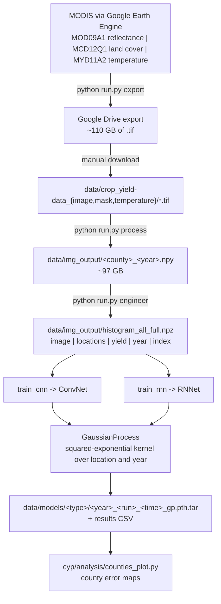
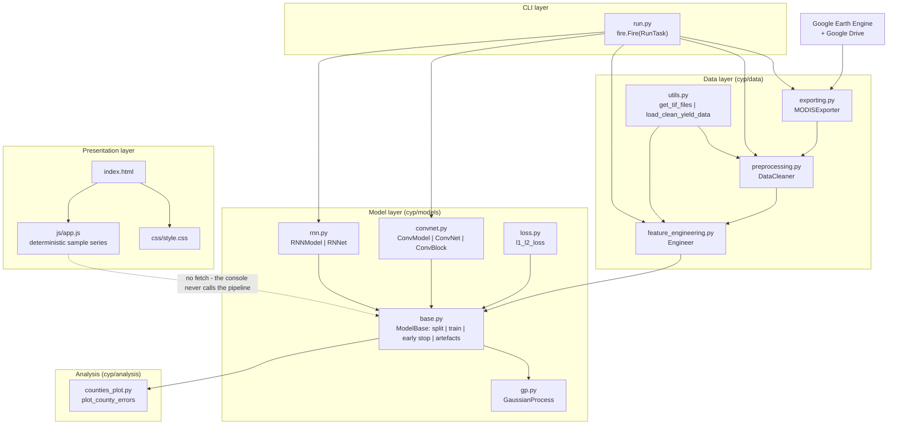
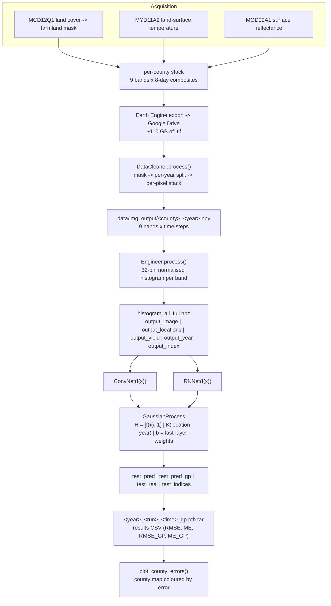
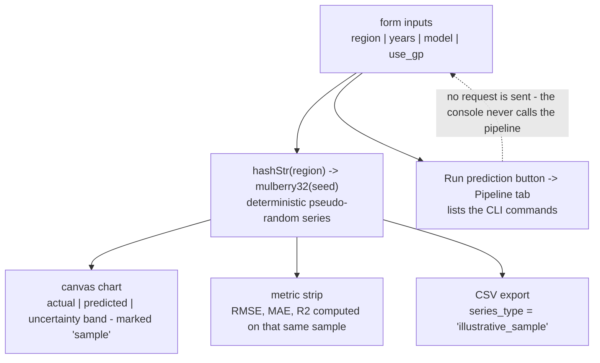

# PROJECT OVERVIEW — YieldSight (`crop-yield-prediction`)

A developer-facing deep dive into the YieldSight work: the four-stage satellite-imagery pipeline behind county-level soybean yield prediction, the deep Gaussian process that gives the forecasts their uncertainty, and the exact boundary between the real (CLI) model and the static demonstration console.

> **Scope note.** The console in this repository is a **front end with no back end**: it contains no model, no inference code and no `fetch()` call. The actual machine learning is the offline four-stage pipeline in `run.py` / `cyp/`. Everything the console displays is either an illustrative pseudo-random sample or a value copied from the upstream README, and it says so on screen.

---

## Project Summary

| Item | Value |
|---|---|
| **Folder id** | `crop-yield-prediction` |
| **Base** | <https://github.com/gabrieltseng/pycrop-yield-prediction> — a PyTorch port of [JiaxuanYou/crop_yield_prediction](https://github.com/JiaxuanYou/crop_yield_prediction) |
| **Reference paper** | *Deep Gaussian Process for Crop Yield Prediction Based on Remote Sensing Data* — AAAI 2017 — <https://cs.stanford.edu/~ermon/papers/cropyield_AAAI17.pdf> |
| **Interface** | Python Fire CLI (`run.py`) + a static HTML/CSS/JavaScript console (`index.html`) |
| Purpose | Predict **county-level US soybean yield** (bushels per acre) from MODIS satellite imagery for 2009–2015 |
| Method | 1-D CNN over 9-band histograms **or** an LSTM over the same histograms, optionally topped with a **deep Gaussian process** |
| Entry point | `run.py` — Python Fire commands `export`, `process`, `engineer`, `train_cnn`, `train_rnn` |
| Front end | `index.html` + `css/style.css` + `js/app.js` — static, no build step, no framework, no network calls |
| Data | `data/yield_data.csv` (USDA), `data/county_data.csv` (US Census fusion table), `data/counties.svg`; MODIS imagery must be exported from Earth Engine |
| Dependencies | PyTorch 1.0.0, GDAL, earthengine-api, fire, numpy, pandas, scipy, matplotlib, tqdm (conda env `crop_yield_prediction`) |
| License | MIT (Gabriel Tseng, 2019) |
| Local state | No `.venv`, no MODIS export, no `data/img_output/`, no `data/models/`, no trained checkpoints; only the three CSV/SVG files ship with the code |

---

## Problem Statement

Agricultural planners and insurers need **yield estimates before the harvest**, at county resolution, for tens of thousands of counties — without sending anyone out to collect ground samples. Manual sampling is accurate but slow, expensive and geographically sparse.

Satellite remote sensing offers coverage of every field, but raw imagery is far too large and noisy to model directly: a decade of 8-day composites for the United States is hundreds of gigabytes, and each pixel's reflectance is dominated by weather, soil and sensor noise rather than by the crop's final productivity.

The specific problem this code solves is therefore a **scale-and-signal** problem:

1. **Scale** — reduce ~110 GB of MODIS composites to a tensor a GPU can train on.
2. **Signal** — compress each county-year into a representation that still predicts yield.
3. **Uncertainty** — yield estimates are used for insurance and policy decisions, so a point prediction is not enough; the system must also express confidence.

---

## Proposed Solution

A **four-stage offline pipeline** that turns raw MODIS imagery into county yield estimates, followed by a **Gaussian process** that propagates uncertainty, plus a static console that documents and visualises the workflow.



**The four design decisions that matter**

1. **Export first, train later.** Earth Engine is used purely as a bulk data-distribution mechanism; the training code never talks to it. The exported tiles are plain `.tif` files that can be re-used.
2. **Histogram as the representation.** Each county-year's 9-band time series is reduced to a 32-bin normalised histogram per band. This is the paper's key compression: it discards per-pixel detail but makes the data small and *shift-invariant* across counties.
3. **One model per target year.** For 2014 the model trains on 2009–2013 and is evaluated on 2014. This matches how the forecast would actually be used and makes the GP's **year kernel** meaningful.
4. **GP on top of the network, not instead of it.** The last dense layer of the CNN/LSTM is treated as a set of basis functions `h(x)`; the GP fits a Bayesian linear model over them with a squared-exponential kernel over **location** and a second, separate kernel over **year**. The paper's core claim is that this yields better accuracy *and* calibrated uncertainty.

---

## Features and Capabilities

**Implemented and verifiable in the code**

- **Earth Engine export** — `MODISExporter.export_all()` builds per-county/year image collections, concatenates a county's bands across export years to cut the file count, and starts Drive export tasks. Resumable via `check_if_done=True`.
- **Pre-processing** — `DataCleaner.process()` merges temperature into reflectance, applies the land-cover mask (farmland only), splits by year and writes one `.npy` per county-year; parallelised with `ProcessPoolExecutor`.
- **Feature engineering** — `Engineer.process()` keeps the growing-season window (day 49–305), builds 32-bin histograms for 9 bands and writes `histogram_all_full.npz`.
- **Two architectures** — `ConvNet` (7 conv blocks, channels 9→128→256→256→512→512→512, strides 1/2 alternating, dense 2048→1) and `RNNet` (single-layer LSTM, hidden size 128, dropout 0.75, dense 256→1).
- **Deep Gaussian process** — `GaussianProcess.run()` with a squared-exponential location kernel (`r_loc=0.5`) and year kernel (`r_year=1.5`), plus a diagonal `B` term (`sigma_b=0.01`) that ties the GP to the network's own weights.
- **Regularised objective** — `l1_l2_loss()`: MSE plus a weighted L1 term, both logged separately.
- **Training discipline** — 10 % held-out validation split, learning-rate decay (÷10 at 2 000 and 4 000 steps), early stopping with patience 10, best-state restore, and `num_runs=2` repetitions to average out initialisation luck.
- **Artefacts** — per-run checkpoints `<year>_<run>_<time>_gp.pth.tar` (holding `state_dict`, `test_real`, `test_pred`, `test_pred_gp`, `test_indices`, `model_weight`, `model_bias`) and per-run result CSVs with `year, run_number, time_idx, RMSE, ME[, RMSE_GP, ME_GP]`.
- **County error maps** — `plot_county_errors()` colours `data/counties.svg` by prediction error and writes a colour bar.
- **YieldSight console** — region / year-range / model / GP-toggle / histogram-bins inputs, a canvas chart with hover tooltips, a sample metric strip, a labelled CSV export, a Pipeline tab with copyable commands, and a Method tab documenting the bands and hyper-parameters.
- **Published results table** — the console reproduces the upstream README's RMSE table (LSTM / LSTM+GP / CNN / CNN+GP, 2009–2015) and labels it as *reported*.

**Not available here**

- No MODIS export, no `data/img_output/`, no `data/models/`, no checkpoints.
- No HTTP API, no server, no inference endpoint.
- No environment: `fire`, `ee`, `rasterio` and `gdal` are absent from the machine's Python 3.12.1.
- `beautifulsoup4`, required by the analysis script, is missing from `environment.yml`.
- No test suite, no CI.

---

## System Architecture



### Layers

| Layer | Module | Responsibility |
|---|---|---|
| CLI | `run.py` | Fire dispatch to the five tasks; owns all path and hyper-parameter defaults |
| Data acquisition | `cyp/data/exporting.py` | Earth Engine collections → Drive export tasks |
| Data preparation | `cyp/data/preprocessing.py`, `cyp/data/utils.py` | `.tif` → masked, temperature-merged per-year `.npy`; file discovery and yield loading |
| Feature extraction | `cyp/data/feature_engineering.py` | `.npy` → 9-band histograms → `.npz` |
| Model | `cyp/models/convnet.py`, `cyp/models/rnn.py` | The two deep architectures |
| Shared training logic | `cyp/models/base.py` | `ModelBase`: split, train loop, early stopping, GP hook-up, artefact writing |
| Uncertainty | `cyp/models/gp.py` | `GaussianProcess.run()` — the deep GP |
| Objective | `cyp/models/loss.py` | `l1_l2_loss()` |
| Analysis | `cyp/analysis/counties_plot.py` | County error maps from a checkpoint |
| Presentation | `index.html`, `css/style.css`, `js/app.js` | YieldSight console (static) |

### Control flow of a training run

`RunTask.train_cnn()` → `ConvModel(...)` (inherits `ModelBase`) → `ModelBase.run(path_to_histogram, times, pred_years, num_runs, ...)`:

1. Load `histogram_all_full.npz` → `output_image`, `output_locations`, `output_yield`, `output_year`, `output_index`.
2. For each target year in `pred_years` and each run in `num_runs`:
   a. Split: samples with `year < target` are training, the target year is the test set, 10 % of the training set is held out for validation.
   b. Time-index selection: `times="all"` → `[32]` (the full season); `times="realtime"` → `range(10, 31, 4)` (forecasting with only early-season data).
   c. `_train()` — SGD with the decayed learning rate, `l1_l2_loss`, early stopping on validation loss, best-state restore.
   d. `_predict()` on the test year → `test_pred`, `test_real`, `test_indices`, `train_feat`/`test_feat`, `train_loc`/`test_loc`, `train_years`/`test_years`.
   e. If `use_gp`: `GaussianProcess.run(...)` using the network's last dense layer's weights and bias as the GP's `b` vector → `test_pred_gp`.
   f. `torch.save(model_information, data/models/cnn/<year>_<run>_<time>_gp.pth.tar)` and append the row to the results CSV.

### Why the GP is "deep"

The network is not merely a feature extractor whose output is thrown away. `ModelBase` reads the **last dense layer's weight matrix and bias** out of the `state_dict` and passes them to the GP as `b`, the prior mean's weight vector. The GP therefore inherits the network's learned representation as its prior, and the network's outputs are *posterior-corrected* rather than merely replaced. The network is still trained end-to-end with MSE; the GP then refines the prediction using the spatial and temporal correlation structure of the training set.

---

## Complete Project Workflow

```powershell
conda activate crop_yield_prediction

# 0. authenticate (one-off, needs a Google account)
earthengine authenticate

# 1. export MODIS from Earth Engine to Google Drive, then download the .tif files
python run.py export --export_limit 100 --major_states_only True --check_if_done True
#    -> data/crop_yield-data_{image,mask,temperature}/

# 2. preprocess into per-year arrays
python run.py process --num_years 14 --checkpoint True
#    -> data/img_output/<county>_<year>.npy        (~97 GB)

# 3. build the model input
python run.py engineer --num_bins 32 --max_bin_val 4999
#    -> data/img_output/histogram_all_full.npz

# 4. train
python run.py train_cnn --use_gp True --pred_years 2014
python run.py train_rnn --use_gp True --pred_years 2014
#    -> data/models/cnn/2014_1_32_gp.pth.tar
#    -> data/models/cnn/<timestamp>.csv

# 5. (optional) map the errors
python -c "from pathlib import Path; from cyp.analysis.counties_plot import plot_county_errors; plot_county_errors(Path('data/models/cnn/2014_1_32_gp.pth.tar'))"
```

**Viewing the console**

```powershell
python -m http.server 8000
# open http://localhost:8000
```

The console's own Pipeline tab lists steps 1–4 with the same flags.

---

## Machine Learning or Algorithm Explanation

### The nine MODIS bands

The exporter builds each county-year's stack from three MODIS products (`data/README.md`):

| Product | Role | Contribution |
|---|---|---|
| **MOD09A1** surface reflectance | red, NIR, blue reflectance at 1 km, 8-day | 7 of the 9 bands |
| **MYD11A2** land-surface temperature | day/night temperature at 1 km, 8-day | 2 of the 9 bands |
| **MCD12Q1** land cover | the IGBP classification | not a band — used as the **farmland mask** |

After the reflectance bands are shifted into the 0–10 000 space that the temperature bands occupy, the network's `in_channels` is **9** (7 reflectance + 2 temperature).

### From pixels to a histogram

`Engineer.process()` keeps the growing-season window (days 49–305), then for each county-year computes, for each of the 9 bands, a **32-bin histogram** of the pixel values, with `max_bin_val=4999` and the counts normalised to sum to 1. Channels-first output: `[batch, bands, times, bins]`. This is what makes the CNN's 1-D convolution over the **time** axis meaningful and the LSTM's input size `9 * 32 = 288`.

### The CNN

`ConvNet` treats the histogram as a small image: 9 channels, one "row" per band, `time` steps along the season, 32 bins along the width. Convolutions run over the **time** axis with `kernel_size=3` and `same` padding, alternating stride 1 and 2 (7 blocks, 512 channels at the end), with dropout 0.5. The flattened vector feeds a dense stack of 2048 → 1 units. The **second-to-last** dense layer's activations are the feature vector `f(x)` that the GP consumes.

### The LSTM

`RNNet` treats the histogram as a sequence: each time step contributes a 288-dimensional vector (`channels * bins`) and the 32 time steps are fed to a **single-layer LSTM** with hidden size 128 and dropout 0.75, followed by dense 256 → 1. It is the "sequence-first" alternative to the CNN, and in the paper it is the stronger of the two before the GP is added.

### The deep Gaussian process

`GaussianProcess.run()` implements a GP on top of the network:

- **Kernel** — a product of two squared-exponential kernels: one over county **locations** (`r_loc=0.5`) and one over **years** (`r_year=1.5`), scaled by `sigma²` and added to a noise term `sigma_e² I` on the training block only.
- **Mean function** — a Bayesian linear model over the network's basis functions `H = [f(x), 1]`, with a diagonal prior precision `B = sigma_b I`; the network's own last-layer weight and bias form the prior mean's vector `b`.
- **Normalisation** — locations and years are min–max normalised over the combined train+test set before the kernel is evaluated.
- **Posterior** — `beta = (B⁻¹ + HᵀK⁻¹H)⁻¹ (HᵀK⁻¹Y + B⁻¹b)` (Rasmussen 2006, eq. 2.41); the prediction is `H*·beta + K*·K⁻¹(Y − H·beta)`.

The result is a prediction that borrows strength across space and time — a county with an unusual year is pulled towards its neighbours' behaviour — and a posterior that yields a meaningful uncertainty band.

### Training details

| Aspect | Setting |
|---|---|
| Loss | `F.mse_loss` + `l1_weight * F.l1_loss` (both logged) |
| Optimiser | SGD (momentum 0.9) with weight decay, learning rate 1e-3 divided by 10 after 2 000 and 4 000 steps |
| Split | Training years vs. the target year; 10 % of the training set as validation |
| Early stopping | Patience 10 validation checks; best `state_dict` restored before testing |
| Repetitions | `num_runs=2` per target year |
| Metrics | RMSE and mean error (ME) per year, run and time index; the GP columns are added when `use_gp=True` |

### Published results (upstream README, not reproduced here)

| Model | 2009 | 2010 | 2011 | 2012 | 2013 | 2014 | 2015 |
|---|---|---|---|---|---|---|---|
| LSTM | 3.88 | 3.75 | 4.14 | 4.33 | 3.98 | 4.09 | 3.61 |
| LSTM + GP | 3.68 | 3.54 | 3.85 | 4.13 | 3.68 | 3.81 | 3.35 |
| CNN | 4.36 | 4.19 | 4.16 | 4.22 | 3.87 | 4.31 | 3.75 |
| CNN + GP | 4.21 | 3.98 | 4.04 | 4.04 | 3.73 | 4.02 | 3.53 |

*(RMSE in bushels per acre, as reported by the upstream authors.)*

---

## File-by-File Code Guide

### Root

| File | Lines / role | Key symbols |
|---|---|---|
| `run.py` | The only executable entry point | `RunTask.export()`, `RunTask.process()`, `RunTask.engineer()`, `RunTask.train_cnn()`, `RunTask.train_rnn()`; `if __name__ == "__main__": fire.Fire(RunTask)` |
| `environment.yml` | Conda environment `crop_yield_prediction` | `pytorch=1.0.0`, `gdal`, `earthengine-api`, `fire`, `numpy`, `pandas`, `scipy`, `matplotlib`, `tqdm` |
| `index.html` | YieldSight console markup | header chips, control panel, canvas chart, metric strip, Pipeline tab, Method tab, results table |
| `js/app.js` | All front-end behaviour | `hashStr()`, `mulberry32()`, `computeSeries()`, `computeMetrics()`, `computePlot()`, `drawChart()`, `exportCSV()`, `switchTab()`, `updateCommands()`, copy-to-clipboard |
| `css/style.css` | Presentation only | layout, cards, chart container, tab styling |
| `LICENSE` | MIT, Copyright © 2019 Gabriel Tseng | — |
| `README.md` | Upstream README: paper, results table, setup | — |

### `cyp/`

| File | Role | Key symbols |
|---|---|---|
| `cyp/__init__.py` | Package exports and state list | `MODISExporter`, `DataCleaner`, `Engineer`, `ConvModel`, `RNNModel`, `MAJOR_STATES` (11 states) |
| `cyp/data/exporting.py` | Earth Engine export | `MODISExporter.export_all()`, `MODISExporter.export_county()`, `check_if_done` |
| `cyp/data/preprocessing.py` | `.tif` → per-year `.npy` | `DataCleaner.process()`, `multiprocessing.Pool`/`ProcessPoolExecutor` workers |
| `cyp/data/feature_engineering.py` | `.npy` → histograms | `Engineer.process()`, `output_image`/`output_locations`/`output_yield`/`output_year`/`output_index` |
| `cyp/data/utils.py` | Shared helpers | `get_tif_files()`, `load_clean_yield_data()` |
| `cyp/models/base.py` | The engine room | `ModelBase.__init__`, `ModelBase.run()`, `ModelBase._train()`, `ModelBase._predict()`, `ModelBase.analyze_results()` |
| `cyp/models/convnet.py` | CNN architecture | `ConvModel`, `ConvNet`, `ConvBlock`, `Conv2dSamePadding` |
| `cyp/models/rnn.py` | LSTM architecture | `RNNModel`, `RNNet` |
| `cyp/models/gp.py` | Deep GP | `GaussianProcess.__init__()`, `GaussianProcess.run()`, `GaussianProcess._normalize()` |
| `cyp/models/loss.py` | Objective | `l1_l2_loss()` |
| `cyp/analysis/counties_plot.py` | Error maps | `plot_county_errors()` (parses `data/counties.svg` with BeautifulSoup) |

### `data/`

| File | Status | Purpose |
|---|---|---|
| `data/yield_data.csv` | **Present** (4 274 567 B) | USDA soybean yield per county-year, in bushels per acre |
| `data/county_data.csv` | **Present** (3 178 767 B) | County lat/long and area from the US 2010 Census fusion table |
| `data/counties.svg` | **Present** (1 995 563 B) | Base map for the error plots |
| `data/README.md` | **Present** | Provenance of all three, plus the MODIS product descriptions |
| `data/crop_yield-data_{image,mask,temperature}/` | **Missing** | Earth Engine exports (≈ 110 GB) |
| `data/img_output/` | **Missing** | Processed `.npy` arrays (≈ 97 GB) and `histogram_all_full.npz` |
| `data/models/` | **Missing** | Checkpoints and results CSVs from a training run |

---

## Data Flow

### The real (pipeline) flow



### The console's flow (deliberately different)



There is **no arrow from the console to the pipeline**. The console's "Run prediction" button validates the region field and then switches to the Pipeline tab, which lists the CLI commands instead of running them.

---

## Example Execution

### 1. Train a single CNN model for 2014 with the GP

```powershell
conda activate crop_yield_prediction
python run.py train_cnn --use_gp True --pred_years 2014 --num_runs 1 --train_steps 2000
```

Expected console behaviour (structure, not literal output): a validation-loss trace, `Running Gaussian Process!` printed by `ModelBase.run()` when the GP is enabled, then the checkpoint and the results CSV written under `data/models/cnn/`.

### 2. Read the results

`data/models/cnn/<timestamp>.csv`:

```csv
year,run_number,time_idx,RMSE,ME,RMSE_GP,ME_GP
2014,1,32,4.02,-0.31,3.74,-0.22
```

(The row above is **illustrative of the format**; the actual values are produced by your run.)

### 3. Load a checkpoint and predict

```python
import torch
ckpt = torch.load("data/models/cnn/2014_1_32_gp.pth.tar", map_location="cpu")
print(ckpt.keys())
# dict_keys(['state_dict', 'val_loss', 'train_loss', 'test_pred', 'test_real',
#             'test_indices', 'model_weight', 'model_bias', 'test_pred_gp'])
```

### 4. Use the console

```powershell
python -m http.server 8000
```

Open <http://localhost:8000>, enter `Iowa` as the region (the field is pre-filled with `Story County, Iowa` and offers a datalist of Iowa and Illinois counties), keep 2009–2015 and `CNN (ConvModel)`, and the console draws a labelled sample chart whose metrics describe the sample only. The **Histogram bins** selector (16/32/64, default 32) rewrites the engineer command in the Pipeline tab. Press **Run prediction** and the console switches to the Pipeline tab with the four commands. The **Export CSV** button writes `yieldsight-sample-iowa-2009-2015.csv` — the region is slugified to lowercase with non-alphanumerics replaced by `-` — with `series_type = illustrative_sample` in every row.

> **Verification status.** Steps 1–4 describe what the code is written to do. They were **not** executed while writing this overview: the repository has no environment, no MODIS export, no processed arrays and no checkpoints, and the rules for this documentation task forbid installing dependencies or running the pipeline.

---

## Dependencies and External Services

### Python packages (conda `environment.yml`)

| Package | Version | Used for |
|---|---|---|
| `python` | 3.7 | The environment the code targets |
| `pytorch` | **1.0.0** | Tensors, `nn.Module`, `torch.save`, `torch.load` |
| `gdal` | — | Reading the exported GeoTIFF composites |
| `earthengine-api` | — | `ee.ImageCollection`, `ee.Image`, `ee.batch.Export` |
| `fire` | — | The CLI (`fire.Fire(RunTask)`) |
| `numpy` | — | Arrays, GP algebra |
| `pandas` | — | Yield data and results CSVs |
| `scipy` | — | `pdist`/`squareform` for the GP kernels |
| `matplotlib` | — | County error maps |
| `tqdm` | — | Progress bars |
| `beautifulsoup4` | **not listed** | Parsing `data/counties.svg` in the analysis script — install manually |

### External services

| Service | Why | Requirement |
|---|---|---|
| **Google Earth Engine** | The only way to obtain the MODIS imagery | A registered account; `earthengine authenticate` must succeed |
| **Google Drive** | Earth Engine's export destination | The export writes there; you download the `.tif` files into `data/` |
| **Google Earth Engine Data Catalog** | Hosts MOD09A1, MCD12Q1, MYD11A2 | Included in the Earth Engine account |
| **USDA NASS** | Provenance of the yield data | Already vendored in `data/yield_data.csv`; re-fetch instructions in `data/README.md` |
| **US Census** | Provenance of the county coordinates | Already vendored in `data/county_data.csv` (the original fusion table was retired in December 2019) |

### Hardware

- **CPU only** is supported (`torch.device("cuda:0" if torch.cuda.is_available() else "cpu")`).
- **Disk**: ≈ 110 GB (export) + ≈ 97 GB (processed) + checkpoints.
- **RAM**: the feature-engineering stage loads the county arrays into memory; the histogram file is the compact representation that makes training feasible.

### Upstream credits and attribution

- **Jiaxuan You** — *Deep Gaussian Process for Crop Yield Prediction Based on Remote Sensing Data*, AAAI 2017, and the original TensorFlow implementation (<https://github.com/JiaxuanYou/crop_yield_prediction>). The yield data and county map are analogous to files in that repository.
- **Gabriel Tseng** — the PyTorch port (<https://github.com/gabrieltseng/pycrop-yield-prediction>), MIT licensed, Copyright © 2019.
- **NASA MODIS** — MOD09A1, MCD12Q1 and MYD11A2, distributed via Google Earth Engine.
- **USDA NASS** and the **US Census** — the yield and county reference data vendored in `data/`.
- **YieldSight console** (`index.html`, `css/style.css`, `js/app.js`) and this documentation were added on top of the upstream project and are not endorsed by the upstream maintainers.

---

## Current Limitations and Future Improvements

### Limitations that are inherent to the current code

1. **No inference path in the console.** The UI cannot produce a real prediction; every user has to run the CLI themselves.
2. **The pipeline cannot run without Earth Engine and Google Drive.** There is no offline or cached alternative shipped with the repository.
3. **Enormous data footprint and long runtimes.** The export alone can take hours and 110 GB; feature engineering is a multi-hour pass.
4. **A 2018-era stack.** `pytorch=1.0.0` and Python 3.7 are pinned; the code uses the PyTorch 1.0 API and `torch.load` defaults that no longer work on modern torch.
5. **`beautifulsoup4` is an undeclared dependency** of the analysis module.
6. **A lossy representation.** 32-bin histograms discard spatial structure entirely; counties with very different field patterns can share a histogram.
7. **The GP cannot rescue a bad network.** It is fitted on the network's last dense layer, so a poorly trained network gives a poorly informed prior.
8. **Coverage is limited to 11 states** by default (`major_states_only=True`).
9. **Seven separate models per configuration** (one per target year) — training cost multiplies with the number of years.
10. **No tests and no CI**, so a modernised environment can regress silently.
11. **The console's metrics are easily misread.** They describe a pseudo-random series; only the explicitly labelled "reported" table contains real model numbers.

### Sensible next steps

- **Ship a real inference path**: a `predict` command that loads a checkpoint, runs the GP and emits JSON; then let the console `fetch()` it.
- **Version the artefacts**: a `manifest.json` per run (data hash, feature config, hyper-parameters) so results are reproducible.
- **Modernise the stack**: `pytorch>=2.0`, `pyproject.toml` with extras (`export`, `train`, `analysis`), a `requirements-cpu.txt`, and a Docker image for the geospatial stage.
- **Declare `beautifulsoup4`** and add a `pyproject`-based dependency check to the environment.
- **Replace the Drive round-trip** with a direct object-storage download, or cache exports locally keyed by county/year.
- **Add smoke tests** that run the pipeline on 2 counties and 1 year, so the four stages are verifiable in CI.
- **Cache and shrink the processed arrays** (float16 or per-county sharded `.npz`) to cut the 97 GB.
- **Label the console even more loudly**, e.g. a persistent banner, and add a `?demo=false` guard.
- **Add a real evaluation panel** that reads the results CSVs and plots RMSE per year next to the published table.

---

## Learning Outcomes

Working through this repository teaches:

- **Remote-sensing ML end to end** — from raw MODIS composites and land-cover masks to a per-county yield number and a county error map.
- **Deep Gaussian processes** — how a neural network's last layer becomes a GP's basis functions, and how a product kernel over space and time becomes a joint model of "where" and "when".
- **Spatio-temporal representation learning** — why histograms over a growing-season window are a defensible, scale-free encoding of a pixel stack.
- **MLOps for an offline research pipeline** — stage boundaries, resumable exports, checkpointing, best-state restore, repeated runs to control for initialisation variance, and CSV artefacts.
- **Geospatial tooling in practice** — GDAL, Earth Engine collection building, Drive export, and the sheer cost of working at 1 km resolution over a whole country.
- **Honest UI design** — how to ship a demonstrative front end that never misrepresents sample data as model output, and what it takes to make the label impossible to miss.
- **The archaeology of an old codebase** — reading a 2018 PyTorch 1.0 codebase, understanding its idioms, and planning a careful modernisation.
- **Cost awareness** — 110 GB, 97 GB and 25 000 training steps per model are numbers worth budgeting before starting.
