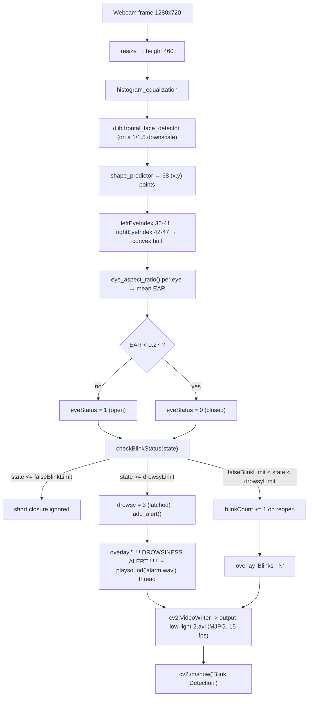
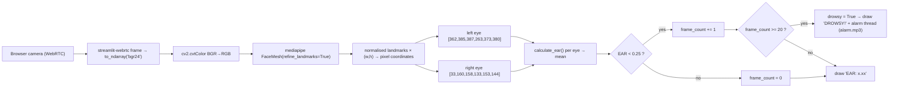

```mermaid
flowchart TD
    subgraph Desktop["Desktop path (dlib)"]
        A1["cv2.VideoCapture(0)"] --> A2["read frame"]
        A2 --> A3["resize to height 460"]
        A3 --> A4["histogram_equalization"]
        A4 --> A5["getLandmarks(): downscale 1/1.5 -> dlib frontal_face_detector -> shape_predictor 68 pts"]
        A5 --> A6{face found?}
        A6 -->|no| A7["overlay 'Unable to detect face' + continue"]
        A6 -->|yes| A8["checkEyeStatus(): hull of eye points -> EAR per eye -> mean"]
        A8 --> A9["eyeStatus = 1 if EAR >= 0.27 else 0"]
        A9 --> A10["checkBlinkStatus(): state counter -> blink / drowsy / alert"]
        A10 --> A11["draw landmark dots + overlay"]
        A11 --> A12{drowsy?}
        A12 -->|yes| A13["alarm thread: playsound('alarm.wav') + DROWSINESS ALERT"]
        A12 -->|no| A14["overlay 'Blinks : N'"]
        A13 --> A15["vid_writer.write(frame) -> output-low-light-2.avi"]
        A14 --> A15
        A7 --> A2
    end

    subgraph Web["Web path (MediaPipe)"]
        B1["streamlit-webrtc: browser camera frames"] --> B2["DrowsinessDetector.transform()"]
        B2 --> B3["cv2.cvtColor BGR->RGB"]
        B3 --> B4["FaceMesh(refine_landmarks=True) -> 468 landmarks"]
        B4 --> B5["calculate_ear(left_eye[362,385,387,263,373,380], right_eye[33,160,158,133,153,144])"]
        B5 --> B6{EAR < 0.25 ?}
        B6 -->|yes| B7["frame_count += 1"]
        B6 -->|no| B8["frame_count = 0"]
        B7 --> B9{frame_count >= 20 ?}
        B9 -->|yes| B10["drowsy = True, draw 'DROWSY!', alarm thread (alarm.mp3)"]
        B9 -->|no| B11["draw 'EAR: x.xx'"]
        B8 --> B11
    end

    subgraph Hud["Cockpit HUD (browser only)"]
        C1["js/app.js: requestAnimationFrame loop, 20 samples/s"] --> C2["stepSignal(): baseline + AR(1) noise + blink/mild/deep envelopes"]
        C2 --> C3["evaluateState(): NORMAL / WARNING (0.15s) / DROWSY (1.5s) / ALERT (<0.25 for 1.0s)"]
        C3 --> C4["setNeedle() + drawChart() + updateMetrics()"]
        C4 --> C5["Web Audio siren while armed"]
    end
```

# Cockpit — Driver Drowsiness Detection · Project Overview

*Folder id: `driver-drowsiness-detection` · Upstream: `Gagandeep-2003/Driver-Drowsiness-Detection-System` (MIT, © 2025 jai-76) · Entry point: `main.py`*

---

## Project Summary

| Field | Value |
|---|---|
| **Display name** | Cockpit — Fatigue Monitor (interface) / Driver Drowsiness Detection System (project) |
| **Folder id** | `driver-drowsiness-detection` |
| **Problem** | Drowsy driving is a leading cause of road accidents. A driver who is falling asleep at the wheel cannot be relied on to notice their own deterioration — and a passenger is often asleep too. |
| **Objective** | Measure eye openness continuously from a camera, detect the moment the eyes stay closed long enough to mean "micro-sleep", and sound an alarm that is loud enough to wake the driver. |
| **Primary users** | Long-haul drivers; drivers on night shifts; drivers on medication; road-safety researchers; students studying EAR-based fatigue detection. |
| **Expected output** | A live video window with eye landmarks and a blink counter, a `! ! ! DROWSINESS ALERT ! ! !` overlay plus an audible alarm, and — on exit — a session summary (duration, EAR samples, mean EAR, alerts, blinks). |
| **Architecture style** | Classical computer vision (no training) in three independent programs — dlib desktop detector, Haar face detector, MediaPipe/Streamlit web app — plus a static HUD page that visualises a **simulated** EAR signal. |
| **Key metric** | **EAR** — Eye Aspect Ratio, `(A + B) / (2·C)`, computed from 6 landmarks per eye. |

Two facts frame everything below: the project uses **no machine learning** (it is
landmark geometry, not a learned model), and the **dlib landmark file is not shipped**, so
the desktop detector only runs after a manual ~100 MB download.

---

## Problem Statement

Blink rate and eye-closure duration are the cheapest physiological proxies for mental
fatigue that a camera can read. A driver's eyes are open almost all the time while
awake; as fatigue sets in, blinks get longer and more frequent, and eventually the eyes
stay closed for a fraction of a second — a *micro-sleep*. The critical quantity is
therefore not "is the eye closed" but "how long has the eye been closed", because a
100 ms blink is normal and a 1.5 s closure is a hazard.

The engineering requirements that follow:

1. **Measure eye openness robustly on cheap hardware.** No GPU, no model download, no
   cloud — a laptop webcam must be enough.
2. **Distinguish a blink from a doze.** A fixed threshold on the frame count cannot do
   this, because the time one frame represents depends on the machine's speed. The
   detector must first *measure its own frame rate* and convert durations into frame
   counts.
3. **Alert loudly enough to be useful.** A visual overlay alone is useless if the driver
   is asleep; an audio alarm is mandatory.
4. **Never cry wolf.** A detector that alarms on every blink is switched off within a
   day, so short closures must be classified as false blinks.
5. **Keep the video local.** Face images of drivers are sensitive; processing must happen
   on the device.

The upstream code satisfies all five; the Cockpit page exists to make the *thresholds and
the mathematics* legible to someone who wants to understand or re-tune the system.

---

## Proposed Solution

### 3.1 The core idea — Eye Aspect Ratio

For each eye, six landmarks are known (two corners and four lid points). Three
distances are measured:

- **A** — vertical distance between the upper and lower lid at the inner pair of points,
- **B** — vertical distance at the outer pair,
- **C** — horizontal distance between the two eye corners.

`EAR = (A + B) / (2·C)`.

Because `C` is a *scale* term (the width of the eye), EAR is **invariant to how far the
driver is from the camera** and to the pixel size of the face. An open eye gives a value
around 0.3; a closed eye gives roughly 0.05–0.1. That single dimensionless number is the
entire signal.

### 3.2 The state machine

```
EAR ≥ 0.27                      → eyes open
EAR < 0.27 for < 0.15 s         → false blink (ignored)
EAR < 0.27 for ≥ 0.15 s         → a real blink (counted)
EAR < 0.27 for ≥ 1.5 s          → drowsy → ALARM
```

The durations are converted to frame counts **after** calibrating the loop's speed:
`falseBlinkLimit = blinkTime / spf` and `drowsyLimit = drowsyTime / spf`, where `spf` is
the measured seconds-per-frame. The result is a detector whose *real-time* behaviour is
the same on a fast laptop and a slow one.

### 3.3 Three implementations of the same idea

| Implementation | Landmarks | Threshold | Runtime | Alarm file |
|---|---|---|---|---|
| `blinkDetect.py` | dlib 68-point shape predictor | `thresh = 0.27` | desktop OpenCV window | `alarm.wav` |
| `streamlit_app/streamlit_app.py` | MediaPipe FaceMesh (468 points) | `EAR_THRESHOLD = 0.25`, 20 frames | browser → streamlit-webrtc | `alarm.mp3` |
| `index.html` + `js/app.js` | none — **simulated** signal | 0.27 / 0.25 bands | static browser page | Web Audio beeps |

### 3.4 The Cockpit interface

A HUD-style instrument view that makes the algorithm visible: an EAR gauge with a redline
at 0.27, a scrolling strip chart with dashed threshold lines at 0.27 and 0.25, session
metrics (blinks, alerts, mean EAR, longest closure), an alarm deck (arm / volume / mute /
test), and an *Engine* rail that quotes the real constants out of `blinkDetect.py` and
`streamlit_app.py` and gives copyable commands to run the actual backends. The signal on
this page is **simulated** and labelled as such in the chip, the chart watermark, the
state copy, the snapshot filename and the footer.

---

## Features and Capabilities

### Existing (verified in the source)

| # | Capability | Implementation |
|---|---|---|
| F1 | EAR from six eye landmarks | `blinkDetect.py:119-125` `eye_aspect_ratio(eye)` — `scipy.spatial.distance.euclidean` |
| F2 | Eye-open/closed decision | `blinkDetect.py:23,153-157` — `thresh = 0.27`, `eyeStatus = 0` when `ear < thresh` |
| F3 | Blink/drowsiness state machine | `blinkDetect.py:159-190` `checkBlinkStatus(eyeStatus)` — three-phase counter on `state` |
| F4 | Speed calibration | `blinkDetect.py:262-300` — 100 valid frames, `spf = totalTime/dummyFrames`, then `drowsyLimit`/`falseBlinkLimit` |
| F5 | Audio alarm thread | `blinkDetect.py:105-117` `soundAlert(path, threadStatusQ)` + `Thread(..., setDaemon(True))` at `345-347` |
| F6 | Visual alert overlay | `blinkDetect.py:340-341` — `! ! ! DROWSINESS ALERT ! ! !` |
| F7 | Blink counter on screen | `blinkDetect.py:350` — `Blinks : {blinkCount}` |
| F8 | Landmark overlay | `blinkDetect.py:334-338` — red dots on the 12 eye landmarks |
| F9 | Face-not-found guidance | `blinkDetect.py:283-289`, `322-329` — "Unable to detect face, Please check proper lighting" |
| F10 | Keyboard control | `blinkDetect.py:358-366` — `r` resets, `q` quits, `Esc` aborts calibration |
| F11 | Session tracking + summary | `blinkDetect.py:54-89` `TempSessionTracker` → duration, EAR count, mean EAR, alerts, blinks |
| F12 | Programmatic session getters | `blinkDetect.py:212-247` — `get_current_ear()`, `get_current_blink_count()`, `get_session_data()`, `get_session_ear_values()`, `start_new_session()`, `end_current_session()` |
| F13 | Video recording | `blinkDetect.py:306` `cv2.VideoWriter('output-low-light-2.avi', fourcc('MJPG'), 15, …)` |
| F14 | Preprocessing | `blinkDetect.py:278,319` `histogram_equalization(frame)` (gamma correction available but commented out) |
| F15 | Haar face detection | `face-try.py:43-52` — `detectMultiScale(gray, 1.1, 4)` + blue rectangles |
| F16 | Lane detection | `lanedetection.py` — `region_of_interest()`, `drow_the_lines()` |
| F17 | Desktop launcher with dark mode | `main.py` — `run_face_detection()`, `run_blink_detection()`, `toggle_theme()`, `on_quit()` |
| F18 | Older launcher with lane button | `ui.py` — `run_script()` via `sys.executable` |
| F19 | Browser drowsiness detection | `streamlit_app/streamlit_app.py` — MediaPipe FaceMesh + `webrtc_streamer` + `DrowsinessDetector.transform()` |
| F20 | PWA packaging | `streamlit_app/streamlit_app_pwa.py`, `manifest.json`, `sw.js`, `icons/`, `offline.html`, `generate_icons.py`, `test_pwa_setup.py` |
| F21 | Cockpit HUD with a simulated signal | `js/app.js` — `stepSignal()`, `evaluateState()`, `setState()`, `initGauge()`-equivalent `buildTicks()`/`setNeedle()`, `drawChart()`, `updateMetrics()`, `snapshot()` |
| F22 | Web Audio alarm with arm/mute/volume | `js/app.js:121-167` `ensureAudio()`, `beep()`, `startAlarmLoop()`, `stopAlarmLoop()` |
| F23 | Keyboard shortcut, clock, storage | `Space` starts/stops the session; 24h/12h clock persisted in `localStorage["cockpit.clock24"]` |

### Future / not implemented

- **No MAR (mouth aspect ratio)** — despite `project-metadata.json` advertising
  "EAR/MAR eye-mouth ratio". Only EAR exists in the code.
- **No trip report** — the metadata mentions one; the only report is the console summary.
- **No session history persistence** — `Sesssion_analysis.py` is a 17-line Tkinter stub
  with two empty `ttk.Frame`s.
- **No trained model** — `models/ML_Models/` contains two empty folders
  (`ResNET+CNN (Tranfer Learning)`, `Using Transformers`) and no weights.
- **No HTTP API** — nothing to call from a browser or a mobile app.
- **No multi-face handling** — only `rects[0]` is tracked.
- **No glasses/sunglasses handling, no head pose, no gaze tracking, no PERCLOS**.
- **No calibration per driver** — one global threshold.
- **No adaptive thresholding** — the value is a hand-tuned constant.
- **`models/ML_Models/` is not loaded by any script** in the repository.

---

## System Architecture

Three independent programs plus one static page. They share the *idea*, not a runtime:

```
┌────────────────────────┐   ┌─────────────────────────┐   ┌────────────────────────┐
│  blinkDetect.py        │   │  streamlit_app/         │   │  index.html + js/app.js│
│  dlib 68 landmarks     │   │  streamlit_app.py       │   │  Cockpit HUD           │
│  cv2.VideoCapture(0)   │   │  MediaPipe FaceMesh     │   │  simulated EAR signal  │
│  → OpenCV window       │   │  streamlit-webrtc       │   │  gauge + strip chart   │
│  → alarm.wav           │   │  → port 8501            │   │  → static file server  │
│  needs models/…68…dat │   │  → alarm.mp3            │   │    (no camera access)  │
└───────────┬────────────┘   └────────────┬────────────┘   └────────────┬───────────┘
            │                             │                             │
            │  cv2 + dlib                 │  mediapipe + av            │  browser JS only
            ▼                             ▼                             ▼
      ┌───────────┐                ┌───────────┐                 (no network I/O)
      │  Webcam 0 │                │  Browser  │
      └───────────┘                │  WebRTC   │
                                   └───────────┘

Shared assets:  models/haarcascade_frontalface_default.xml (present)
                models/shape_predictor_68_face_landmarks.dat (MISSING — download required)
                alarm.wav (root)  ·  streamlit_app/alarm.mp3
```



---

## Complete Project Workflow

### 6.1 Desktop detection (`blinkDetect.py`)

1. **Import-time setup.** `dlib.get_frontal_face_detector()` and
   `dlib.shape_predictor("models/shape_predictor_68_face_landmarks.dat")` are created at
   module level (`blinkDetect.py:31-32`). *If the model file is missing, the script dies
   here — before the camera is ever opened.*
2. **Camera warm-up.** Ten frames are read (`blinkDetect.py:251-255`) and the script exits
   with *"Error: Could not open webcam."* if the capture device is unavailable.
3. **Calibration loop** (`blinkDetect.py:262-292`). While fewer than 100 *valid* frames
   have been collected:
   - the frame is resized so its height is 460 px (`IMAGE_RESIZE = height/460`),
   - `histogram_equalization()` is applied (the gamma-correction alternative is
     commented out),
   - `getLandmarks()` runs, and its duration is accumulated into `totalTime` **only for
     frames where a face was found**,
   - if no face is found, the guidance overlay is drawn, `validFrames` is decremented and
     the loop continues (so calibration always ends after 100 successful detections).
4. **Derived limits.** `spf = totalTime / 100`, then
   `drowsyLimit = drowsyTime / spf` and `falseBlinkLimit = blinkTime / spf`
   (`blinkDetect.py:295-300`) — 0.15 s and 1.5 s expressed in frames.
5. **Session start.** `session_tracker = TempSessionTracker()` (`blinkDetect.py:303`)
   records the start time and prints *"Session started at: …"*.
6. **Detection loop** (`blinkDetect.py:307-371`), per frame:
   - resize → histogram equalisation → `getLandmarks()`;
   - **no face** → guidance overlay, `continue` (the frame is *not* written to the video);
   - `checkEyeStatus(landmarks)`:
     - build the convex hull of the six left-eye points (indices 36–41) and the six
       right-eye points (42–47) and `cv2.fillConvexPoly` them into a mask (the mask is
       never used afterwards — dead code),
     - `eye_aspect_ratio()` per eye, then the mean,
     - push the value into the session tracker,
     - `eyeStatus = 1` (open) or `0` (closed) against `thresh = 0.27`;
   - `checkBlinkStatus(eyeStatus)`:
     - `state ≤ falseBlinkLimit` → a short closure; `state` increments while closed;
     - `falseBlinkLimit ≤ state < drowsyLimit` → a real blink; reopening the eyes
       increments `blinkCount` and resets `state`;
     - `state ≥ drowsyLimit` → **drowsy**: `drowsy = 3` (truthy) and `add_alert()` is
       called on every frame while the eyes stay closed; reopening the eyes also sets
       `drowsy = 3` and counts the blink;
   - the 12 eye landmarks are drawn as red dots;
   - `if drowsy:` → the `! ! ! DROWSINESS ALERT ! ! !` overlay and, once, a daemon thread
     running `soundAlert('alarm.wav')`;
   - otherwise the `Blinks : N` overlay is drawn and `ALARM_ON` is cleared;
   - the frame is written to `output-low-light-2.avi` and shown in the "Blink Detection"
     window;
   - `r` → reset `state`, `drowsy`, `ALARM_ON` and the alarm queue; `q` → break.
7. **Shutdown** (`blinkDetect.py:373-379`): the session summary is printed (duration in
   minutes, EAR reading count, mean EAR, alerts, total blinks), the capture is released,
   the writer is closed and the windows are destroyed.

### 6.2 Browser detection (`streamlit_app/streamlit_app.py`)

1. Streamlit starts on port 8501 and injects the PWA head (manifest link, theme colour,
   service-worker registration, install button) via `st.markdown(..., unsafe_allow_html=True)`.
2. `webrtc_streamer(key="drowsiness-app", video_processor_factory=DrowsinessDetector,
   media_stream_constraints={"video": True, "audio": False}, async_processing=True)`
   negotiates the camera in the browser and pushes frames into `DrowsinessDetector.transform()`.
3. `transform()` converts BGR→RGB, runs `FaceMesh(refine_landmarks=True)`, converts the
   normalised landmarks to pixel coordinates and computes the EAR for both eyes.
4. `EAR < 0.25` → `frame_count += 1`, else `frame_count = 0`. `frame_count >= 20` → draw
   `DROWSY!` and start the alarm thread (one at a time). Otherwise draw `EAR: x.xx`.
5. The alarm thread calls `playsound('alarm.mp3')`; on any exception the Streamlit UI shows
   *"Audio alert failed to play."*.
6. The page also embeds `alarm.wav` as a base64 download link.

### 6.3 Cockpit HUD (`js/app.js`)

1. `buildTicks()` draws the 0.00–0.45 scale plus a red 0.27 tick; `setupChart()` sizes the
   canvas to the device pixel ratio.
2. *Start session* (or `Space`) → `startSession()` resets the counters, schedules the
   profile and starts the `requestAnimationFrame` loop.
3. Every 50 ms (`SAMPLE_MS = 50`) `sample()` runs:
   - `stepSignal()` computes the next value: `baseline + AR(1) noise`
     (`noise = noise*0.94 + (rand-0.5)*0.014`) blended with a half-sine envelope for a
     blink (90–140 ms, floor 0.07), a *mild* closure (1.7–2.3 s, floor 0.252–0.264) or a
     *deep* closure (1.9–2.6 s, floor 0.06), depending on the profile;
   - `evaluateState()` classifies the value using the *real* backend constants;
   - `setState()` updates the plate, the LED, the needle and the trace colour, counts one
     alert per episode, and starts/stops the siren;
   - the sample is appended to the 480-sample ring buffer and the chart is redrawn.
4. *Snapshot PNG* composites the chart with a header that says the signal is simulated and
   downloads `cockpit-ear-sim.png`.

### 6.4 Error handling summary

| Condition | Where | Behaviour |
|---|---|---|
| Missing dlib model | `blinkDetect.py:32` | Crash at import with a dlib error |
| No webcam | `blinkDetect.py:253-255` | *"Error: Could not open webcam."* + `sys.exit()` |
| No face in a frame | `blinkDetect.py:283-289` | Guidance overlay, frame skipped |
| Haar cascade missing | `face-try.py:23-25` | `[ERROR] Failed to load cascade` + exit 1 |
| Alarm file missing / no device | `blinkDetect.py:113-116` | *"Error playing sound: …"* printed, thread ends |
| Any exception in the loop | `blinkDetect.py:370-371` | Printed, loop continues |
| Camera denied in the browser | Streamlit side | No frames; the `transform()` never runs |
| Audio playback failure | `streamlit_app.py:20-21` | `st.warning("Audio alert failed to play.")` |

---

## Machine Learning or Algorithm Explanation

> **No model is trained and no weights are loaded.** The "model" that ships is dlib's
> pre-trained 68-point shape predictor (`shape_predictor_68_face_landmarks.dat`), a
> regression-SVM model that is downloaded by the user. The drowsiness decision itself is
> pure geometry plus a hand-tuned state machine.

### 7.1 Eye Aspect Ratio (dlib version)

```python
def eye_aspect_ratio(eye):
    A = dist.euclidean(eye[1], eye[5])   # vertical distance, pair 1
    B = dist.euclidean(eye[2], eye[4])   # vertical distance, pair 2
    C = dist.euclidean(eye[0], eye[3])   # horizontal distance (eye width)
    ear = (A + B) / (2.0 * C)
    return ear
```

Properties that make this the standard metric (Soukupová & Čech, 2016):

- **Scale invariant** — `C` normalises for face size and distance.
- **Aspect-based** — only the *ratio* of vertical to horizontal extent matters.
- **Monotone in eye openness** — the value falls smoothly as the lids close, which is
  what allows a single threshold to separate open from closed.
- **Cheap** — three Euclidean distances per eye, i.e. six per frame.

`eye` here is the convex hull of the six dlib eye points: `leftEyeIndex = [36..41]`,
`rightEyeIndex = [42..47]`. The per-eye values are averaged:
`ear = (leftEAR + rightEAR) / 2.0` (`blinkDetect.py:145-148`).

### 7.2 The MediaPipe version is *not* the same pairing

```python
def calculate_ear(landmarks, eye_indices):
    p1, p2 = landmarks[eye_indices[1]], landmarks[eye_indices[5]]
    p3, p4 = landmarks[eye_indices[2]], landmarks[eye_indices[4]]
    p5, p6 = landmarks[eye_indices[0]], landmarks[eye_indices[3]]
    vertical1 = euclidean(p2, p4)   # (1, 4)
    vertical2 = euclidean(p3, p5)   # (2, 0)
    horizontal = euclidean(p1, p6)   # (1, 0)
    return (vertical1 + vertical2) / (2.0 * horizontal)
```

The MediaPipe implementation pairs **(1,4)** and **(2,0)** vertically and uses **(1,0)**
horizontally, whereas the dlib implementation uses **(1,5)**, **(2,4)** and **(0,3)**. The
two landmark sets are also different (68 points vs. 468), so their EAR distributions are
not identical — which is why the web app uses a different threshold (`0.25` instead of
`0.27`). Anyone re-tuning one path should not assume the constants transfer.

### 7.3 The blink/drowsiness state machine (dlib)

```
state  ──eyes closed──▶ state+1
         eyes open  ──▶ state = 0   (and blinkCount += 1 once the closure was a real blink)

if state ≤ falseBlinkLimit              → short closure, ignore
elif falseBlinkLimit ≤ state < drowsyLimit → a genuine blink
else (state ≥ drowsyLimit)              → drowsy: drowsy = 3, add_alert() every frame
```

`falseBlinkLimit = 0.15 / spf` frames, `drowsyLimit = 1.5 / spf` frames.

Two behavioural consequences worth knowing:

- **`drowsy` is a latch.** Once it is set to `3` it is never cleared by the state machine
  — only the `r` key (`blinkDetect.py:361`) sets `drowsy = 0`. So the alert overlay and
  the alarm remain active after the driver opens their eyes again, until `r` is pressed.
- **The two ranges overlap by one frame** (`state <= falseBlinkLimit` versus
  `state >= falseBlinkLimit`), and the first branch wins — harmless, but it means the
  false-blink window is `falseBlinkLimit + 1` frames wide.

### 7.4 The MediaPipe state machine

Simpler and frame-based rather than time-based: `EAR < 0.25` for 20 consecutive frames
⇒ `drowsy = True`. At the ~30 fps a browser stream typically delivers, 20 frames ≈ 0.67 s
of closure — noticeably shorter than the 1.5 s the desktop path waits for. The two
detectors therefore differ in sensitivity as well as in implementation.

### 7.5 Why the thresholds look the way they do

- `0.27` sits in the gap between a fully open eye (≈0.30–0.35) and a blink (≈0.10–0.15).
- `0.15 s` is a typical human blink duration, so anything shorter is noise.
- `1.5 s` of continuous closure is well past a blink and into "eyes shut" territory.
- The Cockpit simulation mirrors this: a *mild* closure bottoms out at 0.252–0.264
  (between the 0.25 alert line and the 0.27 redline → the "warning/drowsy" band) while a
  *deep* closure drops to 0.06 (below 0.25 → the ALERT band with the siren).

### 7.6 Complexity

Per frame: one dlib face detection on a 1/1.5-scaled image, one 68-point shape
prediction, 6 Euclidean distances, and a handful of `cv2` drawing calls. The measured
`spf` printed at calibration (typically 10–40 ms on a modern laptop) is what makes the
durations frame-rate independent. The MediaPipe path is heavier: a 468-point face mesh
per frame, which is why it runs client-side through WebRTC.

---

## File-by-File Code Guide

| Path | Role | Key symbols / details |
|---|---|---|
| `main.py` | **Metadata entry point** — Tkinter launcher | `run_face_detection(btn_face)` (10-35), `run_blink_detection(btn_blink)` (38-53), `toggle_theme(root, frame, toggle_btn)` (55-71), `on_quit(root)` (73-76), `main()` (78-118) — 500×500 window, `clam` theme, dark mode, launches scripts with `subprocess.Popen(["python", script])` |
| `ui.py` | Older Tkinter launcher | `run_script(script_name)` (13-16) via `sys.executable`, `face()` (18), `blink()` (21), `lane()` (24) — 300×550 window |
| `blinkDetect.py` | **Core detector** | `FACE_DOWNSAMPLE_RATIO = 1.5` (20), `RESIZE_HEIGHT = 460` (21), `thresh = 0.27` (23), `modelPath` (28), `sound_path = "alarm.wav"` (29), `detector`/`predictor` (31-32), `leftEyeIndex`/`rightEyeIndex` (34-35), `blinkTime = 0.15` / `drowsyTime = 1.5` (40-41), `TempSessionTracker` (54-89), `gamma_correction()` (98), `histogram_equalization()` (101), `soundAlert()` (105-117), `eye_aspect_ratio(eye)` (119-125), `checkEyeStatus(landmarks)` (128-157), `checkBlinkStatus(eyeStatus)` (159-190), `getLandmarks(im)` (192-209), `get_current_ear()` (212), `get_current_blink_count()` (216), `get_session_data()` (220), `get_session_ear_values()` (231), `start_new_session()` (235), `end_current_session()` (242), calibration loop (262-300), main loop (307-371) |
| `face-try.py` | Haar-cascade face detector | `cascade_path` (16-17), `face_cascade.empty()` check (23-25), `detectMultiScale(gray, 1.1, 4)` (46), `q` quits (56) |
| `lanedetection.py` | Lane-marking detector | `region_of_interest(img, vertices)` (10), `drow_the_lines(img, lines)` (17) — Hough lines blended with `cv2.addWeighted` |
| `Sesssion_analysis.py` | Session-history stub | `ttk.Notebook` with `live_track` and `session_his` frames — **no logic, no storage** |
| `streamlit_app/streamlit_app.py` | MediaPipe web detector | `EAR_THRESHOLD = 0.25` (12), `CONSEC_FRAMES = 20` (13), `play_alarm()` (16-21), `euclidean()` (25), `calculate_ear()` (28-39), `DrowsinessDetector` (41-85) with `transform(frame)`, `pwa_html` (96-156), `webrtc_streamer(...)` (186-191), `alarm.wav` embed (193-199) |
| `streamlit_app/streamlit_app_pwa.py` | PWA variant | `serve_pwa_files()` (26+), inline base64 manifest (31-33), same EAR logic, `st.info("This app supports offline use when installed!")` (276) |
| `streamlit_app/.streamlit/config.toml` | Streamlit config | `enableStaticServing = true`, `enableCORS = false`, red theme `#ff6b6b` |
| `streamlit_app/manifest.json`, `sw.js`, `offline.html`, `icons/` | PWA assets | Service worker caches `/`, `/manifest.json` and other assets; icons 72→512 px |
| `streamlit_app/generate_icons.py`, `test_pwa_setup.py` | Icon generation / asset validation | Pillow-based generator; validator for manifest, icons and service worker |
| `index.html` | **Cockpit HUD** | Top bar (LED, session timer, clock) (18-59), simulation chip (61-67), left rail metrics (71-112), SVG gauge with redline (114-138), strip chart + threshold legend (140-159), EAR formula + eye diagram (165-194), backend thresholds (196-206), copyable run commands + honesty list (208-228), footer (233-235) |
| `js/app.js` | Cockpit logic | `MAX_EAR/THRESH/THRESH_ALERT/BLINK_WINDOW/DROWSY_TIME/ALERT_TIME/SAMPLE_MS/MAX_SAMPLES` (42-49), `PROFILES` (51-55), `ensureAudio()/beep()/startAlarmLoop()` (121-167), `gaugePoint()/buildTicks()/setNeedle()` (176-236), `STATE_COPY`/`STATE_LABEL` (238-252), `setState()` (254-280), `setupChart()/yFor()/traceColor()/drawChart()` (288-391), `snapshot()` (393-423), `updateMetrics()` (427-431), `stepSignal()` (468-522), `evaluateState()` (524-560), `sample()` (562-591), `loop()` (593-602), `startSession()/stopSession()` (606-649), `Space` handler (688-701), copy buttons (791-807) |
| `css/style.css` | Cockpit styling | Dark HUD theme, reduced-motion support |
| `models/haarcascade_frontalface_default.xml` | Haar cascade | **Present** — used by `face-try.py` |
| `models/shape_predictor_68_face_landmarks.dat` | dlib 68-point model | **MISSING** — must be downloaded from dlib.net into `models/` |
| `models/ML_Models/` | Placeholder for CNN / transformer models | Two **empty** directories |
| `alarm.wav` | Desktop alarm | Used by `blinkDetect.py` |
| `streamlit_app/alarm.mp3` | Web alarm | Used by both Streamlit apps |
| `requirements.txt` | Dependencies | `opencv-python`, `dlib`, `numpy`, `scipy`, `playsound`, `matplotlib`, `streamlit`, `streamlit-webrtc`, `mediapipe`, `Pillow`, `aiofiles` |
| `DEPLOYMENT.md` | PWA deployment | Streamlit Cloud, Heroku (`Procfile` with `--server.port $PORT`), Docker (`python:3.9-slim`, `EXPOSE 8501`) |
| `License` | License | MIT — *Copyright (c) 2025 jai-76* |
| `project-metadata.json` | Folder metadata | `id: driver-drowsiness-detection`, `entry: main.py`, `stack: "Python; OpenCV; dlib"`, `goal: "EAR/MAR eye-mouth ratio, alarm trigger and trip report."` (**MAR and the trip report are not implemented**) |

---

## Data Flow

### 9.1 Desktop detection



### 9.2 Web detection



### 9.3 Where the data lives

| Data | Lifetime | Location |
|---|---|---|
| Video frames | per frame | memory; the last 460-px-high frame is also written to `output-low-light-2.avi` |
| EAR samples | per session | `session_ear_values` list in RAM (`blinkDetect.py:48`), printed in the summary and returned by `get_session_ear_values()` |
| Blink/alert counters | per session | globals `blinkCount`, `session_alerts` |
| Recorded video | per run | `output-low-light-2.avi` (overwritten each run) |
| Cockpit samples | per session | `S.samples` — a 480-entry ring buffer in the browser tab (lost on reload) |
| Cockpit preferences | persistent | `localStorage["cockpit.clock24"]` |
| Session history | **not stored** | `Sesssion_analysis.py` is an empty stub |

---

## Example Execution

**Illustrative walkthrough.** The console lines below reproduce the *format* the scripts
print; the actual numbers depend on the camera, the lighting and the machine, and were not
measured in this environment.

**Scenario.** A developer with the landmark model in place runs `python blinkDetect.py` on
a laptop with a built-in webcam.

**Step 1 — calibration.**

```
Caliberation in Progress!
Caliberation Complete!
Current SPF (seconds per frame) is 27.41 ms
drowsy limit: 54, false blink limit: 5
```

**Step 2 — session start.**

```
Session started at: 2026-10-21 09:14:02.113
```

**Step 3 — normal driving.** The window shows the red eye-landmark dots and, while alert:

```
Blinks : 17
```

**Step 4 — a long closure.** The driver closes their eyes; after ~1.5 s of continuously
closed eyes the state crosses `drowsyLimit` and the window shows:

```
! ! ! DROWSINESS ALERT ! ! !
```

and the alarm thread starts playing `alarm.wav` (`playsound` runs in a daemon thread; the
console stays responsive). Note that the overlay is a **latch** — it stays on after the
eyes reopen until `r` is pressed.

**Step 5 — exit.** Press `q`:

```
=== Session Summary ===
Duration: 12.47 minutes
Total EAR readings: 27294
Average EAR: 0.2913
Alerts triggered: 3
Total blinks: 214
```

**Step 6 — the Cockpit page.** Opening the static page and pressing *Start session* with
the *Drowsy* profile selected gives, within a few seconds:

- the needle dropping into the red band,
- the plate switching to `ALERT` (deep closures fall below 0.25),
- the trace turning red and the amber chip still reading *"Simulated signal — live webcam
  EAR requires the backend"*,
- the siren beeping while the alarm is armed,
- and the *Snapshot PNG* button downloading `cockpit-ear-sim.png` with
  *"SIMULATED SIGNAL (NOT WEBCAM EAR)"* in the header.

**Failure variant.** If `models/shape_predictor_68_face_landmarks.dat` is missing, the
script never reaches the camera: dlib raises at import time and the process exits with an
error about the shape predictor.

---

## Dependencies and External Services

| Dependency | Why it matters | Notes |
|---|---|---|
| **Webcam** (device 0) | The only input signal | `cv2.VideoCapture(0)` in `blinkDetect.py:249` and `face-try.py:28`; `streamlit-webrtc` negotiates it in the browser |
| **dlib** `>=19.22,<20` | HOG face detector + 68-point shape predictor | **Not pip-installable on Windows without Visual Studio Build Tools + CMake.** The `.dat` model is a separate ~100 MB download |
| **OpenCV** `>=4.5,<5` | Capture, resize, histogram equalisation, `fillConvexPoly`, drawing, `VideoWriter`, `CascadeClassifier` | `opencv-contrib-python` is mentioned as an optional GPU variant |
| **MediaPipe** `>=0.10,<1` | FaceMesh (468 landmarks) for the web path | Avoids dlib entirely — the practical Windows route |
| **SciPy** `>=1.7,<2` | `scipy.spatial.distance.euclidean` for the EAR distances | |
| **NumPy** `>=1.19,<2` | Frame buffers, the gamma LUT, landmark arrays | `numpy<2.0` excludes Python 3.13 |
| **streamlit-webrtc** `>=0.45,<1` + **av** | Brings the browser camera stream into Python | Needs a browser with WebRTC |
| **streamlit** `>=1.25,<2` | Serves the web app on **port 8501** | |
| **playsound** `>=1.2.2` | Plays `alarm.wav` / `alarm.mp3` | Blocking call, run in a daemon thread |
| **Tkinter / ttk** | The two desktop launchers | Part of the standard library; needs a desktop session (not a headless server) |
| **Pillow** `>=8,<11` | Generates the PWA icon set | `streamlit_app/generate_icons.py` |
| **matplotlib** `>=3.3,<4` | Used by `lanedetection.py` | |
| **aiofiles** `>=0.7` | Async file serving for the PWA assets | |
| **Google Fonts** | Rajdhani, Chakra Petch, Share Tech Mono for the Cockpit page | Optional CDN |
| **dlib.net** | Hosts `shape_predictor_68_face_landmarks.dat.bz2` | The only external download the project needs |

**External services: none at runtime.** No cloud inference, no API keys, no telemetry. The
only network traffic is the optional Google Fonts stylesheet in the Cockpit page.

---

## Current Limitations and Future Improvements

### Current limitations

1. **The dlib model is not in the repository** — a manual ~100 MB download is required and
   the script cannot even import without it.
2. **`dlib` is hard to install on Windows**; the practical route is the MediaPipe path.
3. **EAR only** — no MAR, despite the metadata claiming "EAR/MAR". Talking, looking away
   and micro-sleeps with the eyes partly open are all missed.
4. **Fixed thresholds** — `0.27`, `0.15 s`, `1.5 s`, `0.25`, `20` frames are hand-picked
   and not adapted per driver, per camera or per lighting condition.
5. **The two implementations disagree** — different landmark sets, different point
   pairings, different thresholds and different time semantics (1.5 s vs. ≈0.67 s).
6. **The `drowsy` flag latches** — the alert overlay and the alarm stay on after the eyes
   reopen until `r` is pressed; there is no hysteresis or auto-clear.
7. **Frame-rate-dependent sensitivity in the web path** — "20 frames" is ≈0.67 s at 30 fps
   but ≈1.3 s at 15 fps.
8. **Single face** — only `rects[0]` is tracked.
9. **No glasses, occlusion, sunglasses or profile-view handling.**
10. **No HTTP API and no session persistence** — `Sesssion_analysis.py` is a stub; the
    getters in `blinkDetect.py` exist for a `session_history.py` that does not exist.
11. **The alarm is a local file** — `playsound` blocks and depends on the OS audio device.
12. **The Cockpit page is a simulation** — screenshots of it are not measurements, and the
    page says so, but a reader can still mistake the gauge for a live reading.
13. **No unit tests** for the EAR math or the state machine.
14. **Noisy leftovers** — `output-low-light-2.avi` is written on every run, and
    `Sesssion_analysis.py` has a typo in its filename.

### Suggested improvements

- **Ship the model via a download script** (`scripts/get_landmarks.py`) that fetches the
  `.bz2`, verifies the size and unpacks it into `models/`, so the setup is one command.
- **Unify the two EAR implementations** — one function, one landmark convention
  (MediaPipe's 468-point set is the better default), one threshold, one documented
  rationale for any difference.
- **Make the state machine time-based everywhere** (use timestamps instead of frame
  counts) so the detector behaves identically at 15, 30 and 60 fps.
- **Add hysteresis and auto-recovery** — clear `drowsy` when the eyes reopen for a
  sustained period, and require a re-arm before the next alarm.
- **Add PERCLOS** (percentage of eyelid closure) and a **MAR** term, which the metadata
  already advertises; combine them with a simple fusion rule.
- **Calibrate per user** — collect ~20 s of "awake" EAR samples at start-up and set the
  threshold relative to the personal distribution.
- **Add a real session store** (SQLite) and finish `Sesssion_analysis.py`, so the
  `get_session_data()` / `get_session_ear_values()` getters have somewhere to write.
- **Add a small JSON API** around the detector (`POST /session`, `GET /session/<id>`) so
  the Cockpit page — or a mobile app — could consume real values instead of simulating
  them; the HUD is already built for that.
- **Tests**: unit-test `eye_aspect_ratio()` against hand-computed landmark sets and
  `checkBlinkStatus()` against a synthetic frame sequence.
- **Add the missing alarm asset handling** — resolve the audio path relative to the
  script (`Path(__file__).parent`) so the two working-directory assumptions disappear.
- **Support multiple faces** and pick the driver by profile/recency.

---

## Learning Outcomes

By studying this repository you learn:

1. **EAR as a fatigue signal** — why `(A + B) / (2·C)` is scale-invariant, how it behaves
   as the lids close, and where the practical thresholds sit.
2. **Landmark-based face analysis** — dlib's 68-point shape predictor, MediaPipe's
   468-point FaceMesh, and how the choice of landmark set changes the scale of the
   derived metric.
3. **Calibrating a real-time detector to hardware** — measuring seconds-per-frame and
   expressing durations in frame counts so the alarm timing is machine-independent.
4. **State machines for physiological events** — distinguishing a false blink, a real
   blink and a sustained closure, and the latch/reset semantics that make an alarm usable
   (or annoying).
5. **Classical CV vs. ML** — this problem is solved with geometry, not learning; the
   `models/ML_Models/` folders show the abandoned alternative.
6. **Media pipelines** — resizing for speed, histogram equalisation for illumination
   robustness, downscale-then-upscale landmark detection, and why `FACE_DOWNSAMPLE_RATIO`
   trades accuracy for frame rate.
7. **Threading and audio in a CV loop** — a daemon thread for a blocking `playsound`
   call, a queue to stop it, and the cost of those choices.
8. **Two ways to ship a camera app** — OpenCV windows on the desktop versus
   `streamlit-webrtc` in the browser, and what each implies for latency, privacy and
   deployment.
9. **PWA packaging** — manifest, service worker, cached assets, install prompts, and the
   gap between "installable" and "works offline".
10. **Honest simulation** — how to build a convincing instrument view that never claims
    to be measuring the user, and why the watermark, the chip, the copy and the filename
    all have to say so.
11. **Environment-specific engineering** — dlib's C++ toolchain, MediaPipe's wheel
    availability, NumPy 2 breaking Python 3.13, and the relative-path assumptions that
    make an app work from one directory and fail from another.
