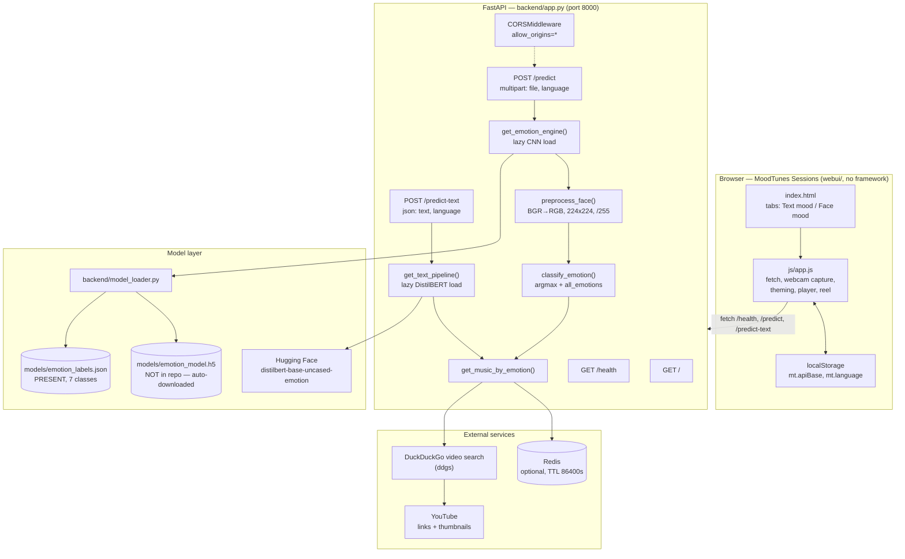
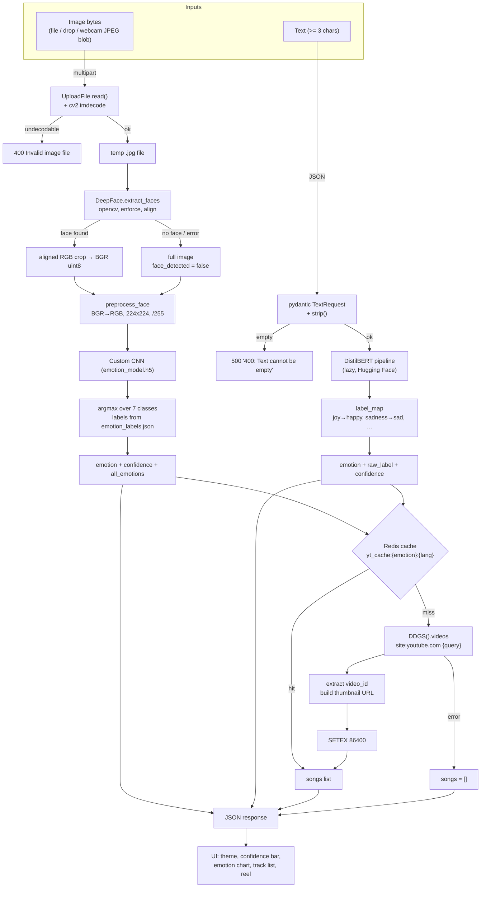

# PROJECT OVERVIEW — MoodTunes (AI Emotion Detection & Music Recommender)

*Folder id: `emotion-detection-from-text-and-face` · UI display name: **MoodTunes Sessions** · Upstream: `SekhSujonHaque2005/MoodTunes-AI-Emotion-Detection-and-Music-Recommendation-System`*

---

## Project Summary

| | |
|---|---|
| **Name** | MoodTunes — AI-Powered Emotion Detection & Music Recommender |
| **Folder** | `N:\Foundev-Projects\Domain\Artificial Intelligence & Machine Learning\emotion-detection-from-text-and-face` |
| **Problem** | People often know *how* they feel but not *what* to listen to, and mood-driven music services normally demand a playlist, a history or a text prompt before they respond. |
| **Objective** | Read the user's mood from two passive inputs — a face photo/webcam frame or a short piece of text — classify it into one of seven emotions, and return a short, mood-matched YouTube track list immediately. |
| **Users** | End users who want instant, mood-aware music suggestions; developers who want a reference hybrid face + text inference API. |
| **Expected output** | A JSON payload (`emotion`, `confidence`, `all_emotions`, `face_detected`/`raw_label`, `songs`) and, in the UI, a themed stage with the detected emotion, a confidence bar and a browsable track list. |
| **Stack** | FastAPI (Python 3.10+) + TensorFlow/Keras CNN + DeepFace + DistilBERT (`transformers`) + DuckDuckGo video search + optional Redis cache, fronted by a framework-free vanilla HTML/CSS/JS UI in `webui/`. |
| **Status** | The API, the vanilla UI and the caching layer are implemented. The trained CNN weights and the training dataset are **not in the repository** (see [Limitations](#current-limitations-and-future-improvements)). |

---

## Problem Statement

Music discovery is usually driven by metadata the user must supply: a song title, an artist, a
genre, or a manually written prompt. Those inputs are slow to produce, and they describe
*what* to play rather than *how* the user currently feels. Three concrete gaps follow:

1. **No low-effort mood capture.** Typing a description of your mood is friction — especially
   on mobile, and especially when the description of a feeling is exactly what you are
   struggling to name.
2. **No unified signal source.** Face-based mood readers and text-based mood readers
   usually ship as separate products. A user with a camera, a keyboard, or neither should
   get the same output shape from both.
3. **No immediate bridge to a playlist.** Even a good emotion label is not a listening
   experience; the user still has to translate "disgust" into a search query.

MoodTunes attacks all three: one API, two interchangeable input modalities, seven shared
emotion classes, and a track list attached to every response.

**Constraints that shape the design** (all observable in the code):

- The deep-learning stack (TensorFlow + PyTorch + a CNN + DistilBERT) is heavy, so nothing
  may be loaded at import time — both models are loaded lazily on first use
  (`get_emotion_engine()`, `get_text_pipeline()`).
- The face model weights are not redistributable inside this repository, so the loader
  fetches them on demand (`download_model()`), and the `.h5` file must be repaired for
  Keras 3 before it can be loaded (`patch_h5_file_permanently()`).
- Track discovery must work without a paid API key, so it uses DuckDuckGo video search
  scoped to `site:youtube.com` rather than the YouTube Data API.
- The app must stay usable when an optional service (Redis) is absent, so the cache layer
  is wrapped in `try/except` and degrades to "no caching".

---

## Proposed Solution

A three-tier hybrid pipeline behind a single FastAPI service.

**Tier 1 — capture (browser).** The MoodTunes Sessions page (`webui/`) offers two tabs.
*Text mood* posts a JSON string; *Face mood* posts a `multipart/form-data` image that can
come from a file picker, a drag-and-drop, or a webcam frame captured in-page with
`getUserMedia` and a canvas. The page polls `GET /health` every 15 seconds and shows an
explicit offline panel with the start commands when the API is unreachable — it never
renders a fabricated result.

**Tier 2 — classify (backend, two parallel paths).**

- *Face path*: bytes → `cv2.imdecode` → temporary `.jpg` → `DeepFace.extract_faces(
  detector_backend="opencv", enforce_detection=True, align=True)` → the aligned RGB crop
  is converted back to BGR uint8 → `preprocess_face()` (BGR→RGB, resize to 224×224, scale
  to `[0,1]`, shape `(1,224,224,3)`) → the custom CNN → `classify_emotion()` returns the
  arg-max label, its confidence and the full score vector. If no face is found (or
  DeepFace throws), the **full image** is classified and `face_detected` is `false`.
- *Text path*: text → `transformers` `text-classification` pipeline on
  `bhadresh-savani/distilbert-base-uncased-emotion` → raw label mapped onto the shared
  seven-class vocabulary (`joy→happy`, `sadness→sad`, `anger→angry`, `love→happy`, …,
  anything else → `neutral`).

Both paths converge on the same seven labels (`happy, sad, angry, fear, surprise,
neutral, disgust`), which is what makes the music layer uniform.

**Tier 3 — recommend (backend + web search).** `get_music_by_emotion(emotion, language)`
turns the label into a search phrase — either the richer `EMOTION_QUERIES` entry (e.g.
`happy → "happy upbeat pop"`) or, when a specific region is selected, a deliberately simple
keyword (`happy → "happy"` → query `"Hindi happy songs"`) because richer English genre
words caused the search engine to ignore the requested language. The query is sent to
DuckDuckGo as a *video* search prefixed with `site:youtube.com`, each result's YouTube
video id is extracted, and a list of `{title, video_id, thumbnail, channel, duration}` is
returned. Results are cached in Redis under `yt_cache:{emotion}:{language}` for 24 hours.

---

## Features and Capabilities

### Existing (verified in the source)

| Capability | Evidence |
|---|---|
| Service banner | `home()` — `backend/app.py:219-221` |
| Health probe for the UI | `health()` — `backend/app.py:224-226` |
| Face-based emotion classification | `predict()` — `backend/app.py:229-297` |
| Per-class score vector for face mode | `all_emotions` in `classify_emotion()` — `backend/app.py:128-131` |
| "No face found" transparency flag | `face_detected` — `backend/app.py:250,268-274` |
| Text-based emotion classification | `predict_text()` — `backend/app.py:298-338` |
| Raw transformer label surfaced to the UI | `raw_label` — `backend/app.py:310,329` |
| Region-aware music queries | `get_music_by_emotion()` — `backend/app.py:140-159` |
| YouTube result extraction (id, thumbnail, channel, duration) | `backend/app.py:186-203` |
| Redis caching with 24 h TTL and graceful degradation | `backend/app.py:59-66,163-172,205-211` |
| Automatic CNN download + Keras 3 repair | `download_model()`, `patch_h5_file_permanently()` — `backend/model_loader.py:14-63` |
| Lazy loading of both models | `get_emotion_engine()`, `get_text_pipeline()` — `backend/app.py:29-40,77-86` |
| Cross-origin access for the static UI | `CORSMiddleware` — `backend/app.py:69-75` |
| Webcam capture in the browser | `webui/js/app.js:446-490` |
| Drag & drop / file picker with a 20 MB guard | `webui/js/app.js:632-655` |
| Health polling every 15 s + manual recheck | `webui/js/app.js:93-112,668` |
| Per-emotion colour theme and stage visuals | `webui/js/app.js:13-21,115-130` |
| Emotion bar chart from `all_emotions` | `webui/js/app.js:221-248` |
| Now-playing band with prev/next and a session reel | `webui/js/app.js:255-329` |
| Copy playlist to the clipboard | `webui/js/app.js:331-349` |
| Honest offline state with run commands | `webui/index.html:43-59` |
| Configurable API base persisted in the browser | `webui/js/app.js:4,40-43` |
| Containerised deployment | `docker-compose.yml`, `backend/Dockerfile` |

### Future / not available in this repository

- **The CNN weights and the dataset are absent** — `models/emotion_model.h5` is git-ignored
  (`models/*.h5`) and fetched from Hugging Face on first use; `data/` contains only a README
  and the raw/processed folders are git-ignored.
- **No training pipeline in the runtime** — the only training artefact is
  `training/emotion-detection-and-music-recommendation-system.ipynb`, and it needs the
  missing dataset (the docs reference FER2013).
- **No audio playback** — the UI links to YouTube; it does not embed a player.
- **No accounts, history or database** — the session lives in the browser tab.
- **No official YouTube API** — search is scraped from DuckDuckGo.
- **A second, upstream front end** exists in `frontend/` (Next.js 16 / React 19 / Tailwind 4,
  PWA support) but is not the documented path; the two UIs are not kept in sync.
- **No authentication** on any endpoint.

---

## System Architecture



**Component notes**

- `backend/app.py` — the whole HTTP surface: three routes, two lazy model loaders, the
  preprocessing and classification helpers, the Redis client and the music search.
- `backend/model_loader.py` — file-system concerns only: where the weights live, how to
  fetch them, how to repair them for Keras 3, how to load them, how to read the label map.
- `webui/` — the shipped front end. It is a plain HTML page with an ES5-style script; no
  bundler, no framework, no runtime dependency. All API access is `fetch`.
- `models/emotion_labels.json` — the only model artefact in the repository; it defines the
  class order the CNN's output vector uses.
- `redis` — a cache, not a store of record. Every cache entry can be recomputed.

---

## Complete Project Workflow

### Face mode

1. **User** picks the *Face mood* tab and either drops an image, browses for one, or
   presses **Use webcam** and then **Capture frame**. The webcam path calls
   `navigator.mediaDevices.getUserMedia({video: {width: 1280, height: 720}})`, draws the
   video frame onto a canvas and exports it as a JPEG blob (`quality 0.92`).
2. **UI validation** — `webui/js/app.js:632-655` rejects anything that is not `image/*` or
   is larger than 20 MB, and shows an inline error message. Nothing is sent to the server
   when validation fails.
3. **Request** — `fetch(BASE + "/predict", {method: "POST", body: FormData})` with the file
   in the `file` field and the selected region in the `language` field.
4. **Server: decode** — `predict()` reads the bytes, `np.frombuffer` + `cv2.imdecode`
   produce the image. If decoding fails the handler raises
   `HTTPException(400, "Invalid image file")`, which the `except HTTPException: raise`
   clause re-raises untouched.
5. **Server: temp file** — the decoded image is written to a `NamedTemporaryFile(suffix=
   ".jpg", delete=False)` because DeepFace's `extract_faces` works on a path. The path is
   deleted in the `finally` block, so the temp file never leaks.
6. **Server: face extraction** — `DeepFace.extract_faces(..., detector_backend="opencv",
   enforce_detection=True, align=True)` returns RGB float crops in `[0,1]`. The first face
   is converted back to BGR uint8. If DeepFace raises or returns no face, the code falls
   back to the **entire image** and sets `face_detected = False`.
7. **Server: classification** — `classify_emotion()` → `preprocess_face()` (BGR→RGB,
   `cv2.resize` to 224×224, `/255.0`, `reshape(1,224,224,3)`) → `engine.predict(...,
   verbose=0)[0]` → `all_emotions` (label → rounded score), `emotion` (arg-max, defaulting
   to `neutral` for an unknown index) and `confidence`. If the engine could not be loaded,
   `classify_emotion()` raises `ValueError("AI Model failed to initialize. Try again in a
   few seconds.")`.
8. **Server: music** — `get_music_by_emotion(emotion, language=language)`: cache lookup →
   DuckDuckGo video search → cache write → list of tracks (empty list on failure).
9. **Response** — `{"emotion", "confidence", "face_detected", "all_emotions", "songs"}`.
10. **UI rendering** — the stage is re-themed for the emotion, the confidence bar is
    animated, the "all emotions" chart is drawn from `all_emotions`, and the tracks fill
    the now-playing band and the session reel. A "no face detected" chip is shown when
    `face_detected` is false.
11. **Error handling in the UI** — a non-2xx response surfaces the server's `detail`
    string; a network failure surfaces a timeout/offline message; a failed search that
    returns `songs: []` is shown as "no tracks returned for this mood" rather than as an
    error.

### Text mode

1. **User** types at least 3 characters (max 2000) in the *Text mood* tab and presses
   **Read my mood** or `Ctrl`/`⌘`+`Enter`.
2. **UI validation** — the client refuses input shorter than `MIN_LEN = 3` and shows
   "Write at least 3 characters".
3. **Request** — `fetch(BASE + "/predict-text", {method: "POST", headers:
   {"Content-Type": "application/json"}, body: JSON.stringify({text, language})})` with a
   30 s client timeout.
4. **Server: validation** — `TextRequest` (pydantic) enforces the body shape; the handler
   strips the text and raises `HTTPException(400, "Text cannot be empty")` for an empty
   string. Note that this `HTTPException` is raised *inside* the `try` whose
   `except Exception` converts everything to a 500, so an empty text surfaces as **500**
   with the detail `400: Text cannot be empty`. The UI's own length check prevents this in
   practice.
5. **Server: inference** — `get_text_pipeline()` lazily constructs the DistilBERT pipeline
   (first call downloads the checkpoint), `pipe(text)` returns label/score dicts, and
   `results[0]` is taken.
6. **Server: mapping** — `label_map` converts the transformer's vocabulary (`joy`,
   `sadness`, `anger`, `fear`, `surprise`, `love`) into the shared seven; unknown labels
   become `neutral`.
7. **Server: music** — same path as the face mode, with the text's `language` field.
8. **Response** — `{"emotion", "raw_label", "confidence", "text_analyzed", "songs"}`. The UI
   shows the raw transformer label as a small chip next to the mapped emotion, so the
   mapping is never hidden from the user.
9. **Error handling** — 400/500 responses are rendered as inline messages; a timeout shows
   the "the first request may take a while" hint.

---

## Machine Learning or Algorithm Explanation

### The face classifier (custom CNN)

- **Architecture:** the repository does not contain the training code for the shipped
  weights, and `models/emotion_model.h5` is not in the repository. What the code *does*
  tell us is precise: the input is a single RGB tensor of shape `(1, 224, 224, 3)`
  (`preprocess_face()`), the output is a 7-element vector (`backend/app.py:129` iterates
  over 7 classes and `emotion_labels.json` contains exactly 7 entries), and the class
  order is fixed by `emotion_labels.json`:
  `angry=0, disgust=1, fear=2, happy=3, neutral=4, sad=5, surprise=6`.
- **Preprocessing contract:** BGR→RGB (`cv2.COLOR_BGR2RGB`) → `cv2.resize(rgb, (224,224))`
  → `astype("float32") / 255.0` → `reshape(1, 224, 224, 3)`. No mean/std normalisation is
  applied, so the model expects plain `[0,1]` scaling.
- **Decision rule:** a plain arg-max over the softmax output. `predicted_idx = int(
  np.argmax(predictions))`; the label comes from `idx_to_label` (falling back to
  `"neutral"` for an out-of-range index) and the confidence is that entry rounded to 4
  decimals. There is no threshold, no calibration and no rejection of low-confidence
  predictions — a 0.31 "happy" is returned as "happy".
- **Label↔index mapping is the load-bearing detail:** `load_emotion_labels()` inverts the
  JSON (`{int(v): k for k, v in label_to_idx.items()}`), so the JSON *is* the model
  contract. Renumbering it silently breaks the classifier.
- **No training or evaluation evidence in the repository:** there is no training script
  for the CNN in the runtime path, no metrics file, and no dataset. The docs and
  `training/*.ipynb` reference FER2013, and `docs/architecture.md` describes the CNN as
  FER2013-trained, but none of that can be verified from the code. Any accuracy claim
  would be fabricated.
- **Keras 3 repair:** `patch_h5_file_permanently()` opens the `.h5` with `h5py`, reads
  the `model_config` attribute, and rewrites `"batch_shape": [null, 224, 224, 3]` into
  `"shape": [224, 224, 3]` with a regex plus a JSON round-trip, writing the attribute
  back. The file is idempotent — a second call finds no `"batch_shape"` and returns
  immediately. Loading then uses `tf_keras.models.load_model(..., compile=False)` with a
  fallback to `tensorflow.keras.models.load_model`.

### The text classifier (DistilBERT)

- **Checkpoint:** `bhadresh-savani/distilbert-base-uncased-emotion`, loaded through
  `transformers.pipeline("text-classification", framework="pt")`.
- **Decision rule:** `results[0]` — the highest-scoring label — is used directly, and its
  score becomes the confidence.
- **Label mapping:** `joy→happy`, `sadness→sad`, `anger→angry`, `fear→fear`,
  `surprise→surprise`, `love→happy`; anything else (notably `neutral` and `disgust`,
  which this checkpoint never emits) falls through to `"neutral"`. This is why the text
  path can never return `disgust`, even though the shared vocabulary contains it.
- **Language caveat:** `distilbert-base-uncased-*` is an English model. The `language`
  field changes only the *music query*, never the text understanding.

### The recommendation algorithm (not machine learning)

`get_music_by_emotion()` is a deterministic, non-learning pipeline:

1. **Query construction** — for `language == "Any"` (or blank) it uses the curated
   `EMOTION_QUERIES` table (`happy → "happy upbeat pop"`, `sad → "sad emotional"`,
   `angry → "heavy aggressive"`, `neutral → "chill relaxing acoustic"`, `surprise → "feel
   good party"`, `fear → "calming peaceful"`, `disgust → "moody atmospheric"`). For a
   specific region it switches to deliberately simple keywords
   (`happy → "happy"`, `neutral → "relaxing"`, `disgust → "lofi"`) and composes
   `"{language} {keyword} songs"`. The code comment explains why: richer English genre
   words make the search engine prioritise English results and ignore the requested
   language.
2. **Cache lookup** — `GET yt_cache:{emotion}:{language_lower_underscored}` from Redis.
   A hit returns the stored JSON verbatim and skips the network entirely.
3. **Search** — `DDGS().videos(f"site:youtube.com {query}", max_results=limit)` (default
   `limit=5`).
4. **Extraction** — for each result, the YouTube id is parsed from either
   `youtube.com/watch?v=<id>` or `youtu.be/<id>`; non-YouTube results are skipped. The
   thumbnail is synthesised as `https://img.youtube.com/vi/{id}/hqdefault.jpg`; the channel
   comes from the `publisher` field, defaulting to `"YouTube"`.
5. **Cache write** — `SETEX yt_cache:{emotion}:{language} 86400 <json>` (24 h).
6. **Failure** — any exception is printed with a traceback and the function returns `[]`,
   so the caller always gets a valid (possibly empty) list.

There is no ranking, no personalisation, no collaborative filtering and no learning of
any kind: the same emotion and language always produce the same search, and the only
variation across users comes from the search engine's own ranking.

---

## File-by-File Code Guide

| File | Key symbols | Role |
|---|---|---|
| `backend/app.py` | `TextRequest` (pydantic model) | Request schema for `/predict-text`: `text: str`, `language: str = "Any"`. |
| | `app = FastAPI(title="Emotion Detection API", version="3.0.0")` | App metadata; also what `/docs` renders. |
| | `get_text_pipeline()` | Lazily builds the DistilBERT `text-classification` pipeline; caches it in the `text_emotion_pipeline` global. |
| | `get_emotion_engine()` | Lazily loads the CNN and the label map into the `emotion_model` / `idx_to_label` globals; prints `CRITICAL: Failed to load .h5 model: …` on failure. |
| | `redis_client` (module level) | Built from `REDIS_URL` or `redis://{REDIS_HOST or 'localhost'}:6379/0`; `ping()` decides whether caching is on. |
| | `CORSMiddleware(allow_origins=["*"], allow_credentials=True, allow_methods=["*"], allow_headers=["*"])` | Allows the static UI on another origin to call the API. |
| | `EMOTION_QUERIES` | The seven global search phrases. |
| | `preprocess_face(face_pixels)` | BGR→RGB, resize to 224×224, `/255.0`, `reshape(1,224,224,3)`. |
| | `classify_emotion(face_pixels)` | Runs the CNN, builds `all_emotions`, returns `(emotion, confidence, all_emotions)`; raises `ValueError` when the engine is `None`. |
| | `get_music_by_emotion(emotion, limit=5, language="Any")` | Query construction, Redis get/set, DuckDuckGo search, YouTube id extraction. |
| | `home()` / `health()` | `GET /` and `GET /health`. |
| | `predict(file: UploadFile, language: str = Form("Any"))` | The image pipeline; 400 on undecodable bytes, 500 on any other exception, temp file removed in `finally`. |
| | `predict_text(request: TextRequest)` | The text pipeline; returns `emotion`, `raw_label`, `confidence`, `text_analyzed`, `songs`. |
| `backend/model_loader.py` | `BASE_DIR`, `MODEL_PATH`, `LABELS_PATH`, `MODEL_URL` | Path constants resolved relative to the file (`BASE_DIR` = project root), plus the Hugging Face download URL. |
| | `download_model()` | Streams `MODEL_URL` to `MODEL_PATH` in 8 KB chunks if the file is missing. |
| | `patch_h5_file_permanently(h5_path)` | Rewrites the `model_config` attribute of the `.h5` (`batch_shape` → `shape`) via `h5py` + `re`; idempotent. |
| | `load_emotion_model()` | download → patch → `load_model(..., compile=False)` (preferring `tf_keras`, falling back to `tensorflow.keras`). |
| | `load_emotion_labels()` | Reads `emotion_labels.json` and returns the inverted `{index: label}` dict. |
| `webui/index.html` | header, tab strip, stage, track list, offline panel | The page shell; contains the explicit "Backend offline" panel with the run commands and the file-size/format hints. |
| `webui/js/app.js` | `DEFAULT_API`, `MIN_LEN`, `MAX_FILE`, `TIMEOUT_MS`, `HEALTH_TIMEOUT_MS`, `POLL_MS` | Client configuration constants (20 MB, 3 chars, 30 s, 8 s, 15 s). |
| | `setTheme(emotion)` / `EMOTION_THEMES` | Per-emotion accent colours and stage visuals. |
| | `checkHealth()` / `startHealthPolling()` | `GET /health` probe, status pill, manual recheck, 15 s polling loop. |
| | `analyzeText()` | Client-side length validation, JSON `POST /predict-text`, response rendering. |
| | `analyzeImage(file)` | Client-side type/size validation, `FormData` `POST /predict`, response rendering, chart drawing. |
| | `startCamera()` / `captureFrame()` | `getUserMedia` (1280×720) and canvas → JPEG blob (0.92). |
| | `renderTracks()` / `nextTrack()` / `prevTrack()` / `copyPlaylist()` | The player strip, the session reel and the clipboard export. |
| `webui/css/style.css` | — | The full visual system: gradient stage, glass panels, theme variables, responsive layout. |
| `models/emotion_labels.json` | — | The class contract: `{"angry":0,"disgust":1,"fear":2,"happy":3,"neutral":4,"sad":5,"surprise":6}`. |
| `requirements.txt` | 18 entries | Runtime dependencies (see [Dependencies](#dependencies-and-external-services)). |
| `docker-compose.yml` | `backend`, `frontend`, `redis` | Three services: API :8000, Next.js :3000, Redis :6379; `REDIS_HOST=redis`, `NEXT_PUBLIC_API_URL=http://localhost:8000`. |
| `backend/Dockerfile` | — | `python:3.10-slim`, installs `requirements.txt`, runs `uvicorn backend.app:app --host 0.0.0.0 --port 8000`. |
| `frontend/` | Next.js App Router (`app/`, `components/`, `lib/`) | The upstream alternative UI — not the documented path. |
| `training/emotion-detection-and-music-recommendation-system.ipynb` | — | The training notebook; requires the missing dataset. |
| `docs/architecture.md` | — | Upstream architecture description (pre-dates the `webui/` layer). |
| `data/README.md` | — | Describes the expected dataset layout; `data/raw/*` and `data/processed/*` are git-ignored and empty. |
| `project-metadata.json`, `LICENSE` | — | Project identity and the MIT license (Copyright (c) 2026 springboardmentor442n-coder). |

---

## Data Flow



**Data shapes on the wire**

| Boundary | Shape |
|---|---|
| Browser → `/predict` | `multipart/form-data`: `file` (binary), `language` (text, default `"Any"`) |
| Browser → `/predict-text` | `application/json`: `{"text": "…", "language": "Any"}` |
| `/predict` → browser | `{"emotion": str, "confidence": float, "face_detected": bool, "all_emotions": {label: float}, "songs": [track]}` |
| `/predict-text` → browser | `{"emotion": str, "raw_label": str, "confidence": float, "text_analyzed": str, "songs": [track]}` |
| `track` | `{"title": str, "video_id": str, "thumbnail": str, "channel": str, "duration": str}` |
| Redis value | JSON array of `track`, TTL 86 400 s, key `yt_cache:{emotion}:{language}` |

---

## Example Execution

*The request and response below is an **illustrative** walkthrough written from the code
paths. No model was executed while producing this document (static reading only), so the
numbers are representative shapes, not measured outputs.*

**Scenario:** a user opens the page, the health pill turns green, they type
*"I am absolutely thrilled about the new job offer!"* in the *Text mood* tab, keep the
region on *Any*, and press **Read my mood**.

1. `webui/js/app.js` validates the length (27 characters ≥ `MIN_LEN`), builds
   `{text, language: "Any"}` and POSTs to `http://127.0.0.1:8000/predict-text`.
2. `predict_text()` strips the text, calls `get_text_pipeline()` — on a cold start this is
   where DistilBERT is downloaded and loaded — and runs the pipeline. Suppose the
   checkpoint returns `[{'label': 'joy', 'score': 0.9941}, …]`.
3. `label_map` maps `joy → happy`, so `emotion = "happy"`, `confidence = 0.9941`,
   `raw_label = "joy"`.
4. `get_music_by_emotion("happy", language="Any")` builds the query
   `"happy upbeat pop"`, checks `yt_cache:happy:any` (a miss on the first call), and
   searches `site:youtube.com happy upbeat pop` with `max_results=5`. The first three
   YouTube results are parsed into tracks such as
   `{"title": "…", "video_id": "…", "thumbnail": "https://img.youtube.com/vi/…/hqdefault.jpg", "channel": "…", "duration": "…"}`.
5. The list is stored with `SETEX yt_cache:happy:any 86400` and returned.

**Illustrative response**

```json
{
  "emotion": "happy",
  "raw_label": "joy",
  "confidence": 0.9941,
  "text_analyzed": "I am absolutely thrilled about the new job offer!",
  "songs": [
    {
      "title": "<title returned by the search backend>",
      "video_id": "<11-character id>",
      "thumbnail": "https://img.youtube.com/vi/<11-character id>/hqdefault.jpg",
      "channel": "<publisher>",
      "duration": "3:45"
    }
  ]
}
```

**Face-mode variant:** the same user switches to *Face mood*, captures a webcam frame and
presses **Analyze face**. The response shape is
`{"emotion": "happy", "confidence": 0.8731, "face_detected": true, "all_emotions": {"angry": 0.0112, "disgust": 0.0043, "fear": 0.0067, "happy": 0.8731, "neutral": 0.0815, "sad": 0.0098, "surprise": 0.0134}, "songs": [...]}`,
and the UI turns the stage green, animates the confidence bar and draws the seven-bar
chart. If DeepFace had found no face, `face_detected` would be `false` and the same
payload would carry a "no face detected" chip.

**Error path:** posting `{"text": ""}` directly to the API does not produce the intended
400 — the `except Exception` handler in `predict_text()` converts it into
**HTTP 500** with `{"detail": "400: Text cannot be empty"}`.

---

## Dependencies and External Services

| Dependency | Why it matters | Failure mode |
|---|---|---|
| `fastapi==0.104.1` | Routing, multipart parsing, the `/docs` and `/redoc` UIs, dependency injection for `UploadFile`/`Form`. | The app cannot start. |
| `uvicorn[standard]==0.24.0` | The ASGI server; the Docker image pins `--host 0.0.0.0 --port 8000`. | The app cannot serve. |
| `pydantic` (via FastAPI) | Validates the `/predict-text` body into `TextRequest`. | A malformed body is rejected with a 422. |
| `tensorflow-cpu>=2.15.0` | Runs the custom CNN (`emotion_model.h5`). | `classify_emotion()` cannot run; the endpoint returns 500. |
| `tf-keras` | Preferred import for `load_model` — the standard Keras 2 API that can load legacy `.h5` files. | Falls back to `tensorflow.keras`. |
| `deepface>=0.0.93` | Face detection and alignment (`extract_faces`, OpenCV backend). | The code catches the failure and classifies the whole image with `face_detected = false`. |
| `opencv-python>=4.10.0.84` | `cv2.imdecode` (upload decoding), `cv2.imwrite` (temp file), `cv2.resize` / `cv2.cvtColor` (preprocessing). | Imports fail at startup (`cv2` is a top-level import). |
| `numpy>=2.0.0` | Image buffers, arg-max, score casting. | Import error. |
| `transformers` + `torch` | The DistilBERT text-classification pipeline (`framework="pt"`). | `/predict-text` returns 500; `/predict` is unaffected. |
| `bhadresh-savani/distilbert-base-uncased-emotion` (Hugging Face) | The actual text classifier. Downloaded on first use (~250 MB). | First text request fails; subsequent ones too. |
| `sujon2005/Emotion_Detection_and_Music_Recommendation_System` (Hugging Face) | Hosts `emotion_model.h5` (~200 MB), fetched by `download_model()`. | `load_emotion_model()` raises; `/predict` returns 500 with "AI Model failed to initialize." |
| `h5py` | Rewrites the `.h5` `model_config` so Keras 3 can load the legacy file. | The patch is skipped with a warning; the load may then fail on `batch_shape`. |
| `requests>=2.31.0` | Streams the model download. | The download fails. |
| `ddgs` (DuckDuckGo Search) | Video search used to build the track list. | `get_music_by_emotion()` returns `[]`; the UI shows "no tracks returned for this mood". |
| `redis` | 24-hour cache of search results. | Logged as `WARNING: Redis not connected. Caching disabled.` — the app still works. |
| `pandas`, `scikit-learn`, `matplotlib`, `seaborn` | Analysis/plotting dependencies inherited from the training notebook; not used on the request path. | Not on the inference path. |
| `python-dotenv`, `werkzeug` | Upstream/utility extras. | Not on the inference path. |
| **Redis server** (external, optional) | Cache for `yt_cache:*` keys. | Caching disabled; every request hits DuckDuckGo. |
| **Hugging Face** (external) | Hosts both model artefacts. | No face or text inference at all. |
| **DuckDuckGo** (external) | Returns the video results. | No track list. |
| **YouTube** (external) | Hosts the videos the links point at; thumbnails come from `img.youtube.com`. | The links/thumbnails 404; the project never hosts media itself. |

**Environment variables actually read:** `REDIS_URL` and `REDIS_HOST` (both in
`backend/app.py:60`). Nothing else — there is no `.env` file and no `.env.example` in the
repository, and the `webui/` page is configured entirely in the browser through
`localStorage["mt.apiBase"]` and `localStorage["mt.language"]`.

---

## Current Limitations and Future Improvements

### Limitations (grounded in the code)

1. **The CNN weights are not in the repository** — `models/*.h5` is git-ignored, so the app
   cannot run offline and depends on a ~200 MB Hugging Face download.
2. **The training dataset is not in the repository** — `data/raw/*` and `data/processed/*`
   are git-ignored and empty; the model cannot be retrained or audited from the shipped
   code.
3. **No accuracy evidence** — there is no evaluation script, no metrics file and no
   confusion matrix for the CNN. Its quality can only be assumed from the upstream
   description.
4. **The label map is an implicit contract** — `emotion_labels.json` defines the class
   order of the CNN's output vector; a mismatch is silently wrong, not an error.
5. **Arg-max with no threshold** — low-confidence predictions are returned as confident
   answers; there is no "I am not sure" path.
6. **No face found is not an error** — the full image is classified instead, so a photo of
   a landscape can be reported as an emotion. The `face_detected` flag is the only signal.
7. **The text model is English-only** — the `language` field influences the music query
   only, never the analysis; the checkpoint also never emits `disgust` or `neutral`, so
   those two classes are unreachable from text mode.
8. **The empty-text 400 becomes a 500** — the `except Exception` handler in
   `predict_text()` swallows the `HTTPException`.
9. **`/health` reports `custom_emotion_model.h5`** while the file on disk is
   `models/emotion_model.h5` — the API contract and the file system disagree.
10. **CORS is `allow_origins=["*"]` with `allow_credentials=True`** — a combination
    browsers reject for credentialed requests, and unacceptable for a public deployment.
11. **No authentication, rate limiting or request quotas** — anyone who can reach port
    8000 can consume the models.
12. **The track list is a web-search result, not a recommendation model** — no ranking, no
    personalisation, no user history; DuckDuckGo's ranking decides what you get, and the
    scraper breaks whenever the markup changes.
13. **The cache key ignores the user and the session** — the same emotion and language
    yield the same tracks for everybody, for up to 24 hours.
14. **No audio playback** — the UI links out to YouTube only.
15. **Two front ends, one API** — `webui/` (documented) and `frontend/` (upstream Next.js)
    are not kept in sync.
16. **`requirements.txt` has a non-installable line** — `torch --index-url …` is invalid
    requirement syntax and breaks `pip install -r requirements.txt` as shipped.
17. **Version tension** — `numpy>=2.0.0` is incompatible with `tensorflow-cpu>=2.15.0`,
    which expects NumPy 1.x.

### Future improvements

- **Vendor the model and the dataset** (or ship a small registry with checksums) so the
  project installs and runs offline.
- **Add a `models/manifest.json`** with the expected class order, input shape, checksum and
  training provenance, and validate it against the loaded model at start-up.
- **Introduce a confidence threshold** and a `"uncertain"` outcome instead of always
  returning the arg-max; surface the top-2 classes in the UI.
- **Refuse to classify when no face is found** (or ask for another photo) instead of
  silently classifying the whole frame.
- **Fix the exception hierarchy** — re-raise `HTTPException` in `predict_text()` before
  the generic handler, and align `/health`'s model name with the real file name.
- **Multilingual text models** (e.g. a multilingual XLM-R checkpoint) so the `language`
  selector actually affects the analysis.
- **Replace the search scraper** with a real API (YouTube Data API, Spotify) plus a
  proper ranking model over audio features — the folder's sibling
  `music-recommender-from-audio-features` project already demonstrates a cosine-similarity
  recommender.
- **Add auth, rate limiting and per-user cache keys**, and narrow CORS to the known UI
  origins.
- **Embed an actual player** (an `<iframe>` or the YouTube IFrame API) so the session is
  self-contained.
- **Persist sessions** and keep a short emotion timeline.
- **Repair the packaging** — split the PyTorch CPU wheel out of `requirements.txt`, pin a
  mutually consistent TensorFlow/NumPy pair, and add a `requirements-lock.txt`.
- **Automated tests** for the label mapping, the query builder and the cache key, none of
  which exist today.

---

## Learning Outcomes

Building on this repository teaches the following, in order of how much they matter in
practice:

1. **Hybrid multi-modal inference design.** Two different model families — a CNN over
   image tensors and a transformer over token ids — are exposed behind one uniform,
   seven-class output contract, so the downstream product layer never has to know which
   modality produced the label. The `label_map` and `emotion_labels.json` are the two
   places that contract is enforced.
2. **Lazy loading as an engineering necessity.** TensorFlow, PyTorch, DistilBERT and a
   200 MB CNN cannot all be resident in a small service. `get_emotion_engine()` and
   `get_text_pipeline()` keep start-up fast and memory proportional to actual use.
3. **Preprocessing contracts are the model.** `preprocess_face()` documents the exact
   tensor the CNN expects (RGB, 224×224, `[0,1]`, batch dim of 1); a silent channel-order
   or scaling mistake produces plausible-looking nonsense rather than an error.
4. **Legacy model files in modern frameworks.** The `h5py` attribute rewrite in
   `patch_h5_file_permanently()` is a practical lesson in the Keras 2 → Keras 3 migration:
   the fix belongs next to the model, is idempotent, and is applied before the load.
5. **Graceful degradation over hard failure.** Redis is optional, DeepFace failure falls
   back to the full image, a failed search returns `[]` instead of raising, and the UI has
   an explicit offline panel. The application stays usable in every partial state.
6. **Caching and its trade-offs.** The `yt_cache:{emotion}:{language}` key with a 24-hour
   TTL shows both the value (the external search disappears from the hot path) and the
   cost (all users share one result set; upstream changes are invisible for a day).
7. **Web scraping as an API substitute — and its limits.** The `site:youtube.com` prefix
   plus the video-id parsing is a working hack with no SLA, no rate-limit guarantees and
   no contract.
8. **Frontend/backend contract hygiene.** A framework-free `fetch` client, a
   `localStorage`-persisted API base, a 15-second health poll and a 30-second client
   timeout are the minimum needed to make a heavy local-ML backend pleasant to use.
9. **Error semantics matter.** The 400-turned-500 bug and the `/health` model-name
   mismatch are the kind of small inconsistencies that make an API hard to trust; noticing
   them in a code review is a real skill.
10. **Honest UX.** The UI never invents a result: no backend, an explicit panel with the
    start commands; no face, an explicit chip; no tracks, an explicit message.

---

*MIT licensed — Copyright (c) 2026 springboardmentor442n-coder, upstream project
*MoodTunes: AI-Powered Emotion Detection & Music Recommender*. The Python backend and the
Next.js `frontend/` are the upstream work; the `webui/` interface and this documentation
were added later.*
