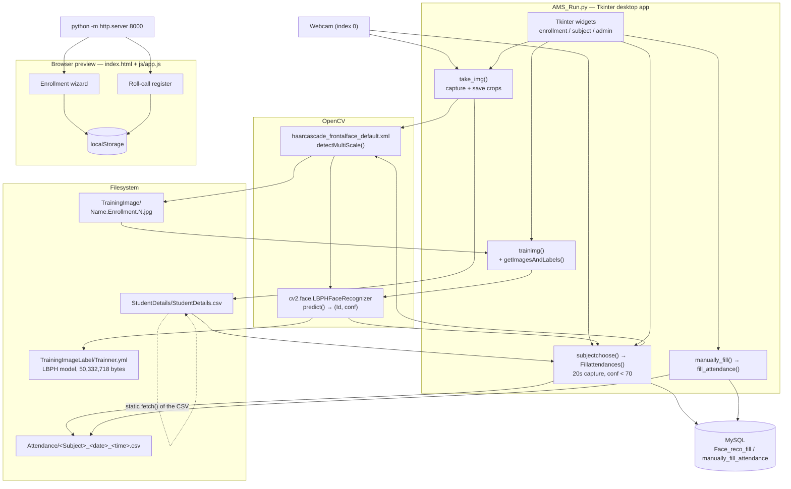
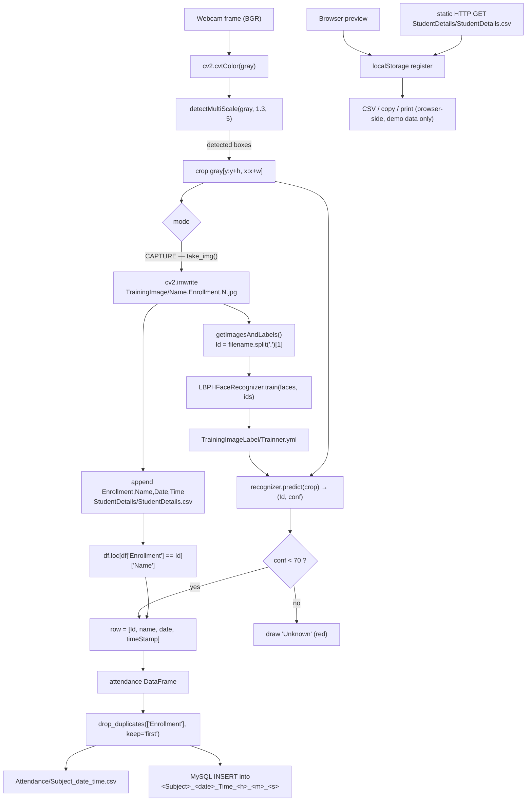

# Project Overview — FAMS Roll-Call Kiosk

Folder id: `face-recognition-attendance-system` · Runtime surface: Tkinter desktop application (`AMS_Run.py`) + a static browser preview (`index.html`).

## Project Summary

| Field | Value |
|---|---|
| Display name | FAMS Roll-Call Kiosk (desktop title: *FAMS-Face Recognition Based Attendance Management System*) |
| Repository id | `face-recognition-attendance-system` |
| Upstream | <https://github.com/Spidy20/Attendace_management_system> |
| Problem | Manual attendance registers are slow, easy to forge, and disconnected from the students who are actually present. |
| Objective | Let an instructor register a student once, then mark attendance automatically from a webcam and produce a per-subject, per-timestamp CSV that can be archived or mirrored to a database. |
| Users | Classroom instructors / lab supervisors taking attendance; an administrator reviewing the enrolled-student register. |
| Expected output | `Attendance/<Subject>_<YYYY-MM-DD>_<HH-MM-SS>.csv` containing `Enrollment,Name,Date,Time`, optionally mirrored into a MySQL table of the same shape. |
| ML technique | OpenCV Haar-cascade face detection + **LBPH** (Local Binary Patterns Histograms) face recognition, accepting a match when the recognizer's confidence distance is `< 70`. |

## Problem Statement

The original workflow is a paper register. The instructor calls names, ticks a box, and later re-types the sheet into a spreadsheet. Three problems follow:

1. **Time** — the register consumes the first minutes of every session.
2. **Integrity** — a hand-ticked sheet is trivially altered and cannot be audited.
3. **Fragmentation** — the data ends up in a format that cannot be queried, joined, or archived automatically.

A machine-vision attendance kiosk replaces the ticking with a webcam pass: enrolled faces are recognised automatically, and each session produces a machine-generated, timestamped record.

The honest scope of this repository: it is a **desktop application**, not a web service. There is no HTTP API, no server, and no multi-camera or multi-user design.

## Proposed Solution

The solution is split into four stages that the code already implements:

1. **Capture** (`take_img`) — the webcam feed is scanned with a Haar cascade; every detected face is written to `TrainingImage/<Name>.<Enrollment>.<N>.jpg` as a grayscale crop until the sample counter passes 70. The enrollment/name pair is appended to `StudentDetails/StudentDetails.csv`.
2. **Train** (`trainimg` + `getImagesAndLabels`) — the crops are re-detected with the cascade, labelled with the enrollment parsed out of the file name, and fed to `cv2.face.LBPHFaceRecognizer_create`. The trained model is serialised to `TrainingImageLabel\Trainner.yml`.
3. **Recognise** (`subjectchoose` → `Fillattendances`) — during a 20-second capture window each detected face crop is passed to `recognizer.predict()`. A returned confidence `< 70` is accepted and resolved to a name via the registry CSV; anything else is drawn as `Unknown`.
4. **Persist** — the accepted rows are de-duplicated per enrollment and written to a timestamped CSV, and (optionally) inserted into a per-session MySQL table.

A fifth, purely manual path (`manually_fill`) lets an instructor type enrollments directly for sessions where the camera is unavailable.

The browser page is a **companion preview**: it re-implements the same fields, CSV columns and acceptance rule so the workflow can be demonstrated or reviewed without a webcam. It performs no recognition.

## Features and Capabilities

### Existing (verified in the source)

| Capability | Implementation |
|---|---|
| Face capture and labeling | `take_img()` in `AMS_Run.py`, cascade `haarcascade_frontalface_default.xml`, `detectMultiScale(gray, 1.3, 5)`, stop at `> 70` samples or `q` |
| Student registry | `StudentDetails/StudentDetails.csv`, header `Enrollment,Name,Date,Time`, appended in `take_img()` |
| Model training | `trainimg()` → `getImagesAndLabels("TrainingImage")` → `LBPHFaceRecognizer.train()` → `TrainingImageLabel\Trainner.yml` |
| Automatic attendance | `Fillattendances()`: 20-second window, `conf < 70` acceptance, per-enrollment de-duplication, `Id` resolved through `df.loc[df['Enrollment'] == Id]['Name']` |
| CSV export | `attendance.to_csv("Attendance/<Subject>_<date>_<HH-MM-SS>.csv", index=False)` |
| Manual attendance | `manually_fill()` → `fill_attendance()` → `enter_data_DB()` → `create_csv()` |
| Database mirror | `pymysql.connect(host='localhost', user='root', password='', db='Face_reco_fill' / 'manually_fill_attendance')`, one `CREATE TABLE` per session |
| Register viewer | `admin_panel()` → `log_in()` → Tk grid rendering of the registry CSV |
| Standalone predict | `testing.py`: LBPH webcam loop, draws `Id`, no threshold and no CSV write |
| Browser preview | `js/app.js`: enrollment wizard, roll-call register, filter, CSV/copy/print export, `localStorage` persistence, static read of `StudentDetails/StudentDetails.csv` |

### Future / not present

- HTTP API and web front end for the recognition pipeline — no server code exists.
- Liveness / anti-spoofing — absent; the project metadata's "anti-spoof basic check" goal is not implemented.
- Multi-camera and multi-session concurrency — the app hardcodes `cv2.VideoCapture(0)` and a single 20-second window.
- Photometric or embedding-based recognition (dlib / `face_recognition`) — not used anywhere; the project metadata's stack claim is wrong.
- Deleting or re-training individual students, and any management of the capture set.
- Automatic roll-call lists per subject (a subject-to-student mapping is never stored).

## System Architecture

Real components only — there is no web server in this project.



**Boundary note.** The dashed arrow is the *only* link between the browser layer and the rest of the system: a static `fetch()` of a CSV file. No detection, recognition, database or model access happens in the browser.

## Complete Project Workflow

**Automatic attendance (the main path)**

1. **User** runs `python AMS_Run.py` from the project root; the Tk window opens at 1280×720.
2. **User** enters enrollment and name and presses **Take Images**.
3. **Validation** — `take_img()` checks that both fields are non-empty and shows the *"Enrollment & Name required!!!"* dialog otherwise; `testVal` additionally rejects non-digit enrollment input as you type.
4. **Capture** — `cv2.VideoCapture(0)` opens; each frame is converted to grayscale and passed to the cascade; every detection is written to `TrainingImage/<Name>.<Enrollment>.<N>.jpg`.
5. **Termination** — the loop ends on `q` or once `sampleNum > 70`; the camera is released and `cv2.destroyAllWindows()` runs.
6. **Registry update** — `Enrollment,Name,Date,Time` is appended to `StudentDetails/StudentDetails.csv`.
7. **Training** — the user presses **Train Images**; `getImagesAndLabels("TrainingImage")` re-detects faces in every crop, parses the enrollment from the file name, and returns `(faceSamples, Ids)`. `trainimg()` trains the LBPH recognizer and saves `TrainingImageLabel\Trainner.yml`. A failure to find the folder is caught and surfaced as a notification instead of a crash.
8. **Roll-call** — the user presses **Automatic Attendance**, types the subject and presses **Fill Attendance**. A blank subject raises the *"Please enter your subject name!!!"* dialog.
9. **Recognition** — for 20 seconds the loop detects faces and calls `recognizer.predict(crop)`. `conf < 70` → accepted: green box, label `<Id>-<Name>`, row appended to the in-memory `attendance` DataFrame. Otherwise → `Unknown`, red box. `Id` is resolved to a name via the registry CSV.
10. **Deduplication** — `attendance.drop_duplicates(['Enrollment'], keep='first')` runs every frame and again before export, so one student produces at most one row per session.
11. **Output** — `attendance.to_csv("Attendance/<Subject>_<date>_<HH-MM-SS>.csv", index=False)`; the app then opens the CSV in a Tk table window.
12. **Database mirror** — a session table `<Subject>_<YYYY_MM_DD>_Time_<H>_<M>_<S>` is created in `Face_reco_fill` and one row inserted. Both the connect and the insert are wrapped in `try/except`, so a missing MySQL server degrades to CSV-only output instead of crashing.
13. **Error handling throughout** — a missing model file shows *"Model not found,Please train model"*; missing input fields show a dedicated warning dialog; camera and CSV problems are caught and printed.

**Browser preview path**

1. Serve the folder with `python -m http.server 8000` and open <http://localhost:8000/>.
2. The wizard validates enrollment/name client-side, animates a **simulated** capture ring, and stores the enrollment in `localStorage`.
3. The roll-call panel tries to load the roster from `StudentDetails/StudentDetails.csv`; if the fetch fails (for example over `file://`) it shows an explicit instruction to serve the folder over HTTP.
4. Manual entries, "mark all present", filter, CSV export, copy and print all operate on the browser-side register.
5. No recognition, no model, no server-side state.

## Machine Learning or Algorithm Explanation

This project is classical computer vision plus a classical biometric template — there is no neural network anywhere in the repository.

### 1. Face detection — Haar cascade

`cv2.CascadeClassifier("haarcascade_frontalface_default.xml")` is the Viola–Jones style cascade that ships with OpenCV. `detectMultiScale(gray, scaleFactor, minNeighbors)` returns the list of `(x, y, w, h)` boxes for frontal faces. The app uses `(1.3, 5)` while capturing and `(1.2, 5)` while marking attendance — a slightly more permissive setting during the live pass, which favours recall (finding faces) over precision (finding exactly one face per person).

### 2. Face representation and matching — LBPH

`cv2.face.LBPHFaceRecognizer_create()` implements **Local Binary Pattern Histogram**. For each pixel the LBP operator compares it with its 8 neighbours, producing an 8-bit code. The face crop is divided into a grid of cells (the recognizer's default is 8×8 cells × 16×16 pixels), and a 256-bin histogram of the LBP codes is built per cell. Concatenating the cell histograms gives a compact descriptor that is characteristic of local texture — which is exactly what distinguishes one face from another.

Matching is done with **chi-squared distance**: the recognizer returns the nearest template and a confidence value that is a distance, so **lower is better**. The app's rule `conf < 70` is therefore a *distance* threshold, not a probability. Above the threshold the face is treated as unknown and drawn in red.

Consequences worth understanding:
- The threshold is a single global constant; it is not calibrated per user and there is no ROC analysis in the repo.
- Because the descriptor is a texture signature, training images matter a lot: the upstream README notes that "noisy image can reduce your accuracy so quality of images matters".
- There is no liveness check, so a photograph of an enrolled face can be matched.

### 3. Why the registry CSV is part of the model

LBPH only returns an **integer label**. The label is the enrollment number parsed out of the file name (`getImagesAndLabels`: `os.path.split(imagePath)[-1].split(".")[1]`). The human-readable name is joined in at *inference* time from `StudentDetails/StudentDetails.csv` via `df.loc[df['Enrollment'] == Id]['Name'].values`. If a row is missing from that CSV, the recognised enrollment still appears but the name column is empty.

### 4. Fisher-face variant

`training.py` uses `cv2.face.createFisherFaceRecognizer_create()` instead — a **Linear Discriminant Analysis** projection that finds the linear directions maximising between-class separation, then compares projections by Euclidean distance. It is more accurate in principle, but it is *not* interchangeable with LBPH: the file it writes (`TrainingImageLabel/trainner.yml`) is the same file the app and `testing.py` read back with `LBPHFaceRecognizer`, which will fail to deserialize a Fisher model.

## File-by-File Code Guide

| File | Key symbols | Role |
|---|---|---|
| `AMS_Run.py` | `take_img()`, `trainimg()`, `getImagesAndLabels(path)`, `subjectchoose()` → `Fillattendances()`, `manually_fill()` → `fill_attendance()` → `enter_data_DB()` / `create_csv()`, `admin_panel()` → `log_in()`, `testVal(inStr, acttyp)` | The whole desktop application: capture, training, automatic and manual attendance, register viewer |
| `testing.py` | module-level script: `LBPHFaceRecognizer_create()`, `recognizer.read('TrainingImageLabel/trainner.yml')` | Standalone webcam prediction; draws the predicted `Id`, no acceptance threshold, no CSV output |
| `training.py` | `getImagesAndLabels(path)`, `createFisherFaceRecognizer_create()` | Standalone **Fisher** trainer writing `TrainingImageLabel/trainner.yml` (overwrites the LBPH model) |
| `retrain.py` | `create_image_lists()`, `create_model_graph()`, `cache_bottleneck_file()`, `run_bottleneck_on_image()` | Vendored 2015 TensorFlow 1.x Inception-v3 transfer-learning example, Apache 2.0. **Unrelated to this pipeline**; requires TF1 and an ImageNet checkpoint |
| `index.html` | markup for the wizard, register, "How recognition works" cards, run panel | Browser companion page |
| `js/app.js` | `loadRoster()` (static `fetch` of `StudentDetails/StudentDetails.csv`), wizard step controller, register table renderer, CSV builder | Browser-side demo logic; `localStorage` persistence |
| `css/style.css` | stylesheet | Browser UI styling |
| `StudentDetails/StudentDetails.csv` | — | Registry: `Enrollment,Name,Date,Time` |
| `Attendance/Manually Attendance/OOP_2019_02_22_Time_11_32_41.csv` | — | Sample manual export: `ID,ENROLLMENT,NAME,DATE,TIME` |
| `TrainingImageLabel/Trainner.yml` | — | Serialised LBPH model (48 MiB), header `opencv_lbphfaces` |
| `haarcascade_frontalface_default.xml`, `haarcascade_frontalface_alt.xml` | — | OpenCV cascades; only the `_default` one is referenced by the code |
| `training code.txt` | — | Scratch note listing the training command |
| `project-metadata.json` | — | Catalog metadata; its `stack` and `goal` fields do not match the code |

## Data Flow



## Example Execution

Illustrative walkthrough using the shipped artefacts. The numbers below are representative of the code's behaviour, not recorded telemetry.

**Scenario:** enroll student `15624031 / Aditi Sharma` in subject `OOP`.

1. `python AMS_Run.py` → the window *"FAMS-Face Recognition Based Attendance Management System"* opens.
2. Enrollment `15624031`, name `Aditi Sharma` → **Take Images**. The camera shows a blue rectangle on the face; each detection writes `TrainingImage/Aditi Sharma.15624031.1.jpg`, `...2.jpg`, … The notification reads *"Images Saved for Enrollment : 15624031 Name : Aditi Sharma"*.
3. `StudentDetails/StudentDetails.csv` gains the row `15624031,Aditi Sharma,2026-10-21,10:15:04`.
4. **Train Images** → *"Model Trained"*; `TrainingImageLabel/Trainner.yml` is rewritten with the new LBPH template set.
5. **Automatic Attendance** → subject `OOP` → **Fill Attendance**. The 20-second window shows:
   - green box, label `15624031-Aditi Sharma` — a match, since `conf` came back well under 70;
   - red box, label `Unknown` — a visitor who is not enrolled.
6. On exit, `Attendance/OOP_2026-10-21_10-15-31.csv` is written:

   ```csv
   Enrollment,Name,Date,Time
   15624031,Aditi Sharma,2026-10-21,10:15:29
   ```

   *(illustrative content — the real file's timestamp reflects when the session ran)*
7. With MySQL running, the same row also lands in the `Face_reco_fill` table `OOP_2026_10_21_Time_10_15_31`.
8. **Check Register students** → log in → the registry CSV renders in a table.

**Browser companion:** `python -m http.server 8000` → <http://localhost:8000/>. The wizard accepts `15624031 / Aditi Sharma`, the simulated capture ring counts to 70, and the roll-call table shows the enrollment with the *manual entry* source label. Nothing on that page is a recognition result.

## Dependencies and External Services

| Dependency | Why it matters |
|---|---|
| `opencv-contrib-python` | Provides `cv2.CascadeClassifier` **and** `cv2.face.LBPHFaceRecognizer`. The plain `opencv-python` wheel has no `cv2.face`, so this specific distribution is mandatory, not a preference. |
| `numpy` | Frame buffers and the label array passed to `recognizer.train(faces, np.array(Id))`. |
| `pandas` | Builds the attendance DataFrame (`pd.DataFrame(columns=['Enrollment','Name','Date','Time'])`), reads the registry CSV, and writes the session CSV. |
| `pillow` (`PIL`) | `Image.open(...).convert('L')` + `np.array(...)` inside `getImagesAndLabels()`; `ImageTk.PhotoImage` for the webcam preview. |
| `tkinter` | The entire desktop UI. Part of the standard library (ships with the python.org Windows installer). |
| `pymysql` *(optional)* | The MySQL mirror. Imported **inside** the attendance functions, so the app still works with CSV output only when it is absent or the server is down. |
| A webcam | `cv2.VideoCapture(0)` is the sole input device for both capture and attendance. |
| MySQL *(optional)* | Schemas `Face_reco_fill` and `manually_fill_attendance`; user `root` with an empty password, on `localhost`. Tables are created at runtime, so only the schemas need to exist. |
| Google Fonts | The browser page loads Libre Franklin and Space Mono from `fonts.googleapis.com` — cosmetic only; the page works offline. |
| Node.js | Not required. The browser layer is static files with no build step. |
| `retrain.py`'s TensorFlow dependency | **Not** a dependency of this application. Only relevant if you decide to run the unrelated vendored Inception-v3 script, which needs TensorFlow 1.x. |

No API keys, no cloud services, no external model downloads. Everything runs locally.

## Current Limitations and Future Improvements

**Current limitations**

- Windows-only relative paths (`TrainingImageLabel\Trainner.yml`) and three hardcoded absolute paths pointing at the original author's home directory.
- `TrainingImage/` is not in the repository, so a fresh clone cannot train until samples are captured.
- The shipped `Trainner.yml` is meaningful only for the faces it was trained on.
- Plain-text admin credential inside `AMS_Run.py`, no hashing, no lockout, no auditing.
- No liveness detection — a photo can be matched.
- A single global `conf < 70` threshold, not calibrated per user or lighting condition.
- No HTTP API, no web deployment, no concurrency, one camera, a fixed 20-second window.
- `training.py` (Fisher) can silently replace the LBPH model file and break `AMS_Run.py` / `testing.py`.
- `retrain.py` is unrelated vendored code that adds ~1,000 lines of noise and a false impression of a deep-learning pipeline.
- `project-metadata.json` misdescribes the stack (`face_recognition`, SQLite) and claims an anti-spoof feature that does not exist.
- Face crops are stored unencrypted in `TrainingImage/`.

**Future improvements**

- Wrap the recognition pipeline in a small Flask/FastAPI service (`/enroll`, `/train`, `/attendance/start`, `/attendance/rows`) so the browser page could consume real results instead of mirroring them.
- Replace the hardcoded paths and credentials with a config file and an environment-variable-driven MySQL connection.
- Add a proper enrollment store (SQLite) with per-student deletion and re-capture.
- Introduce a face-embedding model (dlib / ArcFace) with a calibrated threshold and cosine-distance matching, which is materially more accurate than LBPH.
- Add liveness (blink / head-movement / texture) checks.
- Multi-camera capture and per-camera session logs, plus a subject → roster mapping so a session knows who is expected.
- Replace `drop_duplicates` on the whole frame loop with a tracker so attendance is recorded once per appearance with a time window.
- Prune `retrain.py` and correct `project-metadata.json` to describe the actual stack.

## Learning Outcomes

By working through this repository you should be able to:

1. **Build a face dataset from scratch** — understand why capture quality, count and consistent naming decide whether the recognizer will work at all.
2. **Understand classical biometric recognition** — the LBP operator, per-cell histograms, and why the LBPH confidence is a *distance* whose direction (lower = better) is easy to get wrong.
3. **Connect a classifier to real identities** — how an integer label becomes a name through a side table, and what happens when that table is incomplete.
4. **Separate detection from recognition** — the cascade finds faces, the recognizer names them; the thresholds live in different places and fail differently.
5. **Design a decision threshold honestly** — what a single hard-coded `conf < 70` buys and what it costs, and why it belongs in a calibrated, per-deployment setting.
6. **Build an auditable output format** — a stable CSV schema with a subject, a date and a timestamp, and why a machine-generated sheet is more defensible than a paper one.
7. **Make a desktop app degrade gracefully** — the `try/except` around the MySQL connection so a missing database costs you the mirror, not the attendance.
8. **Understand the boundary between a demo UI and a system** — how a browser preview can honestly mirror a desktop workflow without ever claiming to run the model.
9. **Work safely with third-party code** — the MIT grant on the original project, the separate Apache-2.0 header on the vendored TensorFlow file, and the obligation to keep upstream attribution intact.
