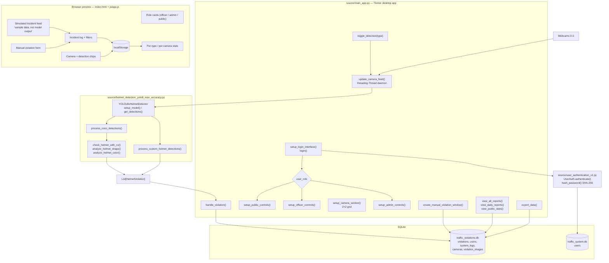
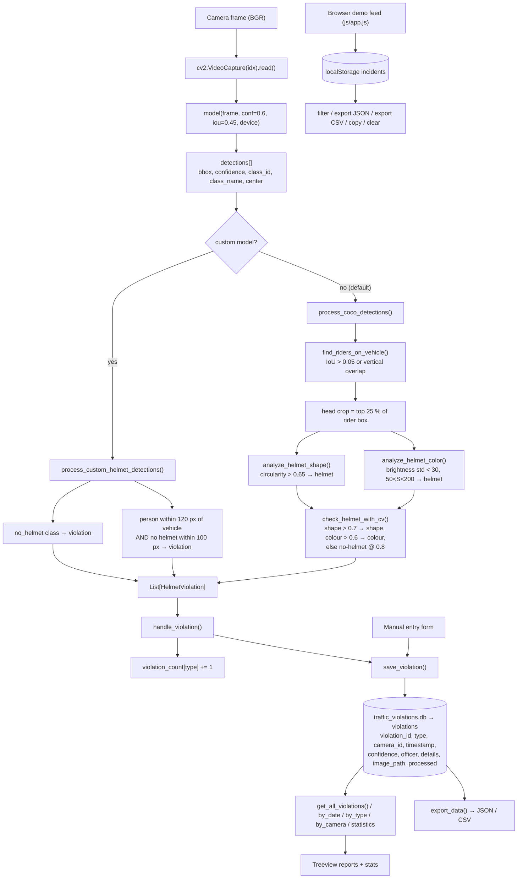

# Project Overview — Signal Control Room

Folder id: `helmet-seatbelt-violation-detection` · Runtime surface: Tkinter desktop application (`source/main_app.py`) + a static browser preview (`index.html`).

## Project Summary

| Field | Value |
|---|---|
| Display name | Signal Control Room (desktop title: *Traffic Violation Detection System*) |
| Repository id | `helmet-seatbelt-violation-detection` |
| Upstream | <https://github.com/3TInfoTinker/traffic_violation_detection> |
| Problem | Helmet violations are enforced manually, from roadside posts, with no durable machine-readable evidence and no way to review what a camera saw afterwards. |
| Objective | Watch road cameras continuously, detect riders without a helmet, log every violation with camera id, timestamp, confidence and officer, and give operators role-scoped reports and exports. |
| Users | Traffic officers on duty, administrators managing cameras and reviewing the log, and the general public as a read-only viewer of statistics. |
| Expected output | Rows in the SQLite `violations` table (`violation_id, type, camera_id, timestamp, confidence, officer, details, image_path, processed`), plus JSON/CSV exports of the same records. |
| ML technique | Ultralytics **YOLOv8x** object detection, followed by a rule layer that converts detections into violations — either a direct `no_helmet` class from a custom model, or classical CV shape/colour analysis over the rider's head region when running on generic COCO weights. |

## Problem Statement

Traffic-police camera deployments produce a lot of video and very little structured evidence. Three gaps follow from that:

1. **No automatic screening.** An officer watching four feeds cannot scan every frame of every camera for a missing helmet; attention lapses within minutes.
2. **No usable record.** When something does look wrong, what exists is a clip or a memory, not a row with a camera id, a timestamp and a confidence.
3. **No access control around the evidence.** Anyone who can reach the monitoring station can currently browse everything, and there is no distinction between an administrator, an officer and the public.

The repository was designed to close these gaps with a YOLO detector, a violation decision layer, a SQLite evidence store and a role-aware operator console. As shipped, **only the helmet detector is implemented**, and the default model is a generic COCO checkpoint rather than a trained helmet model.

## Proposed Solution

The design separates four concerns:

1. **Detection** (`YOLOv8xHelmetDetector`) — a YOLOv8x inference pass over each frame at `conf ≥ 0.6`, `IoU ≥ 0.45`, on `cuda` / `mps` / `cpu` chosen automatically. Detections are returned as plain dictionaries (`bbox`, `confidence`, `class_id`, `class_name`, `center`, `xyxy`).
2. **Violation inference** (`process_detections`) — two strategies:
   - `process_custom_helmet_detections()` for a custom checkpoint whose classes are `person, helmet, no_helmet, motorcycle, bicycle`: a `no_helmet` detection is a violation outright; a `person` box within 120 px of a motorcycle/bicycle with no `helmet` box within 100 px of the person's head is a `person_no_helmet` violation.
   - `process_coco_detections()` for the generic COCO model: find riders by box overlap or vertical alignment with a motorcycle, crop the top 25 % of the rider's box as the head region, then judge it with `check_helmet_with_cv()` — a Canny + contour circularity test (`> 0.65` ⇒ helmet) and an HSV uniformity test (brightness std `< 30` and saturation in `50..200` ⇒ helmet).
3. **Evidence** (`DatabaseManager`) — a SQLite schema with `violations`, `users`, `system_logs`, `cameras` and `violation_images`, four indexes, and four seeded camera rows. Reports are plain SQL queries: by date, by type, by camera, and aggregate statistics.
4. **Access control** (`UserAuth`) — a second SQLite database with SHA-256 password digests and a role column; `authenticate(username, password, role)` requires all three to match, and the role then determines which control panel the operator sees.

The browser page mirrors the console for demonstration and review purposes only — it holds its own incident log in `localStorage`, labels its feed as demo data, and never loads a model.

## Features and Capabilities

### Existing (verified in the source)

| Capability | Implementation |
|---|---|
| Login with role | `setup_login_interface()`, `login()`, `UserAuth.authenticate(username, password, role)` |
| Password storage | `UserAuth.hash_password()` → SHA-256 hex digest; `change_password()`, `add_user()`, `activate_user()`, `deactivate_user()` |
| Four-camera grid | `setup_camera_section()` (2×2), `start_camera(idx)`, `stop_camera(idx)`, `update_camera_feed(idx)` on a daemon thread |
| Helmet detection | `YOLOv8xHelmetDetector.detect(frame, camera_id)` → `(processed_frame, List[HelmetViolation])` |
| Violation rendering | `draw_detections()` — coloured boxes per class, thick red box + `HELMET VIOLATION` banner + `!` marker for violations, `add_frame_info()` overlay (camera, violation count, per-camera total, model type, device) |
| Violation logging | `handle_violation()` → `DatabaseManager.save_violation()`; counters refreshed by `update_violation_display()` |
| Manual entry | `record_violation()` → `create_manual_violation_window()` → `save_manual_violation()` |
| Reports | `view_all_reports()`, `view_daily_reports()`, `view_public_stats()`, rendered into a `ttk.Treeview` |
| Export | `DatabaseManager.export_data(filename, data_type)` → JSON or CSV |
| Statistics | `DatabaseManager.get_violation_statistics()` |
| Housekeeping | `DatabaseManager.backup_database()`, `cleanup_old_data(days_to_keep)`, `log_system_event()`, `get_system_logs()` |
| Browser preview | Role cards, camera chips, demo feed, manual entry, filterable log, stats bars, JSON/CSV export |

### Future / not present

- **Seatbelt detection** — module `seatbelt_detection_v2` is a commented-out import; the detector object is never created.
- **Roundabout / wrong-turn detection** — module `roundabout_detection_v2`, same situation.
- **Plate recognition and evidence images** — `save_violation_image()` and the `violation_images` table exist but nothing populates them.
- **A trained helmet model** — the repository ships no weights and no training script; the default is generic COCO.
- **Ticket generation, system settings, user management panels** — the three buttons show placeholder message boxes.
- **Multi-GPU / multi-process inference, NVRM-style long-running recording, alerting (email/webhook), license-plate-to-driver linkage** — none of this exists.
- **Any HTTP interface** — no server code, so the browser page and the desktop app are disconnected.

## System Architecture

Real components only — there is no web server in this project.

**Boundary note.** The browser layer has no edge to the desktop application or the database. It is a self-contained local simulation that mirrors field names and record shapes so the console can be evaluated without cameras.

## Complete Project Workflow

**Automatic detection (the main path)**

1. **User** launches `python source/main_app.py`; the window *Traffic Violation Detection System* opens at 1400×900.
2. **Login** — the user picks a role and types credentials; `UserAuth.authenticate()` lowercases the username, looks the user up with `is_active = 1`, re-hashes the submitted password with SHA-256 and compares digests, then compares the role string. Any mismatch → *"Invalid credentials or role!"*. A success stamps `last_login`.
3. **Panel selection** — `setup_main_interface()` destroys the login widgets and builds the header, camera grid, the role-specific control panel and the status panel.
4. **Camera start** — `start_camera(idx)` opens `cv2.VideoCapture(idx)`; if it opens, a daemon thread runs `update_camera_feed(idx)`; if not, the user gets *"Cannot access Camera N"*.
5. **Per-frame processing** — the thread reads a frame, copies it, and for each enabled detection system calls `detector.detect(frame)`. The frame is resized to 300×200, converted BGR→RGB and rendered into the tile via `ImageTk.PhotoImage` (the Tk reference is kept on the label to avoid garbage collection).
6. **Detection** — `get_detections()` runs YOLO once per frame at `conf=0.6`, `iou=0.45` on the selected device, and converts every box into a detection dictionary.
7. **Violation decision** — `process_detections()` picks the custom-model or COCO strategy; on the COCO path `find_riders_on_vehicle()` matches people to motorcycles by IoU `> 0.05` or vertical overlap, then `check_helmet_with_cv()` inspects the head crop.
8. **Logging** — `handle_violation()` increments the per-type counter and calls `DatabaseManager.save_violation()` with the violation type, `camera_id + 1`, an ISO timestamp, the violation details and the current officer (only for the Traffic Officer role).
9. **Rendering** — `draw_detections()` paints class boxes and, for violations, a thick red box with a `HELMET VIOLATION` banner, the violation id and a `!` marker; `add_frame_info()` overlays camera id, current and cumulative violation counts, whether a custom model is in use, and the compute device.
10. **Error handling** — the detector catches its own inference errors and paints `DETECTION ERROR CAM N`; the camera thread catches everything else, prints `Camera N error: ...` and ends that camera's thread rather than crashing the GUI.

**Manual path:** **Record Violation** → choose type / camera, type details, press **Save Violation** → `DatabaseManager.save_violation()` → counters update → success dialog.

**Reporting path:** **View All Reports** / **View Daily Reports** / **View Statistics** read from SQLite and render into a `ttk.Treeview` or a list of labels; **Export Data** writes JSON or CSV through `export_data()`.

**Browser preview path:** pick a role card → toggle helmet chips → **Play simulated feed** generates labelled demo incidents, or use **Record manual violation** → filter, copy, export or clear the log → Administrators see the per-type / per-camera statistics.

## Machine Learning or Algorithm Explanation

This project combines a modern learned detector with a classical rule layer. There is no trained model in the repository, so the shipped behaviour is "generic COCO detector + hand-written CV heuristics".

### 1. Object detection — YOLOv8x

`ultralytics.YOLO` runs a single-stage detector over the whole frame. The instance is configured with:

| Parameter | Value | Effect |
|---|---|---|
| `confidence_threshold` | `0.6` | Boxes below 0.6 are discarded — high precision, lower recall |
| `iou_threshold` | `0.45` | Non-maximum-suppression IoU cutoff |
| `device` | `auto` | `cuda` → `mps` → `cpu`, resolved once in `setup_model()` |
| `model_path` | `custom_model_path` if it exists, else `"yolov8x.pt"` | Custom checkpoint wins when supplied |

`setup_model()` also runs a warm-up inference on a 640×640 zero image so the first real frame is not slowed by lazy initialisation.

### 2. Violation inference — custom-model path

`process_custom_helmet_detections()` assumes the class set `person, helmet, no_helmet, motorcycle, bicycle` (exactly the contents of `helmet.names`):

- **Direct rule** — every `no_helmet` box becomes a `no_helmet_detected` violation.
- **Geometric rule** — for each `person`, `is_near_vehicle()` checks whether a motorcycle/bicycle centre is within **120 px**; if so, `has_nearby_helmet()` checks whether a `helmet` box centre is within **100 px** of the person's head point (`x + w/2`, `y + 0.15h`). No nearby helmet ⇒ `person_no_helmet` violation.

The 120 px / 100 px radii are fixed pixel constants, so the rule is **resolution-dependent** — at 1080p the same physical gap maps to more pixels than at 720p.

### 3. Violation inference — COCO path (what actually runs today)

`process_coco_detections()` runs because no custom checkpoint is present:

1. **Rider association** — `find_riders_on_vehicle()` pairs each person with a motorcycle/bicycle when the box IoU exceeds **0.05** (`calculate_overlap()`) *or* when the person's vertical span overlaps the vehicle's (`person_y + person_h >= vehicle_y and person_y <= vehicle_y + vehicle_h`).
2. **Head crop** — `check_helmet_with_cv()` takes the top **25 %** of the rider's box (minimum 10 px tall) as the head region.
3. **Shape test** — `analyze_helmet_shape()` blurs with a 5×5 Gaussian, applies Canny (30, 100), takes the largest external contour, computes circularity `4πA/P²` and treats `> 0.65` as helmet-shaped (helmets are convex and rounded; faces are not).
4. **Colour test** — `analyze_helmet_color()` works in HSV: a low brightness standard deviation (`< 30`) plus moderate saturation (`50 < S < 200`) indicates a smooth, solid-coloured shell.
5. **Combination** — if shape confidence `> 0.7` the shape result wins; else if colour confidence `> 0.6` the colour result wins; otherwise the region is declared **no helmet with confidence 0.8** by default.

Note the conservative default: when neither test fires, the code flags a violation. On a generic COCO model this produces a high false-positive rate, and the two thresholds are uncalibrated constants.

### 4. Why there is no learning here beyond YOLO

The repository contains **no training script, no annotations and no dataset**. The upstream metadata describes the intent ("custom-labelled dataset, detection + plate crop pipeline and evidence log"), but only the inference and storage halves exist here. The `.gitignore` even excludes `*.pt` and `*.weights`, so no checkpoint can be committed through the normal workflow.

## File-by-File Code Guide

| File | Key symbols | Role |
|---|---|---|
| `source/main_app.py` | `TrafficViolationSystem`; `setup_login_interface()`, `login()`, `setup_main_interface()`, `setup_header()`, `setup_camera_section()`, `setup_admin_controls()`, `setup_officer_controls()`, `setup_public_controls()`, `setup_status_panel()`, `start_camera()`, `stop_camera()`, `update_camera_feed()`, `handle_violation()`, `update_violation_display()`, `toggle_detection()`, `update_system_status()`, `view_all_reports()`, `view_daily_reports()`, `view_public_stats()`, `show_reports_window()`, `show_stats_window()`, `record_violation()`, `create_manual_violation_window()`, `generate_ticket()`, `system_settings()`, `export_data()`, `user_management()`, `logout()`, `on_closing()` | The complete operator console: authentication gate, four-camera grid, detection toggles, role-scoped panels, violation counters, report windows, export |
| `source/helmet_detection_yolo8_max_accuracy.py` | `HelmetViolation` (dataclass), `YOLOv8xHelmetDetector`; `setup_model()`, `detect()`, `get_detections()`, `process_detections()`, `process_custom_helmet_detections()`, `process_coco_detections()`, `check_helmet_with_cv()`, `analyze_helmet_shape()`, `analyze_helmet_color()`, `is_near_vehicle()`, `has_nearby_helmet()`, `find_riders_on_vehicle()`, `calculate_overlap()`, `draw_detections()`, `add_frame_info()`, `save_violation_log()`, `violations_to_dict()`, `get_statistics()`, `reset_statistics()`, `set_confidence_threshold()`, `is_model_ready()`, `get_model_info()`; factory `create_helmet_detector()` | All detection and violation-inference logic |
| `source/database_manager.py` | `DatabaseManager`; `init_database()`, `setup_default_cameras()`, `save_violation()`, `generate_violation_id()`, `get_all_violations()`, `get_violations_by_date()`, `get_violations_by_type()`, `get_violations_by_camera()`, `get_violation_statistics()`, `update_violation_status()`, `delete_violation()`, `save_violation_image()`, `get_camera_info()`, `update_camera_settings()`, `log_system_event()`, `get_system_logs()`, `export_data()`, `backup_database()`, `cleanup_old_data()` | SQLite schema, evidence store, reporting queries, export and maintenance |
| `source/user_authentication_v1.py` | `UserAuth`; `init_database()`, `hash_password()`, `create_default_users()`, `authenticate()`, `add_user()`, `change_password()`, `get_all_users()`, `deactivate_user()`, `activate_user()` | Credential store and role verification (SHA-256) |
| `index.html` | markup for role cards, four camera cards, log table, stats, manual form | Browser companion page |
| `js/app.js` | `loadIncidents()` / `saveIncidents()` (localStorage), `nextId()`, `recomputeCounters()`, `addIncident()`, `renderFeed()`, `renderLogTable()`, `renderStats()`, `bars()`, `exportJson()`, `exportCsv()`, `copyLog()`, `clearLog()`, `demoStep()`, `demoToggle()`, `manualSubmit()`, `chipClick()`, `setRole()`, `switchTab()` | Browser-side demo console: role gating, simulated feed, manual entry, filters, exports |
| `css/style.css` | stylesheet | Browser UI styling |
| `models/*.xml`, `models/helmet.names`, `models/yolov4.cfg`, `helmet.names` | — | Unused assets; no source file references them |
| `docs/UserLogin_Trouble.txt` | — | A generic Flask login example that is **not** part of this application |
| `docs/UserAuth_V2.odt` | — | Author's design notes for the authentication module |
| `requirements.txt` | — | `opencv-python, numpy, pillow, torch, torchvision, ultralytics, tk, pytest` — the `tk` entry is not a valid PyPI package |
| `quasar/` | — | Linux virtualenv snapshot (Python 3.10.16); unusable on Windows |
| `LICENSE` | — | MIT, © 2025 Maqboor ur Rahman (@3T-InfoTinker) |

## Data Flow

## Example Execution

Illustrative walkthrough. The values below show the shape of the data the code produces, not recorded telemetry.

**Scenario:** an officer on Camera 1 sees a rider without a helmet at 14:32.

1. `python source/main_app.py` → login as the seeded Traffic Officer account with the matching role. The console replaces the login frame with the header, the 2×2 camera grid, the officer control panel and the status strip.
2. **Start Cam 1** → the tile begins rendering frames at 300×200; the status strip reads `Camera 1 started`.
3. **Toggle Helmet** → `Helmet detection: ON`; the button turns green.
4. A rider appears. YOLO returns a `person` box and a `motorcycle` box. Because the default model is COCO, `find_riders_on_vehicle()` associates them (their boxes overlap vertically), the head crop is taken, and neither the shape test (circularity ≈ 0.42, irregular) nor the colour test (brightness std ≈ 61, varied texture) passes → a `coco_cv_cv_analysis` violation is emitted with confidence `0.8`.
5. The frame shows a thick red box around the rider, a `HELMET VIOLATION` banner, and the id `CAM1_HELMET_000001`. The status counter reads `Helmet Violations: 1`.
6. The row is written to SQLite:

   | violation_id | type | camera_id | timestamp | confidence | officer | details | image_path | processed |
   |---|---|---|---|---|---|---|---|---|
   | `CAM1_HELMET_000001` | `helmet` | `1` | `2026-10-21T14:32:07` | `0.8` | `officer1` | `{...bbox, detection_type...}` | *(empty)* | `0` |

   *(illustrative row — the exact id and confidence depend on the frame and the model)*
7. **View Daily Reports** → today's rows appear in the `Treeview` (Type, Camera, Time, Officer).
8. **Export Data** → choose `*.json` or `*.csv` → the same records are written to the chosen path.

**Browser companion:** `python -m http.server 8000` → <http://localhost:8000/>. Switching to the **Traffic Officer** role enables the manual form; **Play simulated feed** starts producing incidents whose *Source* column reads `demo`, clearly distinguished from `manual` entries. The **Administrator** role additionally reveals the **Stats** tab with per-type and per-camera bars. Nothing on the page came from a camera.

## Dependencies and External Services

| Dependency | Why it matters |
|---|---|
| `ultralytics` | Provides the `YOLO` wrapper, the model loader and the NMS post-processing used by `get_detections()`. Without it the module sets `YOLO_AVAILABLE = False` and `setup_model()` raises `ImportError`. |
| `torch`, `torchvision` | The inference backend for Ultralytics, and the source of `torch.cuda.is_available()` / `torch.backends.mps.is_available()` used for device selection. |
| `opencv-python` | Video capture, frame resizing, BGR→RGB conversion, Canny edges, contour extraction, HSV conversion, and all box/text drawing. |
| `pillow` | Converts the OpenCV frame into a PIL image so `ImageTk.PhotoImage` can render it in a Tk label. |
| `numpy` | Frame buffers, contour areas/perimeters, and the standard-deviation / mean statistics in the colour analysis. |
| `sqlite3` (stdlib) | Both databases. No server to install — the files are created on first use. |
| `tkinter` (stdlib) | The entire console. Note `requirements.txt` lists `tk`, which is not a PyPI package. |
| YOLOv8x weights (`yolov8x.pt`) | The detection model. Not in the repository (`.gitignore` excludes `*.pt`); Ultralytics downloads the published asset on first use, so the first launch needs network access. Governed by the Ultralytics AGPL-3.0 licence. |
| A custom helmet checkpoint | Optional, higher-quality alternative. Must use the `person/helmet/no_helmet/motorcycle/bicycle` class set to take the `process_custom_helmet_detections()` path. |
| Cameras 0–3 | The only sensor input. A missing device is reported, not fatal. |
| Google Fonts | The browser page loads Bricolage Grotesque / Space Grotesk / IBM Plex Mono from `fonts.googleapis.com` — cosmetic only. |
| Node.js | Not required. The browser layer is static files with no build step. |

No API keys, no cloud services, no external databases.

## Current Limitations and Future Improvements

**Current limitations**

- **Seatbelt and roundabout detectors are absent**; enabling their toggles raises `AttributeError` and terminates the camera thread.
- **No helmet-specific model ships.** The default is a generic COCO checkpoint, so "helmet" is decided by shape/colour heuristics over the rider's head region.
- **The heuristics are uncalibrated and resolution-dependent** (fixed 120 px / 100 px radii, fixed circularity and HSV thresholds, a 25 % head crop).
- **The default branch is biased towards flagging**: when neither shape nor colour evidence fires, the region is reported as no-helmet at confidence 0.8.
- **No tracking**, so the same rider is logged as a new violation on every frame.
- **No attribution** — nothing identifies the rider or the vehicle, so a violation record cannot be tied to a person or a plate.
- **Evidence images are never captured** despite the schema and the `save_violation_image()` helper existing.
- **Uncalibrated confidence threshold (0.6)** with no validation set.
- **Unsalted SHA-256 password hashing** and seeded accounts with credentials in the source file.
- **Hardcoded configuration** — database paths, model name, thresholds, camera indices, seeded users — with no environment-variable or config-file layer.
- **No HTTP API, no remote access, no multi-operator concurrency**, and the GUI is single-window.
- **No test suite** despite `pytest` in `requirements.txt`.
- **A committed Linux virtualenv** (`quasar/`) that adds bulk and cannot be used on Windows.
- **Three placeholder features** and a `docs/UserLogin_Trouble.txt` showing a Flask backend that does not exist.

**Future improvements**

- **Train and ship a real helmet model** (or a proper detector fine-tuned on rider/helmet classes) so `process_custom_helmet_detections()` becomes the primary path and the CV heuristics become a fallback.
- **Implement the two missing detectors** and uncomment their imports, with the same `detect(frame)` interface so the GUI needs no change.
- **Add a tracker** (ByteTrack/BoT-SORT) so a rider generates one violation per crossing, not one per frame.
- **Capture evidence crops** on every violation and wire them into `save_violation_image()`; add a review UI for the images.
- **Add licence-plate reading** to convert a visual violation into an attributable offence.
- **Replace SHA-256 with bcrypt/argon2**, force a password change on first login, and drop the seeded accounts from production builds.
- **Introduce a configuration layer** (environment variables or a `config.toml`) for DB paths, model path, thresholds, device and camera mapping.
- **Expose the evidence store over a small HTTP API** (Flask/FastAPI) so the browser console could show real violations, with token authentication and role-based responses.
- **Add alerting** (email/webhook) on a high-confidence violation, and an on-disk ring buffer for missed periods.
- **Add a test suite** around the pure functions (`calculate_overlap`, `find_riders_on_vehicle`, `analyze_helmet_shape`, `analyze_helmet_color`) and the database queries, and remove `quasar/` from version control.

## Learning Outcomes

By working through this repository you should be able to:

1. **Structure a detection pipeline in layers** — raw detections → domain rules → evidence records, and see why each layer needs its own tests.
2. **Understand YOLO inference configuration** — confidence and IoU thresholds, NMS, device selection, and warm-up inference.
3. **Reason about classical CV as a fallback** — Canny edges, contour circularity and HSV uniformity as cheap, explainable proxies for "is there a helmet here", including their failure modes.
4. **Distinguish a learned class from a geometric inference** — the custom-model path uses a `no_helmet` class; the COCO path must *infer* the same concept from texture and shape.
5. **Design a role-aware application** — credential storage, hashing, role matching at login, and panels that change with the role.
6. **Model evidence properly** — a relational schema with indexes, typed columns, a status flag, plus JSON/CSV export for downstream systems.
7. **Handle the concurrency of live video** — per-camera daemon threads, Tk's thread-safety constraints, and the cost of not tracking objects.
8. **Be honest about missing subsystems** — recognise that a commented-out import is a missing feature, that a config file without weights is not a model, and that a placeholder message box is not an implementation.
9. **Ship a demo that never lies** — a browser console that labels simulated incidents as samples and performs no inference.
