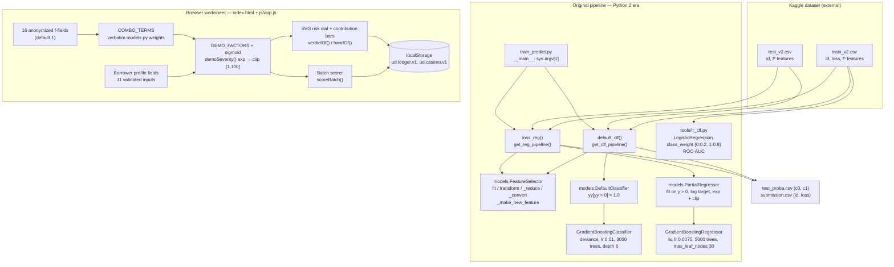
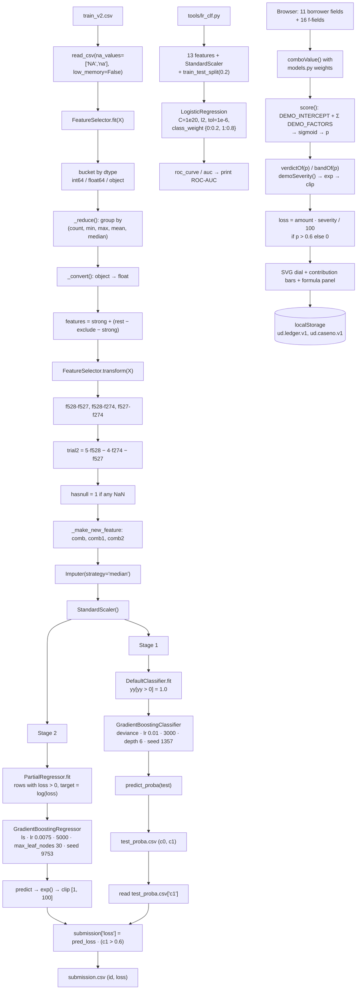

# Project Overview — Underwriting Desk

Folder id: `loan-default-prediction` · Runtime surface: a Python 2-era command-line pipeline (`train_predict.py`) + a static browser worksheet (`index.html`).

## Project Summary

| Field | Value |
|---|---|
| Display name | Underwriting Desk (browser title: *Underwriting Desk — Loan Default Prediction (demo worksheet)*) |
| Repository id | `loan-default-prediction` |
| Upstream | <https://github.com/songgc/loan-default-prediction> — stated in the upstream README to have won the Kaggle *Loan Default Prediction* competition |
| Problem | Lending decisions need two answers at once — *will this borrower default?* and *how much will we lose if they do?* A single regressor on a heavily zero-inflated target answers neither well. |
| Objective | Split the problem into a default **probability** and a loss **severity**, then apply severity only when the probability crosses a threshold, producing a submission-shaped `id, loss` file. |
| Users | The original competitor; today, a student or engineer studying the two-stage decomposition, and an underwriter exploring the scorecard mechanics through the browser worksheet. |
| Expected output | `submission.csv` with columns `id` and `loss` (plus the intermediate `test_proba.csv` with `c0`/`c1`). |
| ML technique | Gradient-boosted trees: `GradientBoostingClassifier` for the binarised default target, `GradientBoostingRegressor` in log space for severity on positive-loss rows only, combined by a hard `P(default) > 0.6` cut. A `LogisticRegression` baseline with `class_weight` provides a comparable ROC-AUC. |

## Problem Statement

The competition target `loss` is a severity in `[1, 100]` and is **exactly zero for the large majority of rows**. Two things follow.

1. **The target is not a clean binary.** "Did they default?" and "how much?" are different questions, and a single model forced to answer both spends its capacity on a distribution that is mostly zeros.
2. **Naive regression is a bad fit.** A gradient-boosted regressor trained on the raw target spends most of its splits distinguishing "zero" from "non-zero" and then predicts a near-constant severity for everybody who did default — which is exactly the information a lender needs and does not get.

The original solution therefore **decomposes** the problem: estimate a probability of default, estimate a severity conditional on default, and gate the second with the first.

The repository is a 2015-era Kaggle artifact. It is valuable as a model of the decomposition and of hand-engineered feature design, but it does not run unmodified on a current interpreter, and it ships no data and no weights.

## Proposed Solution

**Stage 1 — default probability (`default_clf`)**

`models.DefaultClassifier` converts the continuous target into a binary one (`yy[yy > 0] = 1.0`) and hands it to a `GradientBoostingClassifier(loss='deviance', learning_rate=0.01, n_estimators=3000, subsample=0.6, min_samples_split=12, min_samples_leaf=12, max_depth=6, random_state=1357)`. `pipeline.predict_proba(test)` produces `test_proba.csv` with columns `c0` and `c1`; `c1` is `P(default)`.

**Stage 2 — severity (`loss_reg`)**

`models.PartialRegressor` is fitted **only on the rows where `loss > 0`**, on a `log(loss)` target, with a `GradientBoostingRegressor(loss='ls', learning_rate=0.0075, n_estimators=5000, subsample=0.5, min_samples_split=20, min_samples_leaf=20, max_leaf_nodes=30, random_state=9753)`. At prediction time the log-output is exponentiated and clipped to `[1, 100]`.

**The gate**

```python
submission['loss'] = pred_loss * (prob_default_test.values > 0.6)
```

Severity is paid out only above a `0.6` default probability. Below the cut the borrower pays nothing, which is why the submission column is zero for the majority of rows.

**Feature engineering (`models.FeatureSelector`)**

Before either stage sees the data, `FeatureSelector.transform` synthesises:

| Feature | Definition | Purpose |
|---|---|---|
| `f528-f527` | `f528 − f527` | difference between two raw measurements |
| `f528-f274` | `f528 − f274` | difference |
| `f527-f274` | `f527 − f274` | difference |
| `trial2` | `5·f528 − 4·f274 − f527` | a hand-weighted linear projection |
| `hasnull` | `1` if the row contains any NaN, else `0` | missingness as a signal in its own right |
| `comb` | `8.9039·(f528-f527) + 2.9559·(f528-f274) − 2.6462·(f527-f274) − 0.0391·hasnull − 7.3605·f271 + 1.9536·f2` | 6-term combination |
| `comb1` | 13-term combination (adds `f332, f776, f336, f777, f4, f5, f647`) | wider combination |
| `comb2` | 17-term combination (adds `f67, f670, f598, f596`) | widest combination |

`FeatureSelector.fit` additionally triages the raw columns by dtype, collapses statistically identical columns through `_reduce` (grouping on `(count, min, max, mean, median)`), coerces object columns to float via `_convert`, and finally orders the feature set as *`strong` first, then everything not in the ~300-entry `exclude` tail list*.

**The browser worksheet** reuses the three combination coefficient vectors **verbatim** and then applies a transparent, hand-authored scorecard on top of them. It is a teaching/demo surface, not the model.

## Features and Capabilities

### Existing (verified in the source)

| Capability | Implementation |
|---|---|
| Two-stage pipeline | `train_predict.py`: `get_clf_pipeline()`, `get_reg_pipeline()`, `default_clf()`, `loss_reg()`, `__main__` block taking `sys.argv[1]` |
| Feature engineering | `models.FeatureSelector.fit/transform/fit_transform`, `_reduce()`, `_convert()`, `_make_new_feature()` |
| Binarised target wrapper | `models.DefaultClassifier.fit/predict/predict_proba` |
| Positive-only log-space severity | `models.PartialRegressor.fit/predict` (fit on `y > 0`, `log` target, `exp` + clip to `[1, 100]`) |
| Probability output | `test_proba.csv` with `c0`, `c1` |
| Submission output | `submission.csv` with `id`, `loss`; severity gated at `0.6` |
| Imputation and scaling | `Imputer(strategy='median')` → `StandardScaler()` inside both pipelines |
| Logistic baseline | `tools/lr_clf.py`: `LogisticRegression(C=1e20, penalty='l2', tol=1e-6, class_weight={0: 0.2, 1: 0.8})`, `roc_curve`/`auc`, prints the coefficient vector |
| Browser scorecard | `js/app.js`: `COMBO_TERMS` (verbatim `models.py` weights), `DEMO_FACTORS` (15 weighted terms), `DEMO_INTERCEPT = -1.6`, `sigmoid()`, `demoSeverity()`, `verdictOf()`, `bandOf()`, `LOSS_CUT = 0.6` |
| Risk dial and contributions | `buildDial()`, `polar()`, `arcPath()`, per-factor contribution bars (red = towards default, green = protective) |
| Batch scoring | `scoreBatch()` over pasted `test_v2`-style rows, formatted like the submission file |
| Decision ledger | `localStorage` keys `ud.ledger.v1` (decisions) and `ud.caseno.v1` (case counter, `UD-000001` format) |
| Formula transparency | The "Show formula" panel prints every term, its weight and its contribution |

### Future / not present

- **A working modern port** — the source is Python 2 era and needs the seven concrete edits listed in the README.
- **A trained artefact** — no pickled model, no booster file, no inference-only path.
- **A server** — no Flask/FastAPI/Django app, no REST layer, no way for the worksheet to request a real score.
- **Model explainability** — no SHAP, no permutation importance, no feature-importance report; only the hand-built coefficient combinations.
- **Calibration analysis** — the `0.6` cut is asserted, not derived; no reliability curve, no cost matrix.
- **Alternative resampling** — no SMOTE, no `imblearn`, no undersampling anywhere in the tree.
- **A different learner** — `project-metadata.json` claims XGBoost, but the repository uses scikit-learn's gradient boosting exclusively.
- **Streaming / batch monitoring, model registry, experiment tracking** — none of it.

## System Architecture

Real components only — there is no web server in this project.



**Boundary note.** The dashed separation is real: the worksheet shares *coefficients* with the original model and nothing else. Its probability, its severity and its verdict are produced by a different, hand-authored formula that the page prints in full.

## Complete Project Workflow

**Original pipeline (after porting)**

1. **User** places `train_v2.csv` and `test_v2.csv` in one folder and runs `python train_predict.py <folder>`.
2. **Path resolution** — `__main__` joins the argument with the two hard-coded file names.
3. **Read** — `read_csv = partial(pd.read_csv, na_values=['NA','na'], low_memory=False)` loads both files; `low_memory=False` forces consistent dtype inference across the many `f*` columns.
4. **Feature selection** — `FeatureSelector.fit(train)` triages the columns by dtype, reduces duplicates, converts object columns to float, and fixes the final ordered feature list.
5. **Transformation** — `transform` adds the five derived features and the three weighted combinations, then returns `data[self.features].astype(np.float).values` — a dense numpy array.
6. **Impute and scale** — `Imputer(strategy='median')` fills the remaining NaNs (median, so the `hasnull` flag retains the information that a value was missing), then `StandardScaler` standardises the columns.
7. **Stage 1** — `DefaultClassifier.fit` binarises the target and the gradient-boosting classifier fits; `predict_proba(test)` yields `c0`/`c1`, written to `test_proba.csv`.
8. **Stage 2** — `PartialRegressor.fit` keeps only `loss > 0` rows, takes `log(loss)` as the target and fits the gradient-boosting regressor; `predict` exponentiates and clips to `[1, 100]`.
9. **Gate and emit** — `loss_reg` re-reads `test_proba.csv`, multiplies the severity by the `0.6` indicator and writes `submission.csv` with `id` and `loss`.
10. **Error handling** — there is essentially none. Missing columns raise `KeyError`; a missing file raises `FileNotFoundError`; the only guard is the `try/except` around the model read in the browser (there is none here). The `__main__` block prints progress lines — which is exactly what the Python 2 `print` statements break.

**Browser worksheet path**

1. Serve the folder over HTTP and open the page; a boot overlay runs and is force-removed after 2.5 s so the user is never trapped.
2. **Validation** — each of the 11 borrower fields has a min/max range and a default; a numeric field recomputes on blur and on input.
3. **Feature values** — the 16 anonymized `f*` inputs default to `1` and can be reset with **Reset f-fields**.
4. **Combination evaluation** — `comboValue('comb'|'comb1'|'comb2', fv, hasnull)` multiplies each term by the verbatim `models.py` weight; the result is compressed with `tanh(x/40)` and scaled by the per-combo **blend weight** sliders.
5. **Scoring** — `score()` accumulates `DEMO_INTERCEPT` plus the 15 weighted `DEMO_FACTORS` into a logit, applies `sigmoid`, and derives the verdict and band.
6. **Severity** — `demoSeverity()` computes `exp(0.85 + 1.9·p + 0.4·(dti/50) + 0.35·late90 + 0.25·derog)` clipped to `[1, 100]`, mirroring `PartialRegressor`'s `exp` + clip.
7. **Loss** — `loss = amount × severity / 100` if `p > 0.6`, otherwise `0` — the same gate the original uses.
8. **Rendering** — the dial needle animates to `p`, the `0.60` cut marker is drawn on the arc, the contribution bars are coloured by sign, and the formula panel lists each term.
9. **Persistence** — decisions and the case counter are stored in `localStorage`; a failure to write surfaces as *"Could not persist (localStorage blocked in this browser)"*.
10. **Batch** — `scoreBatch()` scores pasted rows with the same heuristic and formats them like the submission file; `Ctrl+Enter` triggers it.

## Machine Learning or Algorithm Explanation

### 1. The two-stage decomposition

Let `Y` be the observed loss, `1{Y > 0}` the default indicator, and `S = Y · 1{Y > 0}` the severity paid on default.

The pipeline models:

- `P(default) ≈ f₁(X)` — a binary gradient-boosting classifier.
- `E[S | X] ≈ f₂(X)` — a severity regressor trained **only** on defaulted rows.

The final expectation used for scoring is `E[Y|X] ≈ f₂(X) · 1{f₁(X) > 0.6}`.

This is a hard-threshold approximation of `E[S|X] · P(default|X]`. It is not a probability-consistent product — severity is either fully applied or not applied at all — but it is exactly the quantity the competition wanted, and it is far more stable than regressing the zero-inflated target directly, because `f₂` never wastes capacity learning "this row is zero".

The `0.6` cut is a business decision encoded as a constant. Rows at or below the cut get `loss = 0` regardless of how large `f₂` says the severity would be.

### 2. Gradient boosting, and why these hyper-parameters

`GradientBoostingClassifier` and `GradientBoostingRegressor` build an additive ensemble `F_M(x) = F₀ + Σₘ γₘ·hₘ(x)`, fitting each new tree `hₘ` to the negative gradient of the loss.

- **Shallow trees** (`max_depth=6` for the classifier, `max_leaf_nodes=30` for the regressor) with **high `min_samples_leaf` (12 / 20)** — classic regularisation for a wide, low-signal tabular dataset with hundreds of anonymised columns.
- **Very low learning rates** (`0.01` and `0.0075`) with **very many trees** (3,000 and 5,000) — the "slow learning, many steps" recipe. It trades compute time for a smoother, lower-variance fit.
- **`subsample` 0.6 / 0.5** — row subsampling at every iteration for stochastic gradient boosting, which regularises further and makes each tree see a different sample.
- **`loss='deviance'`** on the classifier: the historical name for the logistic loss; sklearn ≥ 1.1 renamed it to `'log_loss'`, so a modern port needs that rename too.
- **`random_state` 1357 / 9753** — fixed seeds, so the run is reproducible.
- **The regressor is `loss='ls'`** (least squares) on `log(loss)`, which turns a skewed, right-heavy severity distribution into something closer to symmetric and makes the exponentiated predictions strictly positive.

### 3. Why log-space severity and clipping

`PartialRegressor.fit` sets `yy = np.log(yy)` for `yy = y[y > 0]`, and `predict` applies `np.exp` and then clips to `[1, 100]`. The log transform means the model fits *relative* errors multiplicatively — a severity of 10 is penalised proportionally more than a severity of 100 — which matches how loss magnitudes behave. The clip guarantees the output stays inside the target's declared range even where the boosted trees extrapolate.

### 4. Handling class imbalance — without SMOTE

There is **no SMOTE, no `imblearn`, no resampling of any kind** in the repository. Two different mechanisms do the work:

- In the **production pipeline**, imbalance is structural: stage 1 is a binary classification with `loss='deviance'` (log loss, which is already imbalance-aware through the log), and stage 2 simply never sees the majority class because it is fitted on `loss > 0` rows only.
- In the **baseline** (`tools/lr_clf.py`), imbalance is handled explicitly by `class_weight={0: 0.2, 1: 0.8}` — the minority (default) class receives 4× the weight of the majority. Note this is an unusual orientation (the *default* class is up-weighted), which matches the task: the point of the model is to catch defaults.

### 5. Feature design

`FeatureSelector` is doing two very different things:

- **Dimensional triage** — `_reduce` groups columns by the tuple `(non-null count, min, max, mean, median)` and keeps one representative per group. On a dataset with hundreds of derived `f*` columns this collapses statistically identical variables automatically.
- **Hand-crafted combination features** — the three `comb*` vectors are linear projections with weights that look like they were fitted or heavily hand-tuned offline. `comb2` reaches 17 terms. The `trial2` feature (`5·f528 − 4·f274 − f527`) is the same idea in a single hand-written expression.

`hasnull` deserves a note: the pipeline imputes missing values with the **median** (so the model still has a usable number) while separately giving the model a binary flag saying "this row had a gap". That is a deliberate separation of *value* from *presence*.

### 6. The browser heuristic (and why it is not the model)

`js/app.js` scores a case as `sigmoid(DEMO_INTERCEPT + Σ wᵢ·xᵢ)` with `DEMO_INTERCEPT = -1.6` and 15 `DEMO_FACTORS` covering DTI, delinquency counts, derogatory reports, credit lines, APR, term, amount, age, income, missingness, and the three `comb` projections (compressed by `tanh(x/40)` and scaled by the blend sliders). The weights are hand-authored for illustration; they were not fitted to any data. The severity formula mirrors `PartialRegressor`'s `exp` + clip, and the `0.6` gate mirrors `train_predict.py` — but the probability is a different function entirely.

## File-by-File Code Guide

| File | Key symbols | Role |
|---|---|---|
| `train_predict.py` | `read_csv` (partial), `get_clf_pipeline()`, `get_reg_pipeline()`, `default_clf(train_file, test_file, path)`, `loss_reg(train_file, test_file, path)`, `__main__` block | The pipeline entry point: stage 1 → `test_proba.csv`, stage 2 → `submission.csv` |
| `models.py` | `FeatureSelector` (`strong`, `tail_feature_300`, `exclude`, `fit`, `transform`, `fit_transform`, `_reduce`, `_convert`, `_make_new_feature`); `DefaultClassifier` (`fit`, `predict`, `predict_proba`); `PartialRegressor` (`fit`, `predict`) | Feature engineering and the two estimator wrappers |
| `tools/lr_clf.py` | `LogisticRegression(C=1e20, penalty='l2', tol=1e-6, class_weight={0:0.2, 1:0.8})`, `train_test_split(test_size=0.2)`, `roc_curve`, `auc` | A 13-feature logistic baseline; prints the coefficient vector and the ROC-AUC |
| `index.html` | markup for the borrower form, 16 f-fields, dial, contributions, formula panel, batch tab, ledger, and the "Legacy Python 2 pipeline" panel | Browser worksheet |
| `js/app.js` | `LOSS_CUT`, `COMBO_TERMS`, `DEMO_INTERCEPT`, `DEMO_FACTORS`, `FIELDS`, `F_FIELD_IDS`, `STORE_KEYS`, `demoSeverity()`, `verdictOf()`, `bandOf()`, `comboValue()`, `termValue()`, `buildContext()`, `score()`, `buildDial()`, `polar()`, `arcPath()`, `recompute()`, `scoreBatch()`, `storeGet()`/`storeSet()` | The demo scorecard, the SVG dial, batch scoring and localStorage persistence |
| `css/style.css` | stylesheet | Browser UI styling |
| `README.md` | — | Upstream README: description, dependency pins, 4-step "how to run" |
| `LICENSE` | — | MIT, © 2014 Guocong Song |
| `project-metadata.json` | — | Catalog metadata; the `stack` field (`XGBoost`, `Streamlit`) and the `entry` field are both wrong |
| `.gitignore` | — | Python build artefacts; no data exclusion, because the data was never committed |

## Data Flow



## Example Execution

Illustrative walkthrough. The numbers are representative of the code's behaviour, not recorded telemetry.

**Scenario:** score one loan application with the original pipeline.

1. `train_v2.csv` and `test_v2.csv` are in `D:\kaggle\loan-default\`.
2. `python train_predict.py D:\kaggle\loan-default` prints the two resolved paths and starts stage 1.
3. `FeatureSelector.fit` sees the anonymised `f*` columns, drops the duplicate groups and fixes the ordered feature list; `transform` adds the five derived features and the three `comb*` projections.
4. `DefaultClassifier` binarises the target; the classifier trains 3,000 trees at `lr = 0.01`.
5. `test_proba.csv` is written:

   ```csv
   c0,c1
   0.912047,0.087953
   0.210331,0.789669
   0.640218,0.359782
   ```

   *(illustrative values — the second row is a predicted defaulter)*
6. `PartialRegressor` trains on the defaulted rows only, in log space.
7. `submission.csv` is written:

   | id | loss |
   |---|---|
   | `1` | `0` (P(default) = 0.088 ≤ 0.6) |
   | `2` | `18.42` (P(default) = 0.790 > 0.6, severity ≈ 18.4) |
   | `3` | `0` (P(default) = 0.360 ≤ 0.6) |

   *(illustrative row — the real severity comes from the boosted regressor)*
8. The baseline `tools/lr_clf.py` on the same 13 features prints its coefficient vector and an ROC-AUC figure for comparison with the boosted model.

**Browser worksheet:** open the page, enter amount `45000`, term `60`, rate `18.5`, age `27`, income `38000`, DTI `52`, lines `14`, derogatory `2`, late-30 `4`, late-60 `2`, late-90 `1`.

- The eleven non-combination factors sum to ≈ **8.354**: DTI `2.20 × 52/50 = 2.288`, late-90 `0.85 × 1 = 0.85`, late-60 `0.55 × 2 = 1.10`, late-30 `0.28 × 4 = 1.12`, derogatory `0.60 × 2 = 1.20`, credit lines `0.28 × 14/12 = 0.327`, APR `1.20 × 18.5/30 = 0.74`, term `0.55 × (60−12)/48 = 0.55`, amount `0.75 × 45000/60000 = 0.563`, age `−0.55 × (27−21)/40 = −0.083`, income `−0.95 × 38000/120000 = −0.301`, missingness `0`.
- With the f-fields left at their default of `1` and the blend sliders at `100 %`, the three combination terms add `0.45 × tanh(−5.407/40) = −0.060`, `0.35 × tanh(−8.390/40) = −0.072` and `0.30 × tanh(−7.933/40) = −0.059`.
- Logit ≈ `−1.6 + 8.354 − 0.060 − 0.072 − 0.059 = 6.562` → `p = sigmoid(6.562) ≈ 0.999`.
- `demoSeverity()`: `exp(0.85 + 1.9 × 0.999 + 0.4 × 52/50 + 0.35 × 1 + 0.25 × 2) = exp(4.013) ≈ 55.3`, clipped to `[1, 100]`.
- Verdict: **decline**, band **D**, the `0.60` marker sits below the needle, and since `p > 0.6` the demo loss is applied: `45000 × 55.3 / 100 ≈ 24,880` instead of `0`.

  *(illustrative — the exact p depends on the f-field values and the blend sliders)*

## Dependencies and External Services

| Dependency | Why it matters |
|---|---|
| pandas | Reading the two CSVs with `na_values=['NA','na']` and `low_memory=False`; the `id`/`loss` columns; the `DataFrame` that holds the feature matrix. The upstream README pins **0.13.1 or later**; the code actually needs `iteritems()` (removed in pandas 2.0) and pre-copy-on-write assignment semantics. |
| NumPy | `np.array(...)` for the label arrays, `np.zeros`/`np.isnull` for `hasnull`, `np.log`/`np.exp` for the severity transform, `np.float` for the output cast. |
| scikit-learn | `GradientBoostingClassifier`, `GradientBoostingRegressor`, `LogisticRegression`, `Pipeline`, `StandardScaler`, `Imputer`, `train_test_split`, `roc_curve`, `auc`, `cosine`… (not used here). The upstream README asks for the dev branch at commit `884889a4` (2015). |
| The Kaggle dataset | `train_v2.csv` and `test_v2.csv` with the anonymised `f*` columns. Not redistributable; you need a Kaggle account and to accept the competition rules. |
| Google Fonts (browser) | The page loads a monospace/serif pair from `fonts.googleapis.com` — cosmetic only. |
| Node.js | Not required. The worksheet is static files with no build step. |
| GPU | Not required. `GradientBoosting*` is CPU-only scikit-learn. |

No API keys, no cloud services, no external model downloads, no database.

## Current Limitations and Future Improvements

**Current limitations**

- **The code does not execute on modern Python.** Seven concrete breakages, all verified in the source:
  1. `train_predict.py` lines 76, 77, 78 and 80 — Python 2 `print` statements → `SyntaxError`.
  2. `tools/lr_clf.py` line 41 — `print list(clf.coef_[0])` → `SyntaxError`.
  3. `train_predict.py` line 9 — `from sklearn.preprocessing import ... Imputer` → removed in scikit-learn 0.22.
  4. `tools/lr_clf.py` line 4 — `from sklearn.cross_validation import ...` → removed in scikit-learn 0.20.
  5. `models.py` line 70 — `np.float` → removed in NumPy 1.24.
  6. `models.py` line 28 — `dtypes.iteritems()` → removed in pandas 2.0.
  7. `models.py` line 54 and `tools/lr_clf.py` line 20 — chained assignment `data['hasnull'][mask] = 1` → no longer propagates under pandas copy-on-write.
  Plus a naming change: `loss='deviance'` became `loss='log_loss'` in scikit-learn 1.1.
- **The dataset is not in the repository** and cannot be redistributed.
- **No model artefacts** — no pickled estimator, no saved booster; every run retrains 3,000 + 5,000 trees, so inference-only use is impossible.
- **No HTTP API and no server**; the browser worksheet is a static, hand-authored heuristic.
- **No SMOTE / no resampling** — imbalance is addressed only by `class_weight` and by the two-stage split.
- **No tests, no CI, no `requirements.txt`, no formatting or linting configuration.**
- **`project-metadata.json` is wrong** about both the stack (`XGBoost`, `Streamlit`) and the entry point (`models.py` instead of `train_predict.py`); the browser page calls this out explicitly.
- **The `0.6` threshold is uncalibrated** and unexplained in the repository.
- **Feature semantics are unknowable** — the anonymised `f*` names make the model impossible to explain to an underwriter or to audit against a regulation.
- **Heavy compute**: 8,000 boosting trees over hundreds of columns, trained twice, on every invocation.
- **No monitoring, no drift detection, no model registry.**

**Future improvements**

- **Port the pipeline** to current libraries (`SimpleImputer`, `sklearn.model_selection`, `np.float64`, `.items()`, `.loc` assignment, `loss='log_loss'`) and add a `requirements.txt` with the working pins.
- **Ship a fitted artefact** — persist both stages with `joblib` and add an inference-only CLI that scores a single application in under a second.
- **Expose a real service** — a small Flask/FastAPI wrapper around the fitted pipeline (`POST /score`) so the worksheet can request genuine probabilities instead of approximating them, keeping the current offline fallback.
- **Calibrate the decision threshold** from a business cost matrix (a false positive costs a customer, a false negative costs the principal) rather than asserting `0.6`.
- **Add explainability** — permutation importance or SHAP over the `comb*` features, and a reason-code list per decision.
- **Modernise the learner** — `HistGradientBoosting*` for speed, or a properly validated LightGBM/XGBoost, and benchmark against the historical numbers.
- **Revisit the imbalance strategy** — compare `class_weight` against SMOTE/undersampling on the same features and record the trade-off.
- **Add tests** for `FeatureSelector.transform` (the derived-feature algebra), `DefaultClassifier` binarisation and `PartialRegressor` clipping — all three are pure functions and easy to pin down.
- **Remove the misleading metadata** and record the real dependency floor in the repository.

## Learning Outcomes

By working through this repository you should be able to:

1. **Decompose a compound target** — why a zero-inflated severity target is better modelled as *probability × severity* than as one regression, and what a hard threshold buys and costs.
2. **Work with zero-inflated data** — fitting a regressor only on the non-zero rows, in log space, and clipping predictions back into the target's range.
3. **Read a gradient-boosting configuration critically** — learning rate, tree count, depth, `min_samples_leaf`, row subsampling, and the classic slow-learning / many-trees trade-off.
4. **Design features deliberately** — hand-built difference and projection features, a *missingness* indicator kept separate from the imputed value, and the purpose of collapsing statistically identical columns.
5. **Handle imbalance without resampling** — what `class_weight={0: 0.2, 1: 0.8}` really does, and why a two-stage decomposition removes the need for SMOTE in this problem.
6. **Audit historical code against modern libraries** — the exact list of removed APIs (`Imputer`, `cross_validation`, `np.float`, `iteritems`, chained assignment) and the minimal patch set that brings a 2015 pipeline back to life.
7. **Separate a demo from a model** — why a scorecard that reuses real coefficients but a hand-authored score is still not a model, and how to label it honestly in the product.
8. **Read the documentation as a signal** — how the upstream README's "got the prize" claim and the metadata's wrong stack tell you what to verify before trusting a repository.
9. **Think about production gaps** — the absence of tests, of a model registry, of calibration, of drift monitoring and of an inference path; and why "it ran once on a Kaggle notebook" is not a deployment.
