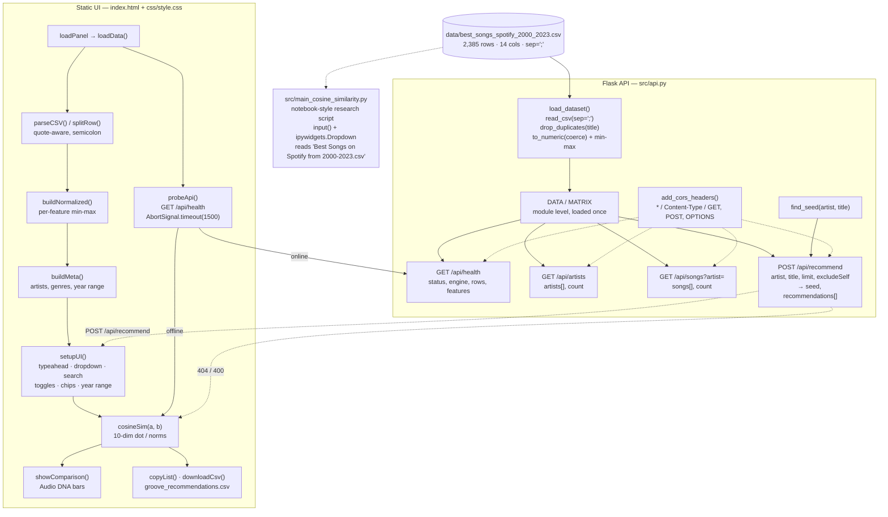
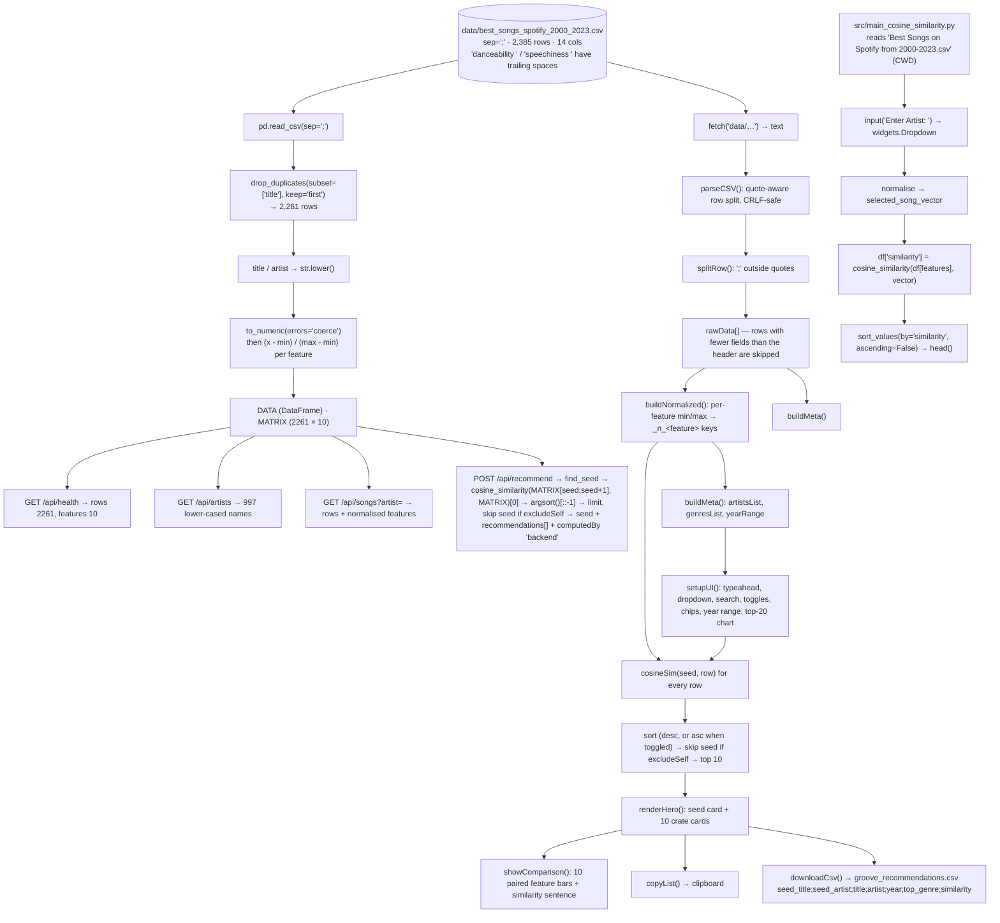

# Project Overview — Groove Observatory

Folder id: `music-recommender-from-audio-features` · Runtime surfaces: a Flask API (`src/api.py`), a static browser app (`index.html` + `js/app.js`), and the original notebook-style research script (`src/main_cosine_similarity.py`).

## Project Summary

| Field | Value |
|---|---|
| Display name | Groove Observatory — "Retro record-crate recommender · cosine similarity over audio DNA" |
| Repository id | `music-recommender-from-audio-features` |
| Upstream | <https://github.com/edenmhuang/Music-Recommender> — Eden Huang, Skyline College research project, 2023; peer-reviewed by Prof. Bryan Swartout; write-up on Medium |
| Problem | Recommending music normally needs user behaviour (plays, skips, likes). This project asks whether **acoustic similarity alone** is enough: if two songs share tempo, energy and danceability, are they similar? |
| Objective | Take one track, compute its similarity to the rest of a Spotify-feature catalogue, and return the closest matches — as a ranked, explainable, per-feature comparison. |
| Users | A listener browsing a "record crate" and asking "what sounds like this?"; a student learning content-based recommendation; a researcher evaluating cosine similarity outside NLP. |
| Expected output | A ranked list of 10 tracks with similarity scores, a per-feature breakdown (Audio DNA), and an exportable CSV. Via the API: a JSON payload with `seed`, `recommendations[]`, `engine` and `computedBy`. |
| ML technique | **Content-based filtering with cosine similarity** over 10 min-max-normalised audio features. No training, no learned parameters, no evaluation metrics — a closed-form geometric method. |

## Problem Statement

Collaborative filtering dominates music recommendation, but it needs a history: what you played, skipped, liked, and how often. Cold-start users have none of that, and a catalogue that has never been played has none either.

**Content-based filtering** inverts the problem: describe the *item* and compare items to each other. If a track's acoustic profile is a point in a 10-dimensional space, then "sounds like" is a geometric question — and geometry has a closed form.

The upstream research question was specifically: *can cosine similarity — a text technique — be reused for music audio features?* The intuition is that acoustic descriptors (tempo, energy, valence, …) behave like sparse text vectors: they are non-negative, bounded, and dominated by a few large components. Cosine similarity is well suited to that shape, because it normalises by vector magnitude and therefore compares *profiles* rather than *levels*.

The honest framing, which the code reflects, is that this is a **baseline**. It is explainable (every recommendation decomposes into ten feature comparisons), instant, and dependency-free — but it has no notion of taste, and "similar" in feature space is only loosely the same as "similar" to a human ear.

## Proposed Solution

**The algorithm, in four steps** (identical in `src/main_cosine_similarity.py`, `src/api.py` and `js/app.js`):

1. **Load** the catalogue — a semicolon-separated CSV with quoted fields, 2,385 rows and 14 columns.
2. **De-duplicate** on `title` (`keep="first"`), then lower-case `title` and `artist` so all lookups are case-insensitive.
3. **Min-max normalise** each of the ten acoustic features over the whole dataset: `(x - min) / (max - min)`, mapping every feature to `[0, 1]`.
4. **Score** every row against the seed with cosine similarity, sort descending, and return the top *N*.

**The feature vector** — the same ten names in all three implementations, with the trailing spaces preserved exactly as they appear in the CSV header:

```
['bpm', 'energy', 'danceability ', 'dB', 'liveness', 'valence',
 'duration', 'acousticness', 'speechiness ', 'popularity']
```

**Two execution surfaces, one algorithm.**

- The **Flask API** loads and normalises the catalogue **once at import time** (`DATA` and `MATRIX` are module-level), then answers each request with a single `cosine_similarity(MATRIX[seed:seed+1], MATRIX)` call.
- The **browser app** parses the same CSV with a hand-written `parseCSV()`/`splitRow()` pair (quote-aware, `\r\n`-safe), normalises with `buildNormalized()`, and computes similarity with a hand-written `cosineSim()` over the same ten features. It needs no Python at all.

**Graceful degradation** — `probeApi()` calls `GET /api/health` with a 1.5 s timeout. If the response is not `{status: "ok"}`, `apiMode` stays `false` and the page computes everything locally. If a later `POST /api/recommend` fails, the app also drops to the local engine and rewrites the badge to *"browser cosine engine (backend unreachable)"*. The user always gets an answer, and the badge always says where it came from.

**Explainability as a first-class feature** — the "Audio DNA Comparison" panel renders the seed and the match as paired bars for all ten features, so a recommendation is not just a number but a set of reasons.

## Features and Capabilities

### Existing (verified in the source)

| Capability | Implementation |
|---|---|
| Cosine recommender (backend) | `src/api.py` → `cosine_similarity(MATRIX[seed_idx:seed_idx+1], MATRIX)[0]`, `sims.argsort()[::-1]` |
| Cosine recommender (browser) | `js/app.js` → `cosineSim(a, b)` — dot product over the ten normalised features, divided by the two norms |
| Min-max normalisation | `src/api.py` → `load_dataset()`; `js/app.js` → `buildNormalized()`; `src/main_cosine_similarity.py` → the `for feature in acoustic_features` loop |
| De-duplication and case folding | `drop_duplicates(subset=["title"], keep="first")` + `str.lower()` on `title`/`artist` in all three implementations |
| Quote-aware CSV parsing in the browser | `js/app.js` → `parseCSV()` (escaped `""` handling) and `splitRow()` (semicolon splitting outside quotes) |
| Artist typeahead | `js/app.js` → `artistInput` listener, `artistsList.filter(...).slice(0, 12)` |
| Song dropdown + search | `js/app.js` → `populateSongs()`, `populateSongSelect()`, `songSearch` listener |
| Seed lookup | `src/api.py` → `find_seed()`; `js/app.js` → `findSeed()` (artist + title, case-insensitive) |
| Exclude-self and ascending-sort toggles | `excludeSelfToggle`, `sortToggle` → `recompute()` |
| Audio DNA comparison | `js/app.js` → `showComparison()`, `dnaChart`, `getMaxRaw()` |
| Genre chips + year range | `js/app.js` → `buildMeta()`, `applyFilters()`, `buildArtistBarChart()` (top 20 artists) |
| Export | `js/app.js` → `copyList()` (clipboard), `downloadCsv()` → `groove_recommendations.csv` |
| Featured example shortcut | `index.html` → `featuredBtn` — *Flowers → The Climb (≈0.996)*, shown only if both rows exist |
| Engine transparency | `datasetBadge` + `loadStatus` show the active engine and the row/feature counts |
| Error surfacing | Load failure shows a *Retry* button and the `python -m http.server 8000` hint; API failures fall back and update the badge |
| HTML escaping | `js/app.js` → `escapeHtml()` for every interpolated title/artist/genre |

### Future / not present

- **No learned model of any kind** — no embeddings, no matrix factorisation, no fine-tuned encoder, no training loop.
- **No collaborative filtering and no user model** — there is no place to store a taste profile, because the system never asks for one.
- **No offline evaluation.** There is no train/test split, no precision@k, no hit-rate, no A/B harness. The only "evaluation" in the repository is the single anecdotal pair in the upstream README.
- **No feature weighting.** All ten dimensions contribute equally to the cosine; there is no learned or hand-tuned weight per dimension.
- **No genre or artist-level abstraction.** The features are per-track only; the "top genre" label is carried through to the UI but never enters the similarity.
- **No audio.** Despite the name, the system works from pre-computed Spotify descriptors — it never touches a waveform, and there is no `librosa` import anywhere in the tree (the metadata's stack line is wrong).
- **No clustering.** The metadata's goal line says "cluster songs"; no clustering algorithm exists in the code.
- **No scale.** A 2,385-row catalogue is scanned in full on every request — fine now, linear later.
- **No server-side search, pagination, caching, rate limiting or auth.**
- **No tests.** The `tests/` folder holds print-only scratch scripts with no assertions.
- **No live catalogue ingestion** — the CSV is a static snapshot; there is no Spotify Web API client.

## System Architecture

Real components only. There is no database, no model server and no queue.



**The key boundary**: the browser and the API compute the *same* similarity from *almost* the same matrix. The API de-duplicates on `title` (2,261 rows); the browser does not (2,385 rows). Different min/max bounds, therefore marginally different percentages — the architecture is duplicated by necessity, because the browser app is designed to work with the backend completely absent.

## Complete Project Workflow

**A. Backend startup**

1. `python src\api.py` → Flask binds `127.0.0.1:5000` with `debug=False`.
2. At import time `load_dataset()` reads the CSV with `pd.read_csv(CSV_PATH, sep=";")`, drops duplicate titles, lower-cases `title`/`artist`, coerces the ten features with `pd.to_numeric(errors="coerce")` and min-max scales each one.
3. The result is frozen into the module-level `DATA` (DataFrame) and `MATRIX` (2,261 × 10 numpy array). No per-request I/O, no per-request parsing.
4. The `after_request` hook attaches the three CORS headers to every response.

**B. Browser startup**

1. `python -m http.server 8000` → the browser loads `index.html`, `css/style.css`, `js/app.js` and the Google Fonts.
2. `loadData()` runs: it first probes the API (1.5 s timeout) and sets the load message accordingly, then `fetch('data/best_songs_spotify_2000_2023.csv')`.
3. `parseCSV()` splits the text into rows (quote-aware) and `splitRow()` splits each row on `;` outside quotes. Rows with fewer fields than the header are skipped; an empty result throws `'Empty dataset'`.
4. `buildNormalized()` computes per-feature min and max over the raw rows and stores each row's scaled values under `_n_<feature>` keys; `buildMeta()` collects the artist set, the genre set and the year range.
5. The load panel is hidden, the app root is revealed, the badge and status are written, and `setupUI()` wires every control.

**C. User interaction → recommendation**

1. The user types an artist; the typeahead shows up to 12 matches; clicking one calls `populateSongs(artist)`, which filters the raw rows by exact (case-insensitive) artist equality and fills the dropdown with `title (year)`.
2. Choosing a song calls `findSeed(artist, title)` and then `computeRecommendations(seed)`.
3. **Backend mode:** `POST /api/recommend` with `{artist, title, limit: 10, excludeSelf}`. The API locates the seed row, computes `cosine_similarity(MATRIX[seed:seed+1], MATRIX)[0]`, sorts descending, skips the seed if `excludeSelf`, takes the first `limit` rows, and returns `seed`, `recommendations[]` (each with `similarity` rounded to 6 dp), `engine` and `computedBy: "backend"`.
4. **Browser mode:** `cosineSim(seed, row)` is evaluated for every row in the normalised array, the seed is skipped when the toggle is on, the list is sorted (descending, or ascending when *Sort ascending* is checked) and the first 10 are kept.
5. `renderHero()` paints the seed card (vinyl disc tinted by valence hue and energy saturation) and one card per recommendation, each with a similarity percentage and bar.
6. Clicking a card opens the comparison panel; `showComparison()` writes the similarity sentence and renders the ten paired feature bars.
7. `copyList()` and `downloadCsv()` export the current ten results.

**D. Error handling**

| Failure | Behaviour |
|---|---|
| API not running | `probeApi()` catches the error → `apiMode = false` → browser engine; badge says "browser cosine engine" |
| API dies mid-session | the `catch` in `computeRecommendations()` sets `apiMode = false` and rewrites the badge to "browser cosine engine (backend unreachable)" |
| `POST` returns 404/400 | the same catch → local fallback; the browser engine is data-driven and cannot 404 |
| CSV fetch fails (e.g. `file://`) | `loadData()` catch → "Load failed: …", *Retry* button shown, `python -m http.server 8000` tip shown |
| Unknown artist in the API | `GET /api/songs` → `404 {"error": "Artist not in database", "songs": []}` |
| Missing `artist`/`title` in the API | `400 {"error": "'artist' and 'title' are required"}` |
| CORS preflight | `OPTIONS /api/recommend` → `204` with the CORS headers |

## Machine Learning or Algorithm Explanation

### 1. Content-based filtering as geometry

Each track is a point `x ∈ ℝ¹⁰` — one coordinate per acoustic feature. "Sounds like" becomes "is close to". The catalogue of 2,261 points is a cloud; the seed is a query point; the answer is the neighbourhood.

The choice of distance function is the whole design decision, and cosine similarity is chosen for two specific reasons:

- **Magnitude invariance.** Cosine compares *direction*, not length. A track that is uniformly "louder" on every axis (higher bpm *and* higher energy *and* higher valence) keeps the same similarity to the seed regardless of the overall scale. For audio, where absolute levels vary wildly across genres and eras, that is exactly the right behaviour: we want "same shape of track", not "same numeric size".
- **Non-negative, bounded features.** After min-max scaling every coordinate lies in `[0, 1]`, so the vectors live in the non-negative orthant. The angle between two such vectors is bounded and interpretable, and the dot product is never negative.

The formula, as implemented in `js/app.js` and equivalent to `sklearn.metrics.pairwise.cosine_similarity`:

```
sim(a, b) = (a · b) / (‖a‖ · ‖b‖)
           = Σᵢ aᵢbᵢ / (√(Σᵢ aᵢ²) · √(Σᵢ bᵢ²))
```

where `aᵢ` and `bᵢ` are the min-max-scaled values of feature *i*. The dot product and the two norms are accumulated in one pass over the ten features; the function returns `0` if either norm is zero (a track with no measurable features).

### 2. Why min-max normalisation is mandatory here

Cosine similarity is *not* scale-invariant — only rotation-invariant. If `duration` (measured in milliseconds, range 0–400+) and `valence` (0–100) are used raw, the duration coordinate dominates the dot product by two orders of magnitude and the "similarity" becomes a duration ranking. Min-max scaling `(x - min) / (max - min)` maps every feature to `[0, 1]`, making the ten dimensions commensurable and letting each contribute comparably to the angle.

The trade-off is that min-max is **outlier-sensitive**: one extreme value compresses the rest of the column into a narrow band, so that feature effectively stops discriminating. The repository does not treat or winsorise outliers.

### 3. De-duplication and case folding

`drop_duplicates(subset=["title"], keep="first")` removes 124 rows (2,385 → 2,261). The key is the *title alone*, which is a simplification: two different songs sharing a title, or the same song appearing for two artists, collapse to the first occurrence. Lower-casing `title` and `artist` afterwards makes every subsequent comparison case-insensitive — which is why `find_seed()` can compare `artist.lower()` against the already-lowercased column.

### 4. Ranking and the neighbourhood

`sims.argsort()[::-1]` produces descending order; the seed is skipped when `excludeSelf` is set; the loop stops at `limit` rows. The browser implements the same ranking with an explicit `Array.sort` comparator, and adds the *ascending* option, which surfaces the **least** similar tracks in the catalogue — a useful diagnostic and a nice contrast with the "Top Recommendations" framing.

### 5. What this method is *not*

- **It is not trained.** There is no objective function, no optimiser, no parameters, no train/test split. The "model" is a closed form over the dataset's own min and max — which also means the results change if the dataset changes.
- **It is not evaluated.** No precision@k, no hit rate, no NDCG, no catalogue-level metrics exist in the repository. The only evidence offered is one anecdotal pair.
- **It is not collaborative.** Nothing in the system can express "users who liked X also liked Y" or a personal taste profile. Everything is item-to-item.
- **It is not perceptual.** Spotify's features are population-level summaries computed by a proprietary model; "high valence and high energy" is a genre-level statement, not a claim about timbre. Two tracks with identical descriptors can sound nothing alike.

### 6. The "Audio DNA" explanation

`showComparison()` does not call a separate explainability library — it simply re-uses the same normalised matrix to draw the seed's and the match's value for each of the ten features as paired bars. The explanation is therefore *exact* rather than approximate: it shows the numbers that produced the cosine, and lets the user see which dimensions are shared and which are not. The trade-off is that cosine itself does not decompose into per-feature contributions, so the panel shows the profile, not the per-feature contribution to the score.

## File-by-File Code Guide

| File | Key symbols | Role |
|---|---|---|
| `src/api.py` | `BASE_DIR`, `CSV_PATH`, `FEATURES`, `app`, `add_cors_headers()`, `recommend_preflight()`, `load_dataset()`, `DATA`, `MATRIX`, `find_seed()`, `row_payload()`, `health()`, `artists()`, `songs()`, `recommend()` | The backend: loads and normalises the catalogue once, serves four routes, adds CORS to every response |
| `src/main_cosine_similarity.py` | `read_csv`, `drop_duplicates`, `popular_songs_count`, `sns.barplot`, `select_artist` (`input()`), `select_title` (`widgets.Dropdown`), `acoustic_features`, `selected_song_vector`, `df['similarity']` | The original research script: top-20 artist bar chart, artist/song selection, cosine ranking. Notebook-style and unchanged |
| `js/app.js` | `FEATURES`, `API_BASE`, `apiMode`, `parseCSV()`, `splitRow()`, `probeApi()`, `loadData()`, `buildNormalized()`, `buildMeta()`, `setupUI()`, `getSongsForArtist()`, `populateSongs()`, `populateSongSelect()`, `findSeed()`, `cosineSim()`, `computeRecommendations()`, `recompute()`, `renderHero()`, `showComparison()`, `getMaxRaw()`, `copyList()`, `downloadCsv()`, `resetAll()`, `applyFilters()`, `buildArtistBarChart()`, `escapeHtml()` | The whole front end: CSV parsing, the in-browser engine, the API client, and every interaction |
| `index.html` | `loadPanel`, `appRoot`, `artistInput`/`artistDropdown`, `songSelect`/`songSearch`, `excludeSelfToggle`, `sortToggle`, `featuredBtn`, `recsList`, `comparisonPanel`, `dnaChart`, `genreChips`, `yearStart`/`yearEnd`, `artistBarChart`, the *How it works* tab | Markup for the app, the "Method (from repo)" panel and the featured-match shortcut |
| `css/style.css` | — | The full visual system: masthead, typeahead, crate cards, similarity bars, DNA rows, chips, year range |
| `data/best_songs_spotify_2000_2023.csv` | 14 columns, `;`-separated | The only data dependency; 2,385 rows |
| `requirements-api.txt` | `flask>=2.3`, `pandas>=2.0`, `scikit-learn>=1.3` | Backend dependencies (the UI needs none) |
| `tests/test_clean_dataset.py` | `read_csv`, `drop_duplicates`, `str.lower()` | Scratch script: the cleaning step in isolation |
| `tests/test_artist_selection.py` | `input()`, `df['artist'].str.contains(...)` | Scratch script: the artist filter |
| `tests/test_song_selection_dropdown.py` | `widgets.Dropdown` | Scratch script: the song dropdown |
| `tests/test_cosine_similarity.py` | `selected_song` dict for *Flowers*, `cosine_similarity(...).flatten()` | Scratch script: the similarity computation for one seed |
| `tests/test_visualization.py` | `value_counts().head(20)`, `sns.barplot` | Scratch script: the top-20 artist chart |
| `trials/trial_1_spotify_recommendation.py` | `drop(df.iloc[:, 4:13], axis=1)`, `value_counts()`, the pop/rock/hip-hop/metal/EDM/R&B/rap grouping sets | Experiment: genre distribution and coarse genre grouping |
| `trials/trial_2_acoustic_recommendation.py` | interactive title/artist lookup, normalisation, `cosine_similarity(...).flatten()` | Experiment: interactive selection of a seed track; unfinished (references an undefined `feature`) |
| `project-metadata.json` | `stack`, `goal`, `entry`, `license` | Catalog metadata — `Librosa`, "cluster songs" and `license: Unknown` are inaccurate |
| `.gitignore` | `.ipynb`, `data/main_cosine_similarity_song_recommendation-2.ipynb` | Excludes the original notebook |

## Data Flow



## Example Execution

Illustrative walkthrough. The numbers below are the values the lead engineer's integration test actually observed (October 2026) where marked ✓; the rest is derived from the code paths.

**Scenario:** the user opens <http://localhost:8000/> with the backend running on port 5000.

1. `loadData()` probes `GET http://127.0.0.1:5000/api/health` → `200 {"status":"ok","engine":"cosine-similarity","rows":2261,"features":10}`.
2. `apiMode = true`. The page fetches the CSV, parses 2,385 rows, and the badge reads **`2,385 songs · 10 audio features · backend cosine API`**, status *"Loaded (backend online)"*.
3. The user types `miley` in the artist box; the typeahead offers up to 12 matches. They pick **Miley Cyrus**; the dropdown fills with 10 tracks.
4. They choose **Flowers (2023)**. The client sends:

   ```json
   { "artist": "miley cyrus", "title": "flowers", "limit": 10, "excludeSelf": true }
   ```

   to `POST /api/recommend`.
5. The API finds the seed row, computes the cosine against all 2,261 rows and returns the top matches. Verified top three: **0.9947 (Kygo)**, **0.9943 (Kendrick Lamar)**, **0.9938 (P!nk)** ✓ — which is why the UI's featured button is labelled *Flowers → The Climb (≈0.996)*.
6. `renderHero()` paints the seed card (*flowers · miley cyrus · 2023*, pop chip, vinyl disc tinted by valence/energy) and ten cards, each with its similarity percentage and bar.
7. Clicking a card opens the Audio DNA panel: *"These tracks share 99.5 % cosine similarity across the 10 normalized audio features based on min-max scaling over the full dataset."*, plus ten rows of paired bars — tempo, energy, danceability, loudness, liveness, valence, duration, acousticness, speechiness, popularity.
8. **Download CSV** writes:

   ```csv
   seed_title;seed_artist;title;artist;year;top_genre;similarity
   flowers;miley cyrus;<title>;<artist>;2023;pop;99.471
   flowers;miley cyrus;<title>;<artist>;2023;pop;99.430
   ```

   *(the similarity column is the percentage with three decimals)*

**Backend-down variant.** Stop the Flask process and reload the page. `probeApi()` times out after 1.5 s, `apiMode` stays `false`, and the badge reads **`2,385 songs · 10 audio features · browser cosine engine`** with status *"Loaded (browser engine)"*. The same interaction now runs `cosineSim()` in JavaScript over 2,385 rows. The percentages differ in the third decimal from the API's, because the browser normalises over the larger, un-deduplicated catalogue.

**API error variant.** `GET /api/songs?artist=nonexistent` → `404 {"error":"Artist not in database","songs":[]}`; `POST /api/recommend` with `{}` → `400 {"error":"'artist' and 'title' are required"}` ✓.

## Dependencies and External Services

| Dependency | Why it matters |
|---|---|
| **Flask** (`requirements-api.txt`, `flask>=2.3`) | Serves the four routes, the JSON responses and the CORS hook. The installed `.venv` has **Flask 3.1.3**. |
| **pandas** (`pandas>=2.0`) | CSV parsing with `sep=";"`, `drop_duplicates`, `to_numeric(errors="coerce")`, the min-max arithmetic, and the `DataFrame`/`Series` API the payload builder uses. Installed: **3.0.6**. |
| **scikit-learn** (`scikit-learn>=1.3`) | `sklearn.metrics.pairwise.cosine_similarity` — the scoring primitive in `src/api.py` and in the original script. Installed: **1.9.1**. |
| **NumPy** | The matrix arithmetic behind `cosine_similarity`; pulled in by pandas/scikit-learn. Installed: **2.5.4**. |
| **matplotlib / seaborn** (original script only) | The top-20 artist bar chart (`sns.barplot`) and the figure. **Not installed** in the bundled `.venv`. |
| **ipywidgets** (original script only) | The interactive song `Dropdown`. **Not installed** in the bundled `.venv`. |
| **Jupyter** (original script only) | `src/main_cosine_similarity.py` uses `input()` and widget display, so it must be executed as notebook cells. |
| **Google Fonts** (browser) | *Bricolage Grotesque*, *Space Grotesk*, *IBM Plex Mono* from `fonts.googleapis.com` — cosmetic, and the page degrades gracefully offline. |
| **The bundled CSV** | The only data dependency; no download, no credentials, no API key. |
| **No other external service** | There is no Spotify Web API client, no model registry, no database, no GPU, no cloud service. |

The `tests/` and `trials/` scripts additionally assume `matplotlib`/`seaborn`/`ipywidgets` and the old CSV filename, so they do not run in the current environment as-is.

## Current Limitations and Future Improvements

**Current limitations**

- **No learning.** Cosine similarity over ten descriptors is a baseline; there is no model to train, tune or improve by data-driven optimisation.
- **No evaluation.** No precision@k, no hit rate, no catalogue-level metrics, no offline benchmark. The repository's only claim is one anecdotal pair (≈0.996).
- **Content-only.** No listening history, no ratings, no session context, no user model — the system cannot learn preference.
- **Equal feature weighting.** `bpm` and `popularity` count the same as `valence` and `liveness`. A learned or hand-tuned per-feature weighting would change the neighbourhood substantially.
- **Min-max is outlier-sensitive.** One extreme `duration` or `dB` compresses that dimension and reduces its discriminative value.
- **`duration` and `popularity` dominate.** They are the widest-ranging features, so high similarity often means "long and popular" rather than "sounds alike".
- **Title-level de-duplication.** 124 rows are dropped, and because the key is the title alone, same-titled songs by different artists collapse into one.
- **The two engines disagree slightly.** The API normalises 2,261 rows, the browser 2,385 — so the same pair scores differently depending on the engine, and the UI's colour treatment and DNA bars are also inconsistent between modes (the API returns normalised values where the browser returns raw ones).
- **The original script is notebook-only and mis-pathed.** It reads `'Best Songs on Spotify from 2000-2023.csv'`, a filename the repository does not contain, and requires `input()` plus widgets.
- **`tests/` contains no tests.** Five print-only scripts, no assertions, no runner, no CI, and three of them read the old CSV filename.
- **`trials/` is unfinished.** `trial_2_acoustic_recommendation.py` references an undefined `feature` (line 68) and repeats blocks; `trial_1_*.py` reads a non-existent filename.
- **Metadata is inaccurate.** `stack` claims `Librosa` (never imported) and `goal` claims clustering (never implemented); `license` is `Unknown` and there is no `LICENSE` file.
- **Linear scan per request.** Every recommendation scores against the full matrix; fine at 2,261 rows, wasteful at 10⁵.
- **No caching, no pagination, no rate limiting, no auth, no request logging.** The Flask app is a development server on `127.0.0.1` with `debug=False`.
- **Static snapshot.** The catalogue is a fixed Kaggle export with a 1985–2023 year range that does not match its own title.

**Future improvements**

- **Build an evaluation harness** — hold out tracks, treat their true neighbours as ground truth, and report precision@k / hit-rate so the method can be compared honestly against popularity and random baselines.
- **Add a learned weighting** — fit per-feature weights (or use PCA to decorrelate the ten dimensions) instead of letting raw ranges decide the geometry.
- **Try stronger embeddings** — MFCCs or a pretrained audio encoder would capture timbre and mood that Spotify's aggregate features cannot; the metadata's mention of Librosa is a natural starting point for a second iteration.
- **Blend content and collaboration** — combine acoustic similarity with popularity or co-occurrence so the neighbourhood is both *apt* and *enjoyable*.
- **Add a session/user model** — store a taste profile and re-rank the content neighbours against it, turning a catalogue browser into an actual recommender.
- **Unify the engines** — serve one implementation (the API) and have the browser call it, with a small embedded WASM/worker fallback instead of a second, subtly different copy of the algorithm.
- **Reconcile the snapshots** — de-duplicate identically in both engines (or expose a `/api/recommend?dedupe=false` option) so the two agree numerically.
- **Replace the scratch `tests/`** with real pytest suites: one for the parser (`parseCSV`/`splitRow` against known quoted rows), one for `cosineSim` against a hand-computed vector, one for `findSeed`, and one for the API contract.
- **Fix and preserve the research lineage** — correct the CSV path, keep the notebook in git rather than ignoring it, and add a `LICENSE`.
- **Support scale** — precompute and cache the matrix, add an approximate-nearest-neighbour index, and paginate `/api/artists` and `/api/songs`.
- **Ship the provenance** — record the dataset's licence and a "last updated" stamp next to the catalogue, since the recommendations are only as current as the CSV.

## Learning Outcomes

By working through this repository you should be able to:

1. **Frame recommendation as geometry** — turning a track into a point in feature space and "sounds like" into a neighbourhood query.
2. **Choose and justify a similarity function** — why cosine (direction, not magnitude) suits bounded non-negative features, and why it is *not* scale-invariant, making normalisation mandatory.
3. **Normalise correctly and know the cost** — min-max scaling to `[0, 1]`, and the outlier sensitivity it inherits.
4. **Implement similarity from first principles** — a dot product over the two norms, with a zero-norm guard, in ten lines of JavaScript, and understand how it maps onto `sklearn.metrics.pairwise.cosine_similarity`.
5. **Read a CSV properly** — semicolon separators, quoted fields containing the delimiter, CRLF endings, and the header quirk of two columns with trailing spaces that every feature list in the repo must preserve.
6. **Design a clean API over a dataset** — de-duplicate, case-fold, normalise once at import time, and serve from a frozen matrix so requests are cheap.
7. **Write a contract-first backend** — explicit 400s for missing parameters, 404s for unknown entities, an `OPTIONS` preflight and permissive CORS, and JSON errors that a client can branch on.
8. **Degrade gracefully** — probing a backend with a timeout, falling back to an equivalent local computation, and labelling in the UI which engine produced the numbers.
9. **Explain a recommendation without an explainability library** — showing the ten raw feature values that produced a score instead of pretending an attribution model exists.
10. **Critique a "model" that has none** — recognising that a closed-form method over a static table has no training, no metrics and no capacity for personalisation, and designing the evaluation that would justify it.
11. **Audit a repository's claims** — the metadata says `Librosa` and "cluster songs" while the code contains neither; the `tests/` folder has no assertions; the original script points at a filename that does not exist. Reading the code rather than the description is the point.
