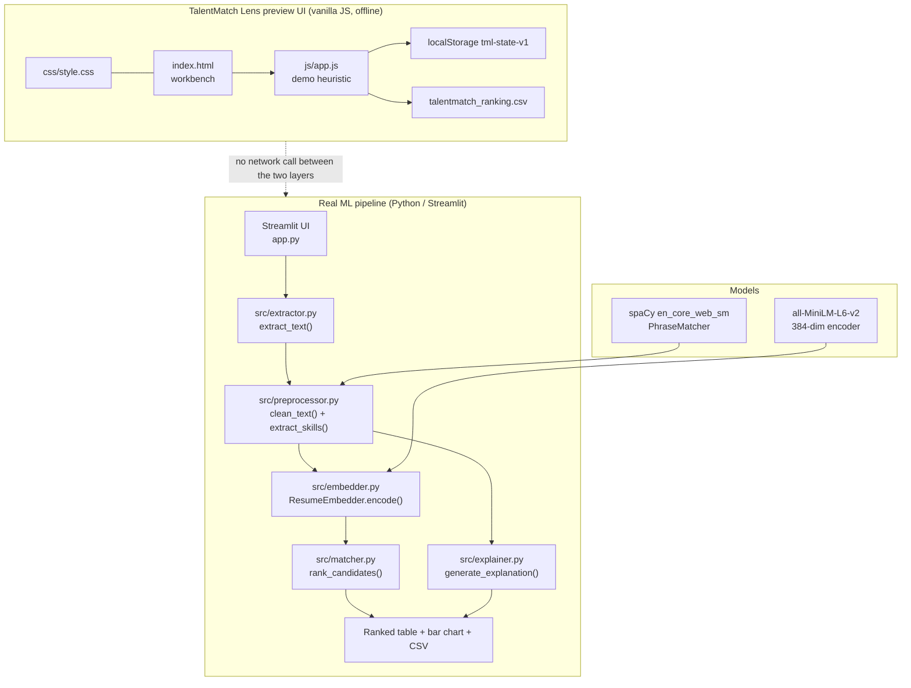
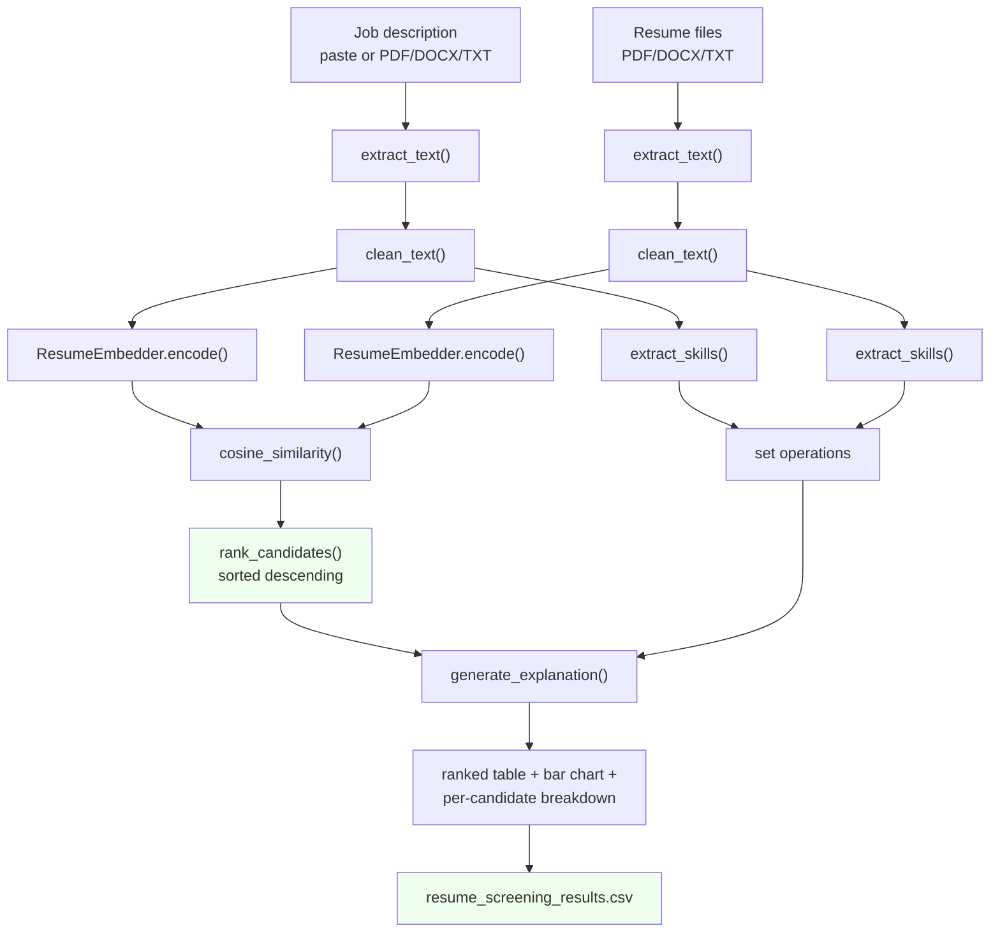

# TalentMatch Lens — Project Overview

Folder id: `resume-screening-and-jd-matching` · UI display name: **TalentMatch Lens**

---

## 1. Project Summary

TalentMatch Lens is an AI-assisted resume screening system. It takes a job description and a batch
of candidate resumes, converts every document into a **384-dimensional sentence embedding** with the
pretrained `all-MiniLM-L6-v2` model, scores each candidate by **cosine similarity** against the
job description, and then produces a **plain-English explanation** for every score: which skills
matched, which required skills are missing, and which extra skills the candidate brings.

**Problem it addresses.** Recruiters skim hundreds of resumes per role; keyword-matching ATS tools
miss synonyms ("ML" vs "Machine Learning"); and a bare score is not a defensible hiring input.

**Objective.** Rank candidates in seconds while keeping every decision auditable.

**Users.** Recruiters, hiring managers, and technical talent leads.

**Expected output.** A ranked table (rank, candidate, match score, skill-match %), a bar chart, a
per-candidate matched/missing/extra skill breakdown, and a downloadable CSV
(`resume_screening_results.csv`).

**Two layers ship in this repository:**

1. **The real ML pipeline** — a Streamlit app (`app.py`) over the `src/` package. This is the
   upstream project (`thrinathpolanki/resume_screening_ai`, MIT).
2. **The TalentMatch Lens preview UI** — `index.html` + `css/style.css` + `js/app.js`, a
   dependency-free browser workbench that re-implements the *interaction design* with a simplified
   scoring heuristic, so the product can be reviewed and demoed without a Python environment.

The two are **not connected**: the browser UI never calls the Python code, and it says so in its own
header (*"Preview UI · real screening runs in Streamlit"*) and in a dedicated panel
(*"Demo heuristic — the real system uses all-MiniLM-L6-v2 embeddings via Streamlit; results
differ."*).

---

## 2. Problem Statement

Screening resumes manually is slow and inconsistent: two recruiters reading the same stack of
documents produce different shortlists, and every decision is hard to justify afterwards.

Three concrete gaps appear in existing tools:

1. **Lexical matching misses meaning.** A candidate who writes "scikit-learn" for a role asking for
   "ML" or "machine learning" is penalised by a keyword ATS, even though the skills are equivalent.
2. **A score alone is not a decision.** A recruiter needs to know *why* a candidate ranked where
   they did — which requirements are met, which are gaps, and what the candidate offers beyond the
   posting.
3. **Rankings are not portable.** A shortlist built in one tool cannot be reviewed, exported or
   defended later without the reasoning attached.

**Non-goals.** This project does not parse scanned resumes (no OCR), does not infer years of
experience or education level (no NER stage), and does not train or fine-tune anything — it uses a
pretrained general-purpose encoder zero-shot.

---

## 3. Proposed Solution

**Embed the documents, not the keywords.** Both the job description and every resume are encoded by
`all-MiniLM-L6-v2`, a sentence-transformer trained so that the whole-text embedding is directly
comparable. Similarity is then the cosine of the angle between the two vectors, which measures
semantic direction and is insensitive to resume length.

**Explain with a deterministic, auditable layer.** Alongside the embedding score, a spaCy
`PhraseMatcher` scans both documents against a curated 90-skill dictionary. Set operations on the
two skill sets produce matched / missing / extra lists and a skill-match percentage — a rule-based
explanation a recruiter can read and challenge, and one that never invents information.

**Separate the two concerns cleanly.** The codebase splits by single responsibility: extraction
(`extractor.py`), cleaning + skills (`preprocessor.py`), embedding (`embedder.py`), scoring
(`matcher.py`), explanation (`explainer.py`). Each module has one public function, so a new file
type or a new model touches exactly one file.

**Make the product reviewable without the heavy stack.** The preview UI reproduces the recruiter
workbench in vanilla JS with a transparent heuristic score, so the interaction design, the
explainability story and the CSV export can be evaluated on a machine with no GPU, no PyTorch and
no model download — while never pretending to be the real model.

---

## 4. Features and Capabilities

### Existing (verified in code)

**Real pipeline — `app.py` + `src/`**

- JD input by pasted text **or** uploaded PDF/DOCX/TXT, with the extracted text echoed back in a
  read-only box.
- Multi-file resume upload with a live count and a single **Run Screening** trigger.
- Validation gates: empty JD → *"Please provide a job description before running screening."*;
  no resumes → *"Please upload at least one resume before running screening."*; both call
  `st.stop()`.
- Format dispatch: `extract_text()` routes by extension to pdfplumber / python-docx / UTF-8 decode,
  and raises `ValueError` for anything else.
- Light cleaning: `clean_text()` removes emails, URLs and exotic characters, collapses
  whitespace, and deliberately preserves natural language and stopwords.
- Skill extraction against `SKILL_KEYWORDS` using spaCy's `PhraseMatcher` with `attr="LOWER"`, so
  multi-word skills such as "machine learning" match as one unit.
- Embedding with `ResumeEmbedder.encode()` → `(n, 384)` float array, `normalize_embeddings=True`.
- Ranking with `rank_candidates()` → `cosine_similarity(jd_embedding, resume_embeddings)[0]`,
  sorted descending.
- Explanation with `generate_explanation()` → matched / missing / extra skill lists, skill-match
  percentage, and a summary sentence bucketed at 0.75 and 0.55.
- Ranked `st.dataframe` + `st.bar_chart` + CSV download (`resume_screening_results.csv`).
- `@st.cache_resource` on `load_models()` so spaCy and the ~90 MB encoder load once per session.

**Preview UI — `index.html` / `js/app.js` (1168 lines)**

- Job description panel with *Paste text* / *Upload file* tabs and a **Load sample JD (repo)**
  button that fetches `data/sample_job_description.txt`.
- Automatic skill extraction into removable chips, with manual skills preserved and flagged
  (`chip-manual`).
- Up to **8** candidate cards (`MAX_CANDIDATES`), each with a name, a text body and a `.txt`
  loader; searchable by name or text.
- Transparent demo scoring:
  `score = round1((0.55 * tokenCosine + 0.45 * skillJaccard) * 100)`.
- Threshold slider (50–95, default 75) driving **Strong / Partial / Weak** bands.
- Results with an SVG score ring, the cosine and Jaccard components, matched/missing/extra chips
  and the shared terms.
- Side-by-side comparison of two candidates, result filtering, CSV export
  (`talentmatch_ranking.csv`), and clear-results / clear-all.
- State persistence in `localStorage` under `tml-state-v1`.
- Accessibility: `aria-*` roles and labels, keyboard shortcuts (`bindGlobalKeys`), focus handling,
  `prefers-reduced-motion` support, and a clipboard fallback for browsers without the async API.

### Future (not present in the repository)

- Fine-tuning the encoder on a labelled resume/JD dataset.
- NER for years of experience and education level.
- Vector-store search (FAISS / Pinecone) for large corpora.
- Authentication and persistent storage for multi-recruiter workflows.
- A real FastAPI backend (mentioned in `project-metadata.json`'s `stack` field, but **not present in
  the code**) so the app can be embedded in an ATS.
- Bias and PII auditing before embedding.

---

## 5. System Architecture



**Real components (only what exists in the code)**

| Component | Files | Responsibility |
|---|---|---|
| Presentation (real) | `app.py` | Streamlit layout, validation, pipeline orchestration, results, CSV export |
| Document parsing | `src/extractor.py` | PDF/DOCX/TXT → plain text, isolated behind `extract_text()` |
| Text + skills | `src/preprocessor.py` | `clean_text()`, `SKILL_KEYWORDS`, `load_skill_matcher()`, `extract_skills()` |
| Embeddings | `src/embedder.py` | `ResumeEmbedder` wrapping `SentenceTransformer` |
| Scoring | `src/matcher.py` | `rank_candidates()` — cosine similarity + descending sort |
| Explanation | `src/explainer.py` | `generate_explanation()` — set differences + summary |
| Presentation (preview) | `index.html`, `css/style.css`, `js/app.js` | Static recruiter workbench with an in-browser heuristic scorer |
| Assets | `data/sample_job_description.txt` | The only data file in the repository |
| Packaging | `requirements.txt`, `resume_screening_ai.zip`, `project-metadata.json` | 10 pinned dependencies; upstream snapshot; catalogue metadata |

**Runtime dependencies that must be present for the real pipeline:** `streamlit`, `spacy` +
`en_core_web_sm`, `sentence-transformers` + `torch`, `scikit-learn`, `pdfplumber`, `python-docx`,
`pandas`, `numpy`. On this machine, `streamlit`, `sentence-transformers`, `spacy`, `pdfplumber` and
`python-docx` are **not installed** and the bundled `venv/` is unusable (it holds only a bash
`activate` script pointing at `C:\Users\thrin\AI_Internship\resume_screening_ai\venv`).

---

## 6. Complete Project Workflow

**Step 1 — Start.** `streamlit run app.py` → http://localhost:8501. `load_models()` runs
immediately (module level) and loads `en_core_web_sm`, the `PhraseMatcher`, and
`ResumeEmbedder("all-MiniLM-L6-v2")`; the first run downloads the encoder weights.

**Step 2 — Provide the job description.** The user picks *Paste text* or *Upload file*. For a
file, `extract_text(jd_file.name, jd_file.read())` returns the text, which is shown in a disabled
text area so the user can verify the extraction.

**Step 3 — Upload resumes.** `st.file_uploader(..., accept_multiple_files=True)`; the count is
confirmed with `st.success(f"{len(resume_files)} resume(s) uploaded.")`.

**Step 4 — Validate.** Pressing **Run Screening** with an empty JD shows
*"Please provide a job description before running screening."* and calls `st.stop()`; with no
resumes, *"Please upload at least one resume before running screening."*.

**Step 5 — Clean and extract JD skills.** `clean_text(jd_text_raw)` → `extract_skills(jd_clean, nlp,
skill_matcher)` → `jd_skills` (a set).

**Step 6 — Clean and extract per-resume skills.** For each uploaded file:
`extract_text()` → `clean_text()` → `extract_skills()`. Names, cleaned texts and skill sets are
accumulated into `resume_names`, `resume_texts_clean`, `resume_skills_list`.

**Step 7 — Embed.** `embedder.encode([jd_clean])` gives shape `(1, 384)`;
`embedder.encode(resume_texts_clean)` gives `(n, 384)`. Both are L2-normalised, so cosine
similarity reduces to a dot product.

**Step 8 — Rank.** `rank_candidates(jd_embedding, resume_embeddings, resume_names)` computes
`cosine_similarity(...)[0]` and sorts descending, producing
`[{"name": ..., "score": ...}, ...]`.

**Step 9 — Explain.** For each result, `generate_explanation(jd_skills=..., resume_skills=...,
similarity_score=...)` returns the skill sets, the percentage and the summary, which are merged
into the result dict with `result.update(explanation)`.

**Step 10 — Present.** `st.success("Screening complete!")`, a `st.dataframe` of Rank / Candidate /
Match Score / Skills Matched (%), a `st.bar_chart` of the scores, a
`st.download_button` producing `resume_screening_results.csv`, and one `st.expander` per candidate
with the summary and the three skill lists.

**Error handling summary.** Validation errors use `st.error` + `st.stop()`. An unsupported
extension raises `ValueError` from `extract_text()` (surfaced by Streamlit as a traceback). A missing
spaCy model or a failed weight download raises at startup, before the UI renders. There is **no
try/except around the pipeline** — a failure anywhere aborts the run with a Streamlit error.

**Preview UI workflow (parallel, offline).** Paste/load a JD → skills are auto-extracted → add up
to 8 candidates → set the threshold → **Run screening** → after a 420 ms simulated delay
`scoreCandidate()` computes the heuristic for each candidate → `renderResults()` draws the cards →
optionally filter, compare, export CSV or clear. State is written to `localStorage` on every change
via `persist()` and restored by `restore()` on load.

---

## 7. Machine Learning or Algorithm Explanation

**The model.** `all-MiniLM-L6-v2` — a pretrained sentence-transformer (MiniLM architecture, 6 layers,
384-dim output, ~80–90 MB). It is used **zero-shot**: the repository contains no training script,
no dataset, no fine-tuning code and no evaluation metrics. Sentence-Transformers (rather than raw
BERT) is the right tool because BERT produces one vector *per token*; averaging those yields poor
sentence-level similarity, whereas a sentence-transformer is trained so the whole-text embedding is
directly comparable by cosine similarity.

**Normalisation.** `ResumeEmbedder.encode()` sets `normalize_embeddings=True`, so every vector has
unit length and cosine similarity equals the dot product.

**Scoring.** `cosine_similarity(jd_embedding, resume_embeddings)[0]` in `src/matcher.py` gives one
score in `[-1, 1]` per candidate. Cosine is chosen over Euclidean distance because it measures the
*angle* between vectors, not their magnitude — important because resume lengths vary widely and a
3-page resume should not out-score a 1-page one purely by containing more text.

**The explainability layer (rule-based, not learned).**

```
matched  = jd_skills ∩ resume_skills
missing  = jd_skills − resume_skills
extra    = resume_skills − jd_skills
skill_match_percentage = round(len(matched) / len(jd_skills) × 100, 1)   # 0.0 if the JD has no known skills
```

The summary is a fixed template with three bands: `similarity_score >= 0.75` → *"a strong overall
match"*; `>= 0.55` → *"a moderate match"*; otherwise *"a weak match"*.

**Skill detection.** `load_skill_matcher()` builds a spaCy `PhraseMatcher` over the 90-entry
`SKILL_KEYWORDS` list with `attr="LOWER"`, so matching is case-insensitive and multi-word phrases
match as a unit. `extract_skills()` lowercases the text, runs the matcher and returns a set of
matched spans. This is a **fixed dictionary**, so a skill outside the 90 entries is invisible to the
explanation even when the embedding score reflects it.

**Text cleaning.** `clean_text()` removes emails (`\S+@\S+`), URLs (`http\S+|www\.\S+`), characters
outside `[a-zA-Z0-9.,;:()/#+\-\s]`, and collapses whitespace. It intentionally does **not** strip
stopwords or lemmatise — the module docstring notes that over-cleaning hurts embedding quality
because transformer models expect natural, fluent text.

**Preview-UI heuristic (demo only, not the model).**

```
cos      = |sharedTokens| / sqrt(|jdTokens| × |resumeTokens|)      # over stopword-filtered tokens
jaccard  = |jdSkills ∩ resumeSkills| / |jdSkills ∪ resumeSkills|
score     = round1((0.55 × cos + 0.45 × jaccard) × 100)
```

Token extraction uses the regex `[a-z0-9+#][a-z0-9+#.]*`, drops tokens shorter than 2 characters and
removes ~70 stopwords (including resume/recruitment boilerplate such as "experience", "skills",
"role", "team"). Skill detection in the browser is a regex boundary scan
(`(^|[^a-z0-9])keyword([^a-z0-9]|$)`) over the same 90 keywords — without spaCy's phrase matcher, so
a multi-word skill can match partially.

---

## 8. File-by-File Code Guide

| File | Key functions / symbols | Notes |
|---|---|---|
| `app.py` | `load_models()` (`@st.cache_resource`), `st.set_page_config`, `st.file_uploader`, `st.download_button`, `st.dataframe`, `st.bar_chart` | 212 lines. The real entry point. Calls `spacy.load("en_core_web_sm")` and `ResumeEmbedder(model_name="all-MiniLM-L6-v2")` at import time |
| `src/__init__.py` | — | 128-byte package marker |
| `src/extractor.py` | `extract_text(filename, file_bytes)`, `extract_text_from_pdf(file_bytes)`, `extract_text_from_docx(file_bytes)`, `extract_text_from_txt(file_bytes)` | 96 lines. pdfplumber page-by-page; docx non-empty paragraphs; UTF-8 with `errors="ignore"`. Raises `ValueError` for unsupported extensions |
| `src/preprocessor.py` | `SKILL_KEYWORDS` (90 entries), `clean_text(text)`, `load_skill_matcher(nlp)`, `extract_skills(text, nlp, matcher)` | 112 lines. The skill dictionary is the single source of truth for the explainability layer |
| `src/embedder.py` | `class ResumeEmbedder` → `__init__(model_name="all-MiniLM-L6-v2")`, `encode(texts) -> np.ndarray` | 58 lines. `convert_to_numpy=True`, `show_progress_bar=False`, `normalize_embeddings=True`; returns `(n, 384)` |
| `src/matcher.py` | `rank_candidates(jd_embedding, resume_embeddings, resume_names) -> list[dict]` | 46 lines. `cosine_similarity(...)[0]`, dicts `{"name", "score"}`, sorted descending |
| `src/explainer.py` | `generate_explanation(jd_skills, resume_skills, similarity_score) -> dict` | 65 lines. Returns `matched_skills`, `missing_skills`, `extra_skills`, `skill_match_percentage`, `summary`; percentage falls back to 0.0 when the JD has no recognised skills |
| `index.html` | Tabs `#tabPaste` / `#tabUpload`, `#jdText`, `#jdFile`, `#loadSample`, `#extractSkills`, `#skillInput`, `#candList`, `#addCand`, `#threshold`, `#runScreening`, `#exportCsv`, `#compareSection`, `#about` | 10.8 KB. Semantic markup, `aria-*` attributes, Google Fonts (Plus Jakarta Sans, JetBrains Mono) |
| `css/style.css` | — | 22.8 KB. CSS custom properties, ring/bar/panel styling, responsive layout, reduced-motion rules |
| `js/app.js` | `SKILL_KEYWORDS`, `STOPWORDS`, `STORAGE_KEY = "tml-state-v1"`, `MAX_CANDIDATES = 8`, `tokenSet()`, `tokenCosine()`, `skillSetsOverlap()`, `scoreCandidate()`, `bandFor()`, `bandLabel()`, `ringMarkup()`, `runScreening()`, `renderResults()`, `renderCompare()`, `exportCsv()`, `persist()`, `restore()`, `loadSampleJd()`, `handleResumeFile()`, `handleJdFile()`, `bindGlobalKeys()` | 1168 lines, ES5-style vanilla JS in an IIFE. `exportCsv()` writes `talentmatch_ranking.csv` with a Blob; the only `fetch()` is `data/sample_job_description.txt` |
| `data/sample_job_description.txt` | — | 683 bytes. "Machine Learning Engineer" posting: Python, PyTorch, scikit-learn, NLP/transformers, FastAPI/Flask, SQL, AWS/GCP, Docker, CI/CD, Agile/Scrum |
| `requirements.txt` | — | 10 pins: `streamlit==1.38.0`, `sentence-transformers==3.0.1`, `torch==2.3.1`, `scikit-learn==1.5.1`, `spacy==3.7.5`, `pdfplumber==0.11.4`, `python-docx==1.1.2`, `pandas==2.2.2`, `numpy==1.26.4` |
| `venv/Scripts/activate` | — | The only file in `venv/`. A **bash** script; sets `VIRTUAL_ENV="C:\Users\thrin\AI_Internship\resume_screening_ai\venv"`. No `python.exe`, no `site-packages` → unusable |
| `resume_screening_ai.zip` | — | Upstream snapshot: `src/*.py`, `app.py`, `requirements.txt`, `README.md`, `.gitignore`, `data/sample_job_description.txt`. No models, no datasets |
| `project-metadata.json` | — | `id`, `repository`, `stack: "Python; spaCy; FastAPI"`, `license: "MIT"`, `entry: "app.py"`, `expectedFileCount: 7`, `downloadedFileCount: 13`. The FastAPI mention is **not** backed by code |
| `LICENSE` | — | MIT, Copyright (c) 2026 Thrinath Polanki |

---

## 9. Data Flow



**Data shapes at each stage**

| Stage | Type | Shape / content |
|---|---|---|
| Raw input | `bytes` / `str` | Uploaded file bytes, or the pasted JD |
| `extract_text()` | `str` | Plain text; `""` for an image-only PDF |
| `clean_text()` | `str` | Emails/URLs/special characters removed, whitespace collapsed |
| `extract_skills()` | `set[str]` | Lowercase skill names, deduplicated |
| `ResumeEmbedder.encode()` | `np.ndarray` | `(1, 384)` for the JD, `(n, 384)` for the resumes; L2-normalised |
| `rank_candidates()` | `list[dict]` | `[{"name": str, "score": float}, ...]`, descending |
| `generate_explanation()` | `dict` | `matched_skills`, `missing_skills`, `extra_skills`, `skill_match_percentage`, `summary` |
| Display | `DataFrame` | Rank, Candidate, Match Score, Skills Matched (%) |
| Export | `bytes` | `resume_screening_results.csv` (UTF-8) |

**Preview-UI data flow**

```
JD text ──▶ findSkills() ──▶ state.skills (auto + manual chips)
                 │
resume text ────┴──▶ tokenSet() ──▶ tokenCosine()  ─┐
                     skillSetsOverlap() ──▶ jaccard ─┴──▶ scoreCandidate() ──▶ state.results
state.threshold ────────────────────────────────────▶ bandFor()  (strong / partial / weak)
                                                              │
                                       persist() ◀──────────┘
                                   localStorage "tml-state-v1"
```

---

## 10. Example Execution

**10.1 — Real pipeline (requires the missing packages)**

```powershell
cd "N:\Foundev-Projects\Domain\Artificial Intelligence & Machine Learning\resume-screening-and-jd-matching"
py -3.11 -m venv .venv
.\.venv\Scripts\Activate.ps1
python -m pip install --upgrade pip
python -m pip install -r requirements.txt
python -m spacy download en_core_web_sm
streamlit run app.py
```

```
  You can now view your Streamlit app in your browser.
  Local URL: http://localhost:8501
```

On this machine, step 4 fails because `streamlit`, `sentence-transformers`, `spacy`, `pdfplumber`
and `python-docx` are not installed — the documented install above is the prerequisite.

**10.2 — Screening session (illustrative output)**

*Inputs:* JD = the contents of `data/sample_job_description.txt`; resumes = one `.txt` resume
mentioning Python, PyTorch, scikit-learn, NLP, Docker and SQL, and one unrelated marketing resume.

*Illustrative* Streamlit output:

```
Screening complete!

  Rank  Candidate            Match Score   Skills Matched (%)
    1   ml_engineer.txt              78.4                    80.0
    2   marketing.txt                 21.6                     0.0
```

Expanded card for candidate 1:

```
This candidate is a strong overall match for the role (semantic similarity: 0.78),
matching 8 of 10 required skills (80.0%).

✅ Matched Skills   docker, machine learning, nlp, python, pytorch, scikit-learn, sql, transformers
❌ Missing Skills   aws, gcp
➕ Extra Skills     agile, scrum
```

The numbers above illustrate the *format* the app produces — real values depend entirely on your
documents and on the pretrained model's behaviour. No such run was executed here, because the
environment lacks the required packages.

**10.3 — Preview UI (runs today, no dependencies)**

```powershell
cd "N:\Foundev-Projects\Domain\Artificial Intelligence & Machine Learning\resume-screening-and-jd-matching"
python -m http.server 8000 --bind 127.0.0.1
```

Open **http://localhost:8000/**:

1. Click **Load sample JD (repo)** → status: *"Loaded data/sample_job_description.txt (the repo
   sample)."* and the skill chips fill with the detected skills.
2. Click **+ Add candidate**, type a name, paste resume text.
3. Move the threshold to 70, press **Run screening**.
4. After ~0.4 s a result card appears with the score ring, the band label and the matched /
   missing / extra chips; a toast reads *"Screening complete - demo ranking ready."*
5. Press **Export CSV** → `talentmatch_ranking.csv` with the columns Rank, Candidate, Match Score
   (%), Band, Skills Matched (%), Matched Skills, Missing Skills, Extra Skills.

**10.4 — Where the browser UI stops**

Uploading a PDF or DOCX resume in the preview UI produces the explicit message *"Parsing <file> needs
the backend (pdfplumber/python-docx) - paste the text instead."* — the browser cannot do that, and
the UI says so instead of faking a result.

---

## 11. Dependencies and External Services

**Declared in `requirements.txt`**

| Package | Pin | Why it matters |
|---|---|---|
| `streamlit` | 1.38.0 | The real UI: file uploaders, cached model loading, dataframe, bar chart, download button |
| `sentence-transformers` | 3.0.1 | Wraps PyTorch + Hugging Face transformers to produce the 384-dim sentence embeddings |
| `torch` | 2.3.1 | Inference runtime for the encoder (largest install; a CUDA build is optional) |
| `scikit-learn` | 1.5.1 | `cosine_similarity` in `src/matcher.py` |
| `spacy` | 3.7.5 | Tokenisation and `PhraseMatcher` for skill extraction |
| `pdfplumber` | 0.11.4 | PDF text extraction (text-layer PDFs only) |
| `python-docx` | 1.1.2 | DOCX paragraph extraction |
| `pandas` | 2.2.2 | Results table and CSV export |
| `numpy` | 1.26.4 | Embedding matrices |

**Not in `requirements.txt` but required at runtime**

| Item | Needed by | How to get it |
|---|---|---|
| spaCy model `en_core_web_sm` | `app.py` → `spacy.load(...)` | `python -m spacy download en_core_web_sm` |

**Model / weight downloads (external, not redistributed)**

| Asset | Size | Source | Cached in |
|---|---|---|---|
| `all-MiniLM-L6-v2` | ~90 MB | Hugging Face Hub (via `sentence-transformers`) | `HF_HOME` / `~/.cache/huggingface` |
| `en_core_web_sm` | ~12 MB | spaCy model repository | The active environment's `site-packages` |

**External services**

| Service | Used by | Required | Status |
|---|---|---|---|
| Hugging Face Hub | `sentence-transformers` model download (first run only) | No key | Download needed once; offline afterwards |
| spaCy model download | `python -m spacy download en_core_web_sm` | No key | Download needed once |
| Google Fonts (Plus Jakarta Sans, JetBrains Mono) | Preview UI typography | No | Loaded from the CDN; the page falls back to system fonts offline |
| Any ATS / job board | — | — | **No integration exists** |

**No API keys, no accounts and no paid services** are required. Everything runs locally.

**Data assets in the repository**

| Path | Size | Content |
|---|---|---|
| `data/sample_job_description.txt` | 683 bytes | Sample "Machine Learning Engineer" JD |
| `resume_screening_ai.zip` | 15.8 KB | Upstream source snapshot (10 entries) — **no models, no datasets** |

---

## 12. Current Limitations and Future Improvements

### Current limitations

**Environment**

- `streamlit`, `sentence-transformers`, `spacy`, `pdfplumber` and `python-docx` are **not installed**
  on this machine, so the real pipeline cannot start as shipped.
- The bundled `venv/` contains only a bash `activate` script pointing at
  `C:\Users\thrin\AI_Internship\resume_screening_ai\venv` — it has no interpreter and no
  `site-packages`, and must be recreated.
- `torch==2.3.1` does not have wheels for every Python 3.12 configuration, so 3.11 (the upstream
  recommendation) is the safe choice.
- `load_models()` executes at import time, so a missing spaCy model or an interrupted download
  crashes the app before any UI appears.

**Model and accuracy**

- **No training, fine-tuning or evaluation** anywhere in the repository — no dataset, no metrics,
  no benchmark.
- `all-MiniLM-L6-v2` truncates at **256 tokens**; long resumes are only partially represented.
- The skill dictionary is **hard-coded to 90 entries** and has no aliases or weights, so "ML",
  "K8s" or "Postgres" are not recognised; the two layers can disagree — a candidate can have a high
  embedding score and a low skill-match percentage.
- The dictionary is **duplicated** in `src/preprocessor.py` and `js/app.js`, so the two layers can
  drift.
- Only the top-level "requirements" section of a JD is used; no hierarchical or weighted matching
  is performed.

**Product and operations**

- **No HTTP API** — the pipeline is reachable only through the Streamlit UI. `project-metadata.json`
  mentions FastAPI, but no FastAPI code exists.
- **No persistence, authentication, or multi-user support**; every Streamlit session is isolated and
  nothing is stored.
- **No PII redaction** beyond removing emails and URLs; names, phone numbers and addresses are
  embedded and sent to the model.
- **No bias/fairness auditing** of either the dictionary or the similarity score.
- **No OCR** — scanned PDFs extract as empty strings and silently score 0.
- **No unit tests, no CI, no linting configuration.**
- **Preview UI only:** heuristic (not embedding) scoring, `.txt`-only file parsing, an 8-candidate
  cap, `localStorage` state that is unencrypted and per-browser, and a 420 ms artificial delay.

### Future improvements

1. Install the environment and add the `en_core_web_sm` download to the setup script so the
   documented commands are reproducible end-to-end.
2. Replace the broken `venv/` with a working `.venv`, or delete it and document the recreation steps.
3. Add a real FastAPI service (`/screen`, `/health`) exposing `extract_text` → `clean_text` →
   `embed` → `rank_candidates` → `generate_explanation`, and point the preview UI at it — the UI
   already has a natural place for an online/offline badge, as the other projects in this collection
   do.
4. Add a **vector store** (FAISS) so screening scales past a handful of resumes per job.
5. Add **NER** for years of experience, education level and companies.
6. Introduce **skill aliases and weights** ("ML" → "machine learning") and share one dictionary
   between Python and JavaScript, e.g. by generating the JS list from the Python one.
7. **Fine-tune** the encoder on a labelled resume/JD set, and publish a small benchmark so the
   claim "ranks better than keyword overlap" is measurable.
8. Add **PII redaction** before embedding, plus a bias audit on the skill dictionary.
9. Add **authentication and persistent shortlists** for multi-recruiter workflows, and an ATS
   export format.
10. Add **pytest coverage** for the pure functions (`clean_text`, `extract_skills`,
    `rank_candidates`, `generate_explanation`) — they need no model to test.
11. Handle **long documents** by chunking and averaging embeddings instead of truncating.
12. Add **OCR** (or an explicit "scanned PDF detected" error) instead of silently scoring 0.

---

## 13. Learning Outcomes

Working through this project teaches:

- **Sentence embeddings vs. token models** — why averaging BERT token vectors is inferior to a
  sentence-transformer, and how `normalize_embeddings=True` turns cosine similarity into a dot
  product.
- **Choosing a similarity metric for variable-length text** — why cosine (angle) beats Euclidean
  (magnitude) when a 1-page and a 3-page resume must be comparable.
- **Zero-shot versus fine-tuned NLP** — and the honesty cost of shipping a model with no training
  data, no evaluation and no metrics.
- **Explainability as set algebra** — matched/missing/extra skills computed with `∩`, `−` and
  `|∩|/|∪|`, giving an auditable rationale beside a learned score.
- **Dictionary-based NLP** — spaCy `PhraseMatcher` with `attr="LOWER"` for multi-word, case-insensitive
  skill matching, and the trade-off of a fixed vocabulary versus embedding coverage.
- **Module design with a single responsibility** — `extractor` / `preprocessor` / `embedder` /
  `matcher` / `explainer`, each exposing one public function, so a new file type or a new model
  touches exactly one file.
- **Performance engineering in a UI framework** — `@st.cache_resource` to avoid reloading a 90 MB
  model on every widget interaction, and the difference between caching a *resource* and caching a
  *value*.
- **Caching and I/O hygiene** — `io.BytesIO` wrapping of uploaded bytes so pdfplumber and python-docx
  can read in-memory uploads, and `errors="ignore"` decoding for real-world text files.
- **Building a UI that does not lie** — the preview UI shows its heuristic, its components and its
  limits, refuses PDF/DOCX it cannot parse, and points at the real command to run — a pattern worth
  copying for any prototype.
- **Browser-side implementation of an ML idea** — token-set cosine, Jaccard over skill sets, stopword
  filtering, weighted score fusion, SVG progress rings, Blob-based CSV export and `localStorage`
  persistence, in dependency-free ES5-style JavaScript.
- **Environment archaeology** — reading a `requirements.txt` against the imports, spotting a
  `venv/` that only contains a bash `activate`, and recognising that a metadata field advertising
  FastAPI does not mean FastAPI exists.
