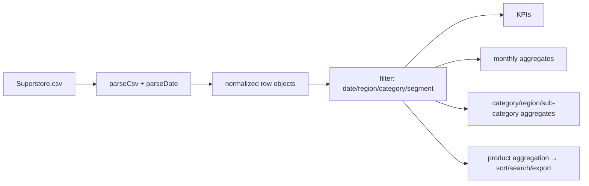

# PROJECT_OVERVIEW — DemandSight (retail-sales-forecasting)

## Project Summary

| Field | Value |
|---|---|
| Name | DemandSight — Retail Sales Analytics |
| Problem | Retail transaction data (orders, products, regions, profit) is hard to explore without SQL or Excel pivots |
| Objective | Turn the bundled Superstore CSV into an instant, zero-install analytics dashboard |
| Intended users | Analysts, store managers, students learning data analytics |
| Expected output | KPIs, time-series charts, category/region breakdowns, product rankings — all from real data |

## Problem Statement

The upstream repo ships a MySQL-based SQL query kit. Running it requires database setup,
Python dependencies, and manual query execution — a high bar for a single CSV. Non-technical
users cannot see sales/profit patterns at all without that infrastructure.

## Proposed Solution

A static, framework-free web dashboard that loads the same CSV in the browser and performs the
aggregations client-side: min-cost (any static server), instant feedback, filters that recompute
everything live. Forecasting is deliberately **not** faked — the UI states plainly that no model
exists and what a real one would require.

## Features and Capabilities

**Existing:** CSV parsing (quoted fields), KPI computation, date/region/category/segment filters,
monthly sales+profit chart, category/region bars, sub-category profitability, sortable/searchable
top-products table, CSV export, insight copy.
**Future (not implemented):** server-side forecasting (Prophet/ARIMA) behind an API; database
connector in place of the CSV.

## System Architecture

```mermaid
flowchart TD
    U[User + Browser] --> HTML[index.html + css/style.css]
    HTML --> JS[js/app.js analytics engine]
    JS -->|fetch same-origin| CSV[(dataset/Superstore.csv)]
    JS --> KPI[KPI strip + sparklines]
    JS --> CH[Chart.js charts via CDN]
    JS --> TB[Top products table / export]
    subgraph optional upstream (not used by UI)
        APP[app.py cleaning] --> MYSQL[(MySQL)] --> RUN[run_all_queries.py + sql/retail_analysis.sql]
    end
```

## Complete Project Workflow

1. User opens `http://localhost:8000/` (static server).
2. `loadData()` fetches `dataset/Superstore.csv`, parses it with a quote-aware state-machine parser.
3. Each row is normalized: `_date/_year/_month` from `Order Date` (M/D/YYYY), numeric `_sales/_profit/_qty/_discount`.
4. `buildFilters()` derives distinct regions/categories/segments/years from the data; H1/H2 chip labels use the latest year present.
5. Any filter change runs `applyFilters()` → recomputes `filtered` → `renderAll()`.
6. `renderKpis()` sums sales/profit, counts unique Order IDs, computes weighted discount and sparklines.
7. Chart.js line/bar charts render monthly series and group sums; sub-category profit bars are colored by sign.
8. `productAgg()` aggregates by Product Name; search/sort produce the Top-10 table; export/insight act on that list.
9. Errors (missing file, `file://` protocol) surface in the load panel with a Retry button and a server hint.

## Machine Learning or Algorithm Explanation

No ML model exists in this project. The core processing is deterministic aggregation:
groupBy + sum/mean over filtered rows, monthly bucketing by calendar month, and a sales-weighted
discount mean (`Σ(discount·sales)/Σ(sales)`). Margin % is `profit/sales`. Sub-category profitability
is a signed sum of profit used for diverging bars.

## File-by-File Code Guide

| File | Responsibility |
|---|---|
| `index.html` | Layout: filter ribbon, KPI strip, chart panels, products table, forecast/data-notes panels |
| `js/app.js` | `parseCsv`, `parseDate`, `loadData`, `buildFilters`/`makeChip`, `applyFilters`, `renderKpis`, `renderSparkline`, `renderSalesChart`, `renderBarChart`, `renderSubcatChart`, `productAgg`/`currentProducts`/`renderProductsTable`, export & insight handlers |
| `dataset/Superstore.csv` | 9,994 rows × 21 columns, 2014–2017 |
| `css/style.css` | Dark dashboard styling |
| `app.py`, `sql/`, `run_all_queries.py` | Upstream MySQL analytics kit (independent of the UI) |

## Data Flow



## Example Execution

Serve the folder, open the page, click Region chip **West** and *By year → 2017*.
*Illustrative but grounded in the dataset:* the KPI strip recomputes to West-region 2017 totals
(the full-dataset anchor figures are 9,994 rows and $2,297,201 total sales — verified in-browser
during implementation testing). The monthly chart now shows only 2017 months; the Top-10 table
ranks West 2017 products by sales.

## Dependencies and External Services

- **Chart.js 4 (CDN):** charts only; everything else works offline (guarded `typeof Chart` checks).
- **Google Fonts (CDN):** typography; graceful fallback.
- No APIs, no database, no secrets.

## Current Limitations and Future Improvements

- No forecasting model (labeled in UI); a FastAPI+Prophet service with `/forecast?horizon=…` is the natural next step.
- Avg Discount is a weighted approximation.
- Upstream MySQL kit needs path/credential edits and `pymysql` to run.
- Full dataset loads at once (fine at 2.3 MB; a server-side aggregate would be needed for larger data).

## Learning Outcomes

- Client-side ETL: CSV parsing, date normalization, typed row models
- Filter → recompute → render state management in vanilla JS
- Chart.js configuration (line/bar, diverging colors, legend control)
- Aggregation patterns (group-by sum, unique counts, weighted means)
- Honest UX: surfacing missing functionality instead of faking it
