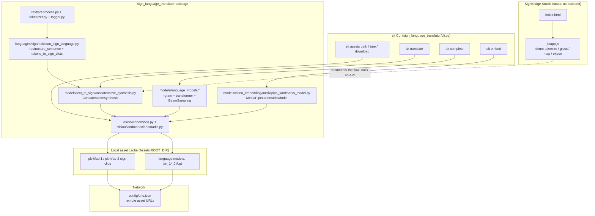
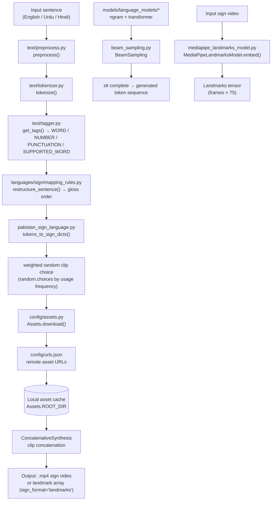

# Project Overview — sign-language-to-text-translation (SignBridge Studio)

## Project Summary

| Field | Value |
| --- | --- |
| **Folder id** | `sign-language-to-text-translation` |
| **Upstream package** | `sign_language_translator` v0.8.1 (Poetry, Apache-2.0) |
| **UI display name** | SignBridge Studio (`index.html`, `css/style.css`, `js/app.js`) |
| **Problem** | Hearing and hearing-impaired people cannot communicate directly; most deaf people in the developing world use a regional sign language that has almost no digital text corpus, so mainstream speech/OCR translation tools are useless to them. |
| **Objective** | Provide a reusable, extensible Python framework that (a) converts written text into a sequence of sign-language video clips using a dictionary of recorded signs, and (b) converts sign videos into machine-learning-friendly landmark/embedding vectors so that sign-to-text models can be trained. |
| **Users** | Deaf and hearing-impaired users; accessibility researchers; developers of regional sign-language datasets; ML engineers training sign-recognition models. |
| **Expected output** | A playable sign video (`.mp4`) for a given sentence, or `.csv`/`.pt` embedding files for a set of sign videos. |

The repository contains the upstream library in `sign_language_translator/`, a Sphinx `docs/` tree, a `tests/` suite, and a **static demo UI** (SignBridge Studio) that explains the pipeline without running any model.

## Problem Statement

Automatic Sign Language Translation (ASLT) is hard for three compounding reasons:

1. **No written corpus.** Sign languages have no standard orthography, so there is no text to align with, and no large parallel text corpus to train a sequence-to-sequence model on.
2. **Spatial and temporal structure.** A sign is a 3-D trajectory of hand, arm and body configurations. It is not a sequence of discrete symbols, so it must be reduced to a numeric representation (landmarks) before any learning can happen.
3. **Regional variation and resource scarcity.** Each country has its own sign language and its own dictionary of recorded clips. Pakistan Sign Language (PSL) has a curated `pk-hfad` clip collection, but the tooling to use it did not exist.

The upstream project answers this with a **rule-based** first step: given a dictionary of word-level sign videos plus a JSON mapping from text tokens to those videos, you can assemble a sentence into a video by concatenating clips. The same framework then offers a landmark extractor to produce training data for the *neural* sign-to-text models that would come later.

## Proposed Solution

Two complementary, layered mechanisms:

**Layer 1 — Rule-based text → sign (`ConcatenativeSynthesis`).**
1. `TextLanguage.preprocess()` normalises the input string.
2. `TextLanguage.tokenize()` splits it into tokens; `TextLanguage.get_tags()` classifies each token as `WORD`, `NUMBER`, `PUNCTUATION` or `SUPPORTED_WORD`.
3. `SignLanguage.restructure_sentence()` reorders and prunes the token list into a *gloss* (a sign-language-appropriate word order) using the mapping rules of the target sign language.
4. `SignLanguage.tokens_to_sign_dicts()` maps each gloss token to one or more candidate sign clips — direct word match, digit-by-digit expansion, or character-by-character spelling fallback.
5. The clips are downloaded from the asset manager if missing, weighted-randomly chosen among candidates, and concatenated into an output video or landmark sequence.

**Layer 2 — Feature extraction for learned models.**
`MediaPipeLandmarksModel` converts a sign video into a per-frame array of pose and hand landmarks (the `mediapipe-world` representation: 33 pose + 2 × 21 hand points, 5 channels each), giving a fixed-shape numeric tensor that a sequence model can consume.

**Layer 3 — SignBridge Studio (this repository's addition).**
A static, framework-free page that walks a newcomer through the same five stages using a small embedded demo lexicon, clearly labelling every place where the real library takes over. It exists to make the upstream package comprehensible, not to reimplement it.

## Features and Capabilities

**Existing (verified in code)**

| Capability | Implementation |
| --- | --- |
| Text → sign video | `models/text_to_sign/concatenative_synthesis.py` → `ConcatenativeSynthesis.translate()` |
| Text preprocessing / tokenisation / tagging | `text/preprocess.py`, `text/tokenizer.py`, `text/tagger.py` |
| Gloss restructuring | `languages/sign/mapping_rules.py`, `languages/sign/sign_language.py` → `restructure_sentence()` |
| Token → clip mapping | `languages/sign/pakistan_sign_language.py` → `tokens_to_sign_dicts()` |
| Video landmark embedding | `models/video_embedding/mediapipe_landmarks_model.py` → `MediaPipeLandmarksModel` |
| n-gram language models | `models/language_models/ngram_language_model.py` |
| Beam sampling over models | `models/language_models/beam_sampling.py` → `BeamSampling` |
| Transformer language model + training | `models/language_models/transformer_language_model/{model.py,train.py,layers.py}` |
| Text embeddings via lookup table | `models/text_embedding/vector_lookup_model.py` |
| Asset management | `config/assets.py` → `Assets`; manifest `config/urls.json` |
| CLI | `cli.py` → `slt assets | complete | translate | embed` |
| Video / landmark containers | `vision/video/video.py` → `Video`; `vision/landmarks/landmarks.py` → `Landmarks` |
| Browser pipeline demo | `index.html` + `js/app.js` |

**Future / not present**

- A trained **sign-to-text** neural model — explicitly marked `COMING SOON!` in `sign_language_translator/__init__.py`.
- Sign languages other than Pakistan Sign Language.
- Input languages other than English, Urdu and Hindi.
- Any server-side API or hosted inference (none is planned in this repo).

## System Architecture

Three cooperating layers, none of which is a web service:

1. **Library core** (`sign_language_translator/`) — pure Python, imported as `sign_language_translator as slt`.
2. **CLI shell** (`sign_language_translator/cli.py`) — a Click group exposing the same core over a terminal.
3. **Static UI** (`index.html`, `css/style.css`, `js/app.js`) — an independent, zero-dependency browser demo that documents the flow.

Supporting infrastructure: the `Assets` manager plus `config/urls.json` (downloads), `config/enums.py` (short codes / factory lookup), and `config/settings.py` (asset root).



## Complete Project Workflow

**Real CLI flow (text → sign)**

1. **User** runs `slt translate --model-code rule-based --text-lang english --sign-lang pk-sl --sign-format video "What is your name?"`.
2. **`cli.py`** parses the flags and calls `get_model(model_code=…, sign_language=…, text_language=…, sign_format=…, sign_embedding_model=…)` (`models/utils.py`), which resolves short codes through `config/enums.py`.
3. **`ConcatenativeSynthesis.translate(text)`** runs the pipeline:
   - `text_language.preprocess(text)` → cleaned string.
   - `text_language.tokenize(...)` → token list.
   - `text_language.get_tags(tokens)` → per-token tag (`WORD` / `NUMBER` / `PUNCTUATION` / `SUPPORTED_WORD`).
   - `sign_language.restructure_sentence(tokens, tags)` → gloss token list (stopwords and punctuation dropped, gloss word order applied per `mapping_rules.py`).
   - `sign_language.tokens_to_sign_dicts(gloss_tokens, tags)` → candidate clip names per token (direct / digit-wise / spelled-out).
4. **Asset resolution** — `Assets` checks the local cache for each clip; a missing clip is fetched from the URL recorded in `config/urls.json` via `utils/download.py`.
5. **Clip selection** — among candidates, one is chosen with `random.choices`, weighted by usage frequency, so ambiguous words can resolve differently between runs.
6. **Synthesis** — clips are decoded, resized and concatenated into a video (or into a landmark array when `sign_format="landmarks"`), then written to `--output-dir` with `--save-format` (default `mp4`).
7. **Output** — the file is saved and, unless `--display False`, opened for preview via the `vision/video` display helpers.
8. **Error handling** — an unsupported model code makes `cli.py` echo `This type of translation is not yet supported!`; a missing asset raises a download error from `utils/download.py`; a non-`TextToSignModel` result is caught by the `isinstance` check in `cli.py`.

**Real CLI flow (embed)**

`slt embed` → `MediaPipeLandmarksModel.embed(frames)` → per-frame pose/hand landmark tensor → saved as `.pt`/`.csv`/`.npy`/`.npz` via `--save-format`, with `--processes` for multiprocessing across files.

**Browser flow (SignBridge Studio)**

1. Open the page → stage 01 textarea receives the sentence.
2. `js/app.js` runs a demo regex tagger → stage 02 chips.
3. Demo gloss rules (a mirror of `mapping_rules.py`) → stage 03 order comparison.
4. Demo lexicon lookup → stage 04 mapping table + placeholder sign cards.
5. Stage 05 shows a placeholder video frame, the copyable `slt translate` command, and gloss export buttons (`.txt`, `.csv`).

## Machine Learning or Algorithm Explanation

**The rule-based translator is not a machine-learning model.** It is a deterministic transformation chain, and the README describes it as "rule-based". Its components:

- **Tokenisation** — `text/tokenizer.py` splits on language-specific boundaries; `text/tagger.py` assigns one of the `Tags` enum values.
- **Gloss restructuring** — `mapping_rules.py` holds per-rule regular-expression substitutions that move question words, drop stopwords and remove punctuation, approximating the target sign language's word order.
- **Clip mapping** — `PakistanSignLanguage.tokens_to_sign_dicts()` tries a direct token→clip lookup, then a digit expansion (each digit is a separate clip), then a spelling fallback (one clip per character).
- **Clip selection** — weighted random choice using per-clip usage frequency; this is the only stochastic element.

**The ML parts of the repository**

| Component | Type | What it does |
| --- | --- | --- |
| `MediaPipeLandmarksModel` | Neural model (MediaPipe pose + hand landmark networks) | Maps a video frame to a fixed-length vector: 33 pose landmarks + 2 × 21 hand landmarks, 5 channels (x, y, z, visibility, presence) → 75 values per frame. |
| `NgramLanguageModel` | Statistical n-gram LM | Character/word-level next-token probabilities, used by `slt complete`. |
| `TransformerLanguageModel` (`models/language_models/transformer_language_model/`) | Neural sequence model | Token embedding + transformer layers, trained by `train.py`; the released checkpoint is `tlm_14.0M.pt` (~14 M parameters) for `ur-supported-gpt`. |
| `BeamSampling` (`beam_sampling.py`) | Search algorithm | Beam search over one or more language models with per-model selection weights (`--model-weight`) and a `choose`/`merge` selection strategy. |
| `VectorLookupModel` (`models/text_embedding/vector_lookup_model.py`) | Lookup table | Maps text tokens to precomputed FastText-style vectors (`lookup-ur-fasttext-cc`). |

**What the repo does *not* contain:** a trained sign-to-text classifier. `sign_language_translator/__init__.py` shows the intended usage and comments it out with `# sign-to-text model (pytorch) (COMING SOON!)`. The library's role is to *generate the synthetic training data* such a model would need.

## File-by-File Code Guide

| File | Key symbols | Role |
| --- | --- | --- |
| `sign_language_translator/__init__.py` | `Assets`, `Video`, `Landmarks`, `get_model`, `get_text_language`, `get_sign_language`, `get_sign_wrapper_class`, `__version__` | Public API surface and the usage docstring. |
| `sign_language_translator/cli.py` | `slt`, `assets` (group), `path`, `tree`, `download`, `translate`, `complete`, `embed` | Click console script; every user-facing flag lives here. |
| `sign_language_translator/config/assets.py` | `Assets` (`ROOT_DIR`, `FILE_TO_URL`, `set_root_dir`, `download`, `list_all`, `delete`) | Owns the local asset cache and the download lifecycle. |
| `sign_language_translator/config/urls.json` | URL manifest | The single source of truth for downloadable datasets and models. |
| `sign_language_translator/config/enums.py` | `ModelCodes`, `TextLanguages`, `SignLanguages`, `SignFormats`, `ModelCodeGroups` | Short codes used on the CLI and in the UI's "Model zoo" panel. |
| `sign_language_translator/config/settings.py` | `Settings` | Default asset root and other defaults. |
| `sign_language_translator/text/preprocess.py` | `preprocess()` | Normalisation before tokenisation. |
| `sign_language_translator/text/tokenizer.py` | `tokenize()` | Language-aware token splitting. |
| `sign_language_translator/text/tagger.py` | `get_tags()`, `Tags` | Token classification (`WORD`, `NUMBER`, `PUNCTUATION`, `SUPPORTED_WORD`). |
| `sign_language_translator/text/synonyms.py` | synonym expansion helpers | Optional `deep-translator` back-off for unknown words. |
| `sign_language_translator/languages/sign/pakistan_sign_language.py` | `PakistanSignLanguage`, `tokens_to_sign_dicts()`, `restructure_sentence()` | The only sign-language implementation shipped. |
| `sign_language_translator/languages/sign/mapping_rules.py` | rule table | Regular-expression gloss transformations. |
| `sign_language_translator/languages/text/{english,urdu,hindi}.py` | `English`, `Urdu`, `Hindi` text languages | Lexicon sizes and preprocessing per language. |
| `sign_language_translator/models/text_to_sign/concatenative_synthesis.py` | `ConcatenativeSynthesis`, `translate()` | Orchestrates the whole text → sign chain. |
| `sign_language_translator/models/video_embedding/mediapipe_landmarks_model.py` | `MediaPipeLandmarksModel`, `embed()` | Pose + hand landmark extraction. |
| `sign_language_translator/models/video_embedding/video_embedding_model.py` | `VideoEmbeddingModel` (abstract) | Base class for embedders. |
| `sign_language_translator/models/language_models/ngram_language_model.py` | `NgramLanguageModel` | n-gram statistics + probability lookup. |
| `sign_language_translator/models/language_models/beam_sampling.py` | `BeamSampling` | Beam search across one or more LMs. |
| `sign_language_translator/models/language_models/transformer_language_model/model.py` | `TransformerLanguageModel` | Neural LM used by `ur-supported-gpt`. |
| `sign_language_translator/models/utils.py` | `get_model()` | Factory that maps short codes → concrete classes. |
| `sign_language_translator/vision/video/video.py` | `Video` | Video container: `load_asset()`, `iter_frames()`, `save()`, `show()`. |
| `sign_language_translator/vision/landmarks/landmarks.py` | `Landmarks` | Landmark array wrapper with `show()` and connections. |
| `sign_language_translator/utils/download.py` | download helpers | HTTP fetch used by `Assets`. |
| `index.html` | — | SignBridge Studio markup: five-stage rail, "Model zoo", "CLI quickstart", "Build your own translator". |
| `js/app.js` | demo tokenizer / gloss rules / lexicon / export handlers | The browser demo. No `fetch()` calls, no network. |
| `css/style.css` | — | UI styling. |
| `pyproject.toml` | `[tool.poetry.scripts] slt = "sign_language_translator.cli:slt"` | Packaging and the console-script entry point. |
| `tests/` | `test_cli.py`, `tests/models/test_text_to_sign/test_concatenative_synthesis.py`, … | pytest suite (declared under the `dev` extra). |

## Data Flow



**Asset flow:** every clip referenced by the lexicon is checked against the local cache; a miss triggers an HTTP GET against the URL recorded in `config/urls.json`, the payload is written into `Assets.ROOT_DIR`, and the pipeline continues.

## Example Execution

**Illustrative walkthrough — CLI (requires the package installed and assets downloadable):**

```powershell
slt translate --model-code rule-based --text-lang english --sign-lang pk-sl --sign-format video --output-dir .\out --save-format mp4 "What is your name?"
```

Expected behaviour, stage by stage:

1. Preprocessing normalises the casing and punctuation of the sentence.
2. Tokenisation yields `What`, `is`, `your`, `name`, `?`.
3. Tagging marks `What`/`is`/`your`/`name` as `WORD` (or `SUPPORTED_WORD` if present in the `pk-hfad` lexicon) and `?` as `PUNCTUATION`.
4. Restructuring drops the punctuation and any stopword that `mapping_rules.py` marks as non-signable, and may reorder the remaining tokens into the gloss order.
5. Mapping produces one or more candidate clips per surviving token — for a token with no direct clip, a digit-wise or spelled-out fallback.
6. Each candidate is checked in the asset cache; missing clips are downloaded.
7. One clip per token is chosen by weighted random selection.
8. The clips are concatenated and written to `.\out\What is your name..mp4` (the filename is `"<text>.<save-format>"` — `cli.py` builds it with `os.path.join(output_dir, f"{text}.{save_format}")`).

*Illustrative only: the exact surviving tokens, gloss order and chosen clips depend on the lexicon contents and the random weighting, so two runs can legitimately differ.*

**Illustrative walkthrough — browser:**

Open <http://localhost:8000/>, keep the pre-filled `What is your name?`, and expand the five stages. Stage 02 shows the token chips with their tags; stage 03 shows the gloss reorder; stage 04 shows one row per token with the rule that fired and a demo clip id; stage 05 offers **Copy gloss**, **Download .txt** and **Download .csv**.

*Illustrative only: the demo lexicon and clip ids in the browser are placeholders and are not the real `pk-hfad` filenames.*

**Illustrative walkthrough — embedding:**

```python
import sign_language_translator as slt
video = slt.Video.load_asset("pk-hfad-1_aap-ka-nam-kya(what)-hy")
embeddings = slt.models.MediaPipeLandmarksModel().embed(video.iter_frames())
```

## Dependencies and External Services

| Dependency | Why it matters |
| --- | --- |
| `click` `^8.1.4` | Provides the `slt` console script's argument parsing and help output. |
| `numpy` `1.26.*` / `1.24.4` | Frame arrays, landmark tensors, n-gram count structures. |
| `torch` `==2.2.*` | Required by the transformer language model and by landmark post-processing. Heavy download. |
| `opencv-contrib-python` `^4.8.0.74` | Video decoding, frame resizing, clip concatenation, MP4 writing (codec must exist on the host). |
| `matplotlib` `^3.7.4` | Rendering frames and landmark skeletons for `show()` / `show_frames_grid()`. |
| `requests` `^2.31.0` | HTTP downloads performed by the asset manager. |
| `mediapipe` `0.10.9` *(optional, Python ≤ 3.11)* | Supplies the pose and hand landmark networks used by `MediaPipeLandmarksModel`. |
| `deep-translator` `^1.11.4` *(optional)* | Synonym back-off in `text/synonyms.py` when a token is not in the lexicon. |
| `pytest`, `pytest-cov`, `black`, `isort` *(optional `dev` extra)* | Test suite and formatting; `pyproject.toml` already configures `pytest` and `isort`. |
| **External service: asset URLs in `config/urls.json`** | The only network dependency at runtime. Hosts the `pk-hfad` clip collections, n-gram models and `tlm_14.0M.pt`. No API key is used. |
| **No database, no cloud service, no paid API.** | All state lives on disk in `Assets.ROOT_DIR`. |

## Current Limitations and Future Improvements

**Current limitations**

- No sign-to-text model — the framework stops at embeddings and rule-based synthesis.
- Only Pakistan Sign Language, only English/Urdu/Hindi inputs.
- `mediapipe` extra caps the interpreter at Python ≤ 3.11 while the package itself allows `<3.13`.
- The first translation is slow and network-bound: the clip collection is downloaded lazily.
- Ambiguous tokens resolve by weighted random choice, so output is not reproducible.
- The package ships no test fixtures for large media; `tests/` is unit-level.
- The browser demo (SignBridge Studio) is documentation, not a functional client of the library — it cannot synthesise or render real sign video.

**Future improvements**

- Train and ship a sign-to-text sequence model on `pk-hfad` embeddings (the intended roadmap, per `__init__.py`).
- Add more regional sign languages by subclassing `SignLanguage` / `TextLanguage`, as the README's "Build your own translator" recipe describes.
- Deterministic clip selection (temperature/top-k) instead of weighted random sampling.
- Cache-aware streaming so repeated translations avoid re-checking the asset directory.
- Wire SignBridge Studio to a real `slt` service so stage 5 can render an actual synthesised video in the browser.

## Learning Outcomes

Working through this repository should build the following understanding:

- **How rule-based sign translation is assembled** — normalisation → tokenisation → tagging → gloss restructuring → clip mapping → concatenation — and why each stage is separable.
- **The difference between a gloss and a translation**, and why sign languages need their own word order rather than the source language's.
- **Designing an extensible NLP interface** — subclassing `TextLanguage` and `SignLanguage` and injecting them into `ConcatenativeSynthesis` is a clean example of the strategy/factory pattern applied to a research codebase.
- **Turning video into a tensor** — what MediaPipe's pose and hand landmark representation gives you (75 values per frame) and why a fixed-length numeric encoding is the precondition for any learned sign model.
- **Asset lifecycle management** — a content-addressed cache, lazy downloads, and the operational cost of a network-dependent pipeline.
- **Beam search and language-model mixing** — how `BeamSampling` combines several LMs with weights and a `choose`/`merge` strategy.
- **The honest gap between a framework and a model**: the library can *manufacture* the synthetic training data for sign-to-text, but the model itself is future work — a useful lesson about scoping ML projects.
- **Reading an upstream research repo responsibly** — distinguishing what is implemented, what must be downloaded, and what does not exist yet.
