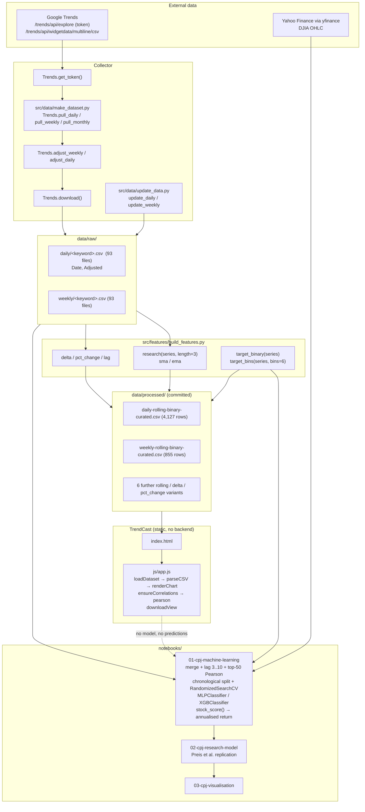
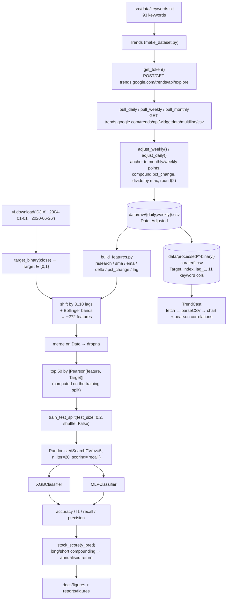

# Project Overview — stock-price-trend-predictor (TrendCast)

## Project Summary

| Field | Value |
| --- | --- |
| **Folder id** | `stock-price-trend-predictor` |
| **Upstream project** | "Njord" by Cristian Perez Jensen (MIT) — `PROJECT_NAME = Stock-Market-Prediction-via-Google-Trends` in the `Makefile` |
| **UI display name** | TrendCast — Alternative-Data Terminal (`index.html`, `css/style.css`, `js/app.js`) |
| **Problem** | Traditional market indicators (price, volume, fundamentals) arrive *after* the information is priced in. Can a public, freely available and high-frequency behavioural signal — the volume of Google searches for terms such as "debt", "crisis" or "unemployment" — add predictive information about where the DJIA goes next? |
| **Objective** | Build a reproducible pipeline that (1) collects daily/weekly/monthly Google Trends search volumes for 93 keywords, (2) puts them on a single relative scale so they are comparable across the whole 2004–2020 window, (3) engineers the Preis/Moat/Stanley research features from them, (4) trains binary up/down classifiers against the DJIA, and (5) measures whether the resulting signal produces a positive annualised return. |
| **Users** | Quantitative researchers; alternative-data practitioners; students reproducing the Preis et al. result; data engineers refreshing the dataset. |
| **Expected output** | A direction classification (up/down) per day/week, an evaluation report (accuracy, F1, recall, precision, annualised return), research figures, and a curated CSV dataset that ships with the repository. |

## Problem Statement

**Preis, Moat & Stanley (2014)** reported that changes in Google search volume for terms related to financial stress preceded movements of the S&P 500, and that a simple trading rule built on that signal beat buy-and-hold. The result was widely discussed and widely questioned — partly because Google Trends does not serve long, high-resolution histories directly, and partly because reproducing a decade-long result requires care about scale consistency and about evaluation methodology.

This repository is a **replication attempt and an engineering exercise** built around three concrete obstacles:

1. **Windows in the data source.** Google Trends only serves a limited time window at high resolution. Collecting 2004→2020 daily data for one keyword therefore requires stitching many requests together.
2. **Comparability across the whole span.** Each Trends response is normalised within its own window, so a raw value in 2005 and a raw value in 2019 are not on the same scale. Without a correction, a "research" feature computed across the series is meaningless.
3. **Honest evaluation.** A direction classifier that scores well on a random split tells you nothing about a trading strategy. The evaluation must be chronological, and the metric of interest is the return of a long/short rule, not accuracy.

The repository also faces a fourth, meta-problem, which this documentation effort addresses: the upstream code is a notebook-and-script research project. A newcomer needs to know **which parts actually run**, which need a 90-second-per-keyword data collection, and which parts simply do not exist (a served model).

## Proposed Solution

**Stage 1 — Collection (`src/data/make_dataset.py`, `Trends`).**
For each of the 93 keywords in `src/data/keywords.txt`, pull daily, weekly and monthly Trends series for geo `US`, category `0`, resolution `DAY`/`WEEK`/`MONTH`, using a token obtained from the `explore` endpoint (`Trends.get_token()`).

**Stage 2 — Adjustment (`Trends.adjust_weekly()`, `Trends.adjust_daily()`).**
Trends normalises each response against its own maximum, so the values are only comparable *within* a window. `adjust_weekly()` anchors every 5-year weekly increment to the corresponding adjusted monthly point and rebuilds the intervening weeks by compounding each unadjusted week's percentage change onto the previous adjusted value; `adjust_daily()` does the same for daily data, anchoring each 6-month increment to an adjusted weekly point. Finally the series is divided by its maximum and rounded to two decimals, yielding the `Adjusted` column in `data/raw/*`.

**Stage 3 — Feature engineering (`src/features/build_features.py`).**
Eight functions: `research()`, `sma()`, `ema()`, `delta()`, `pct_change()`, `lag()`, `target_binary()`, `target_bins()`. `research(series, length=3)` is the Preis et al. feature — today's value minus the previous *n*-day simple moving average, shifted by one period — i.e. "how far above its own recent average is this keyword's search interest, relative to yesterday".

**Stage 4 — Labeling and lag construction (`notebooks/01-cpj-machine-learning.ipynb`).**
`target_binary(djia.Close)` turns the index's close-to-close percentage change into `1` (up) / `0` (down). Each keyword series is shifted by lags 3–10 (Google Trends publishes with roughly a 3-day lag), the lagged matrix is merged with the DJIA frame on `Date`, and the top **50** features by absolute Pearson correlation with the target are selected.

**Stage 5 — Modelling and evaluation.**
`train_test_split(X, y, test_size=0.2, shuffle=False)` — a chronological split, not a random one. `RandomizedSearchCV(cv=5, n_iter=20, scoring='recall')` tunes an `XGBClassifier` and an `MLPClassifier`. The notebook prints accuracy, F1, recall and precision, and `stock_score(y_pred)` converts the prediction series into a compounded long/short position and an annualised return.

**Stage 6 — Reporting.**
`notebooks/02-cpj-research-model.ipynb` replicates the original trading signal; `notebooks/03-cpj-visualisation.ipynb` produces the figures stored under `docs/figures/` and `reports/figures/` (strategy comparisons, Bollinger bands, SMA-delta overlays).

**TrendCast (this repository's addition).**
A static terminal that loads the two curated datasets the browser can actually use, computes Pearson correlations against the target client-side, and documents each pipeline stage with the real commands — while stating plainly that the repository ships no weights and no serving code.

## Features and Capabilities

**Existing (verified in code)**

| Capability | Implementation |
| --- | --- |
| Trends collection (daily/weekly/monthly) | `Trends.pull_daily()`, `Trends.pull_weekly()`, `Trends.pull_monthly()` |
| Token acquisition | `Trends.get_token()` (also re-implemented in `update_data.py:get_token()`) |
| Cross-window scale adjustment | `Trends.adjust_weekly()`, `Trends.adjust_daily()` |
| Raw CSV emission | `Trends.download()` → `data/raw/daily/*.csv`, `data/raw/weekly/*.csv` |
| Incremental refresh | `update_data.main()`, `update_daily()`, `update_weekly()` |
| Feature library | `build_features.research/sma/ema/delta/pct_change/lag/target_binary/target_bins` |
| Dataset build orchestration | `Makefile` targets `requirements`, `data`, `clean`, `lint`, `sync_data_to_s3`, `sync_data_from_s3` |
| Direction classifiers | `notebooks/01-cpj-machine-learning.ipynb` — `XGBClassifier`, `MLPClassifier` |
| Trading-signal backtest | `stock_score(y_pred)` in `notebooks/01-cpj-machine-learning.ipynb` |
| Research replication | `notebooks/02-cpj-research-model.ipynb` |
| Figures | `docs/figures/*.png`, `reports/figures/*.png` |
| Client-side exploration | `js/app.js` → `loadDataset()`, `parseCSV()`, `renderChart()`, `ensureCorrelations()`, `pearson()`, `downloadView()` |

**Future / not present**

- A **walk-forward (rolling) validation** loop — the upstream README mentions it, but no `TimeSeriesSplit` or walk-forward splitter appears in the notebooks.
- A **served model**: no `.sav`/`.joblib` artefact, no API, no container.
- **Live data refresh in production** — `.github/workflows/main.yml` schedules `python scripts/script.py`, and `scripts/` does not exist.
- **Additional markets** beyond the DJIA.
- **A `make train` target** — the upstream cookiecutter README mentions one; this `Makefile` defines none.

## System Architecture

Four cooperating layers. Only the last one is interactive.

1. **Collector** (`src/data/make_dataset.py`) — talks to Google Trends; produces `data/raw/`.
2. **Feature/label library** (`src/features/build_features.py`) — pure functions over pandas Series; produces the engineered matrix.
3. **Notebooks** (`notebooks/`) — merge with `yfinance` DJIA data, train, evaluate, plot. In-memory only; nothing is persisted as a model.
4. **TrendCast** (`index.html`, `css/style.css`, `js/app.js`) — a static browser client over `data/processed/`.



## Complete Project Workflow

**Offline path (what a reviewer can do today)**

1. Open the folder over HTTP → `python -m http.server 8000` → <http://localhost:8000/>.
2. `js/app.js` `init()` runs on `DOMContentLoaded`: it initialises tabs, the clock, the feature-family list and the keyword chips, then calls `loadDataset("daily")`.
3. `loadDataset("daily")` issues `fetch("data/processed/daily-rolling-binary-curated.csv")`; on a non-2xx response it shows the "DATA FEED UNREACHABLE" panel with the `python -m http.server 8000` remedy.
4. `parseCSV(text)` splits the file into headers and typed rows (numeric cells become numbers).
5. `buildDefaultSelection()` marks `debt`, `stock_market`, `crisis` and `Target` active for the daily set (weekly: `debt`, `stock_market`, `Target`); `renderChips()` builds one toggle chip per column.
6. `renderChart()` draws the selected series; `renderStats()` fills rows / columns / index range / up-down split; `renderPreview()` renders the first 25 rows.
7. On the FEATURES tab, `ensureCorrelations()` computes, for every numeric column, the count, min, max, mean and the **Pearson correlation with `Target`** via `pearson(pairsX, pairsY)` — entirely client-side.
8. `downloadView()` writes the currently selected columns to `trendcast-view-<dataset>.csv` via a `Blob`.

**Online path (data refresh + training)**

1. `python src/data/make_dataset.py` → `Trends()` iterates `src/data/keywords.txt`, skipping keywords already present in both `data/raw/weekly/` and `data/raw/daily/`.
2. For each keyword: `pull_daily()`, `pull_weekly()`, `pull_monthly()` request the Trends CSV endpoint; `adjust_weekly()` then `adjust_daily()` rebuild a common scale; `download()` writes the two CSVs; the script sleeps 90 s before the next keyword. Errors are retried up to 3 times with a 120 s back-off, then `sys.exit('Too many errors.')`.
3. `python src/data/update_data.py` → `main()` → `update_daily()` / `update_weekly()` fetch only the missing tail for each keyword and recompute the `Adjusted` column by chaining `Adjusted[i-1] * (1 + pct_change)`; results land in `data/interim/{daily,weekly}/` (directories that must exist — they are not in the repo).
4. Open `notebooks/01-cpj-machine-learning.ipynb` and run all cells: `yf.download('DJIA', '2004-01-01', '2020-06-26')` supplies the target; `target_binary()` builds the label; `research/delta/pct_change/sma/ema` + Bollinger bands build the base features; lags 3–10 are appended; rows with `NaN` are dropped; the frame is merged with the DJIA data on `Date`; `train_test_split(test_size=0.2, shuffle=False)` splits chronologically; the top-50 correlated features are selected; `RandomizedSearchCV` tunes the two classifiers; `accuracy_score / f1_score / recall_score / precision_score` are printed; `stock_score(y_test_preds)` prints the annualised return.
5. **Error handling in the code path:** `Trends.__init__` retries and eventually exits with a message; `update_data.get_token()` raises `TypeError` if the keyword/timespan is not a string; the notebooks have no error handling at all — a failed `yf.download` or a missing CSV raises immediately.

## Machine Learning or Algorithm Explanation

**The core signal — `research()` (Preis et al. 2014)**

```
research(series, length=3) = series - series.rolling(length).mean().shift(1)
```

i.e. today's keyword interest minus the moving average of the previous *n* periods. The `.shift(1)` is what makes it usable: it is the deviation from trend known *before* today's observation, so the feature never leaks the current value. A positive value means search interest for the keyword is running above its own recent norm.

**The label — `target_binary(series)`**

The DJIA close series is converted to a percentage change and binarised: `1` when the index rose, `0` when it fell. This is a *direction* target — no magnitude information is modelled.

**The other engineered features**

| Function | Definition | Role |
| --- | --- | --- |
| `sma(series, length=6)` | rolling mean | Trend baseline |
| `ema(series, length=6)` | exponential moving average, `span=length`, `adjust=False` | Faster-reacting trend baseline |
| `delta(series, length=3)` | `series.diff(length)` | Absolute change over *n* periods |
| `pct_change(series, length=3)` | percentage change over *n* periods | Scale-free momentum |
| `lag(series, length=1)` | `series.shift(i)` → `lag_1 … lag_{n-1}` | Lagged copies; the curated CSVs persist `lag_1` |
| `target_bins(series, bins=6)` | quantile bucketing of `pct_change` | Multi-class experiments |

The notebook additionally builds **Bollinger bands** (`rolling(20).mean() ± 2·rolling(20).std()`, plus 1σ and 10/20-day variants) and shifts every base feature by lags **3–10** to compensate for the roughly 3-day publication lag of Google Trends. This yields the ~272 features the upstream README refers to.

**Feature selection**

```python
correlations = np.abs(X_train.corrwith(y_train))
features = list(correlations.sort_values(ascending=False)[0:50].index)
```

The 50 columns with the largest absolute Pearson correlation with the target — computed on the **training split only**, which is the right thing to do.

**Models**

| Model | Search space (notebook) | Optimisation |
| --- | --- | --- |
| `XGBClassifier` | `learning_rate` ∈ {0.1, 0.01, 0.001}, `gamma` ∈ {0.01…2}, `max_depth` ∈ {2, 4, 7, 10}, `colsample_bytree`, `subsample`, `reg_alpha`, `reg_lambda`, `min_child_weight`, `n_estimators` ∈ {100, 250, 500, 1000} | `RandomizedSearchCV(cv=5, n_iter=20, scoring='recall')` |
| `MLPClassifier` | `solver='sgd'`, `max_iter=1000`, `alpha` ∈ `10**-arange(1,10)`, `hidden_layer_sizes` ∈ `arange(10,15)`, `learning_rate_init=0.15`, `momentum` ∈ U(0.8, 1) | `RandomizedSearchCV(cv=5, n_iter=20, scoring='recall')`; a fixed `MLPClassifier(learning_rate_init=0.1, momentum=0.9, max_iter=1000, shuffle=False, random_state=0)` is also evaluated |
| Reference (`02-cpj-research-model.ipynb`) | The original Preis et al. signal | — |

**The trading metric — `stock_score(y_pred)`**

```python
position = 100
for i, p in enumerate(y_pred):
    position *= stock['pct_change'][i] if p == 1 else 1 / stock['pct_change'][i]
ann_return = ((1 + (position - 100) / 100) ** (1 / (len(y_pred) / 365)) - 1) * 100
```

A long/short rule: `1` compounds the index's daily return, `0` compounds its inverse. The annualisation exponent assumes 365 calendar days per year of prediction periods. It ignores transaction costs, slippage and capacity — a limitation, not a modelling choice.

**Validation methodology (and its limit)**

`train_test_split(X, y, test_size=0.2, shuffle=False)` — a single chronological hold-out. There is no walk-forward / rolling re-fit, so the reported metrics come from one period and one split.

## File-by-File Code Guide

| File | Key symbols | Role |
| --- | --- | --- |
| `src/data/make_dataset.py` | `Trends` (`__init__`, `pull_daily`, `pull_weekly`, `pull_monthly`, `get_token`, `adjust_weekly`, `adjust_daily`, `download`) | The collector. Resets the relative scale across windows and writes the raw CSVs. |
| `src/data/update_data.py` | `main`, `update_daily`, `update_weekly`, `get_token` | Incremental refresh; writes to `data/interim/`. `get_token()` is adapted from Pytrends (Apache-2.0, credited in the docstring). |
| `src/data/keywords.txt` | 93 lines | The keyword universe: `debt`, `color`, `stocks`, … `environment`, `ring`. |
| `src/features/build_features.py` | `research`, `sma`, `ema`, `delta`, `pct_change`, `lag`, `target_binary`, `target_bins` | The feature/label library — the scientific core. |
| `notebooks/01-cpj-machine-learning.ipynb` | `stock_score(y_pred)`; cells building features, lagging, `train_test_split`, `RandomizedSearchCV`, `MLPClassifier`, `XGBClassifier`, metric prints, commented `joblib.dump` | The ML notebook. |
| `notebooks/02-cpj-research-model.ipynb` | Preis et al. replication cells | The strategy notebook. |
| `notebooks/03-cpj-visualisation.ipynb` | plotting cells | Figure generation. |
| `Makefile` | `requirements`, `data`, `clean`, `lint`, `sync_data_to_s3`, `sync_data_from_s3`, `create_environment`, `test_environment` | Orchestration. `BUCKET`/`PROFILE` are the only knobs. No `train` target. |
| `test_environment.py` | `REQUIRED_PYTHON = "python3"`, `main()` | Interpreter sanity check. |
| `setup.py` | `name='src'`, `version='0.1.0'`, `license='MIT'` | Minimal setuptools stub. |
| `data/processed/daily-rolling-binary-curated.csv` | 4,127 rows × 14 cols | The daily dataset the UI loads. |
| `data/processed/weekly-rolling-binary-curated.csv` | 855 rows × 14 cols | The weekly dataset the UI loads. |
| `data/raw/daily/*.csv`, `data/raw/weekly/*.csv` | `Date, Adjusted` | 186 raw keyword series. |
| `index.html` | Trends / Features / Pipeline / Raw keywords tabs, `runCmd` block | The TrendCast markup. |
| `js/app.js` | `DATASETS`, `KEYWORDS`, `FEATURE_FAMILIES`, `parseCSV`, `loadDataset`, `buildDefaultSelection`, `renderChips`, `renderChart`, `renderStats`, `renderPreview`, `pearson`, `ensureCorrelations`, `downloadView` | All client-side behaviour. `pearson()` is a hand-rolled implementation. |
| `.github/workflows/main.yml` | cron `0 8 * * 2-6`, branch `webpage`, `python scripts/script.py` | Scheduled refresh — **references a file that does not exist**. |
| `docs/figures/`, `reports/figures/` | PNGs | Published research figures. |
| `references/*.pdf` | Preis et al.; Can We Predict… | The source papers. |

## Data Flow



**The adjustment step, precisely.** `make_dataset.py` expresses the reconstruction rule as:

```python
new_value = prev_value * (1 + unadjusted.pct_change())
```

Anchoring is what makes a value comparable across windows; the compounding rule is what fills the gaps between anchors; dividing by the series maximum is what puts the result on a 0–1 relative scale. `update_data.py` applies the same compounding rule when extending an existing series.

## Example Execution

**Illustrative — TrendCast, daily dataset**

```powershell
python -m http.server 8000
```

Open <http://localhost:8000/>. Expected behaviour:

1. The TRENDS tab shows `LOADING daily-rolling-binary-curated.csv ...` then `LOADED daily-rolling-binary-curated.csv — 4,127 rows x 14 cols`.
2. Column chips appear for `Target, index, lag_1, debt, stocks, dow_jones, markets, unemployment, money, stock_market, crisis, nasdaq, finance, invest`; `debt`, `stock_market`, `crisis` and `Target` start active.
3. The stats panel reports 4,127 rows, 14 columns, the index range (0 → 4,126) and the up/down split of the `Target` column.
4. The preview table shows the first 25 rows, e.g. row 0 = `Target 0, index 0, lag_1 0, debt 0.106, stocks 0.198, dow_jones 0.0, markets 0.26, …` (these values are read straight from the committed CSV).
5. Switching to the weekly chip loads `weekly-rolling-binary-curated.csv` → `855 rows x 14 cols`.
6. On the FEATURES tab, `ensureCorrelations()` fills the correlation table and the status line reads `DONE — correlations computed client-side from 4,127 rows of daily-rolling-binary-curated.csv (Pearson)`. The `Target` row shows `— (this is the target)`.
7. **DOWNLOAD VIEW AS CSV** produces `trendcast-view-daily.csv`.

*Illustrative only: the exact correlation coefficients are computed at runtime from the CSV and are not reproduced here.*

**Illustrative — training run (notebook)**

```python
# inside notebooks/01-cpj-machine-learning.ipynb
X = data.drop('target', axis=1); y = data.target
X_train, X_test, y_test, y_train = train_test_split(X, y, test_size=0.2, shuffle=False)
correlations = np.abs(X_train.corrwith(y_train))
features = list(correlations.sort_values(ascending=False)[0:50].index)
rf = RandomizedSearchCV(XGBClassifier(), param_distributions=parameters, cv=5, n_iter=20, scoring='recall', n_jobs=-1)
rf.fit(X_train, y_train)
```

Expected output: the notebook prints `Top 7:` followed by seven feature names, then `Accuracy:`, `F1:`, `Recall:`, `Precision:` and `Annual return:`.

*Illustrative only: the numeric metric values depend on the exact data snapshot and on `RandomizedSearchCV`'s random search — they are not reproduced here, and no trained weights exist in the repository.*

## Dependencies and External Services

| Dependency | Why it matters |
| --- | --- |
| `requests` `2.23.0`, `urllib3` `1.26.5` | HTTP calls to the Google Trends endpoints; `requests` also manages the `NID` cookie used by `get_token()`. |
| `pandas` `1.0.4`, `numpy` `1.18.5` | All the series manipulation in `Trends`, the feature functions and the notebooks. |
| `python-dateutil` `2.8.1`, `DateTime` `4.3` | Date arithmetic for the collection windows and `relativedelta` in `update_data.py`. |
| `yfinance` `0.1.54` | DJIA OHLC history — the *target* series. External service: Yahoo Finance. |
| `scikit-learn` `0.23.1` | `MLPClassifier`, `train_test_split`, `RandomizedSearchCV`, `accuracy/f1/recall/precision_score`, `corrwith`. |
| `xgboost` `1.1.0` | `XGBClassifier` — the gradient-boosted alternative in the notebook. |
| `jupyter` `1.0.0` | Notebook execution environment. |
| **Google Trends** (external service) | The `explore` and `widgetdata/multiline/csv` endpoints. No API key; tokens are fetched per request. Subject to rate limiting, which is why the collector sleeps 90 s between keywords. |
| **Yahoo Finance** (external service) | DJIA prices via `yfinance`. |
| **Chart.js** (external, front-end) | Loaded by `index.html` from a CDN for the chart; the rest of the UI is dependency-free vanilla JS. |
| **AWS CLI** (optional) | Only for the `sync_data_to_s3` / `sync_data_from_s3` Makefile targets. |

**No API keys, no tokens, no secrets are stored in this repository.**

## Current Limitations and Future Improvements

**Current limitations**

- **No shipped model and no serving code.** A user wanting a live direction prediction must train in the notebooks and write their own inference path.
- **Single hold-out split.** One chronological 80/20 split instead of walk-forward validation — the upstream README proposes walk-forward, but no such splitter is implemented.
- **Backtest ignores real-world friction.** No transaction costs, slippage, liquidity or capacity constraints in `stock_score()`.
- **Annualisation assumes 365 days.** `(1/365)` in `stock_score()` treats a year of trading periods as a calendar year.
- **The 272-feature matrix is not committed.** Only the curated 13-column projection ships, so the "top 50" selection cannot be reproduced from the repo alone — it requires re-running the notebook.
- **Google Trends normalisation is lossy.** Relative frequencies cannot be converted back into absolute search counts, so long-window comparisons are anchored reconstructions rather than measurements.
- **One market, one label.** DJIA only; binary direction only.
- **Legacy dependency stack** (`pandas==1.0.4`, `numpy==1.18.5`, `scikit-learn==0.23.1`, `yfinance==0.1.54`) that does not install on Python ≥ 3.10 without changes.
- **Broken CI.** `.github/workflows/main.yml` calls `python scripts/script.py`; `scripts/` is absent.
- **No `make train` target**, despite the upstream README referencing one.
- **Collection is slow and fragile.** 93 keywords × 90 s, three retries, and `sys.exit` on exhaustion.
- **`data/interim/` is missing**, so `update_data.py` fails out of the box.

**Future improvements**

- Implement a genuine walk-forward / expanding-window evaluation and report out-of-sample returns per fold.
- Persist the full engineered feature matrix (parquet) so the top-50 selection is reproducible from the repository alone.
- Ship the trained model and a minimal inference service, with an explicit "no weights in repo" note until then.
- Add `scripts/script.py` (or retarget the workflow) so the scheduled refresh actually works.
- Add a `train` Makefile target that drives the notebooks via `nbconvert`/`papermill`.
- Replace the hand-rolled `pearson()` in `js/app.js` with a numerically identical but better-documented implementation, and add a feature-matrix export from the notebooks so the UI can display the 272-feature set.
- Add a `data/interim/` folder to `.gitignore` and create it on demand in `update_data.py`.
- Explore additional markets and multi-horizon targets (`target_bins` is already in place).

## Learning Outcomes

Working through this repository should build the following understanding:

- **How alternative-data research is actually staged** — acquire, normalise, adjust, engineer, label, select, train, evaluate, and only then visualise.
- **The normalisation problem in scraped time series** and the specific anchoring-plus-compounding trick that makes a stitched Google Trends series comparable across a 16-year window.
- **The Preis/Moat/Stanley research feature** and why the one-period shift is what keeps it free of look-ahead leakage.
- **Feature leakage discipline** — selecting the top-50 correlated features on the *training* split only, and the cost of doing it on the full frame instead.
- **Chronological vs random validation** — why `shuffle=False` matters for time series, and why a single hold-out is still weaker than walk-forward evaluation.
- **Turning a classifier into a strategy** — the long/short compounding rule in `stock_score()`, and the gap between "accuracy 0.6" and "annualised return X%".
- **Hyperparameter search trade-offs** — `RandomizedSearchCV` with `scoring='recall'` (favouring recall on a rare event) rather than accuracy, and what that choice implies for a class-imbalanced target.
- **Research reproducibility hygiene** — what it means for a repository to ship data and code but no model, and how to tell "not implemented" from "not yet built" by reading the code rather than the README.
- **Browser-side data analysis** — how the same Pearson correlation can be recomputed in JavaScript over a fetched CSV, and how to keep a static UI honest about what it is and is not computing.
