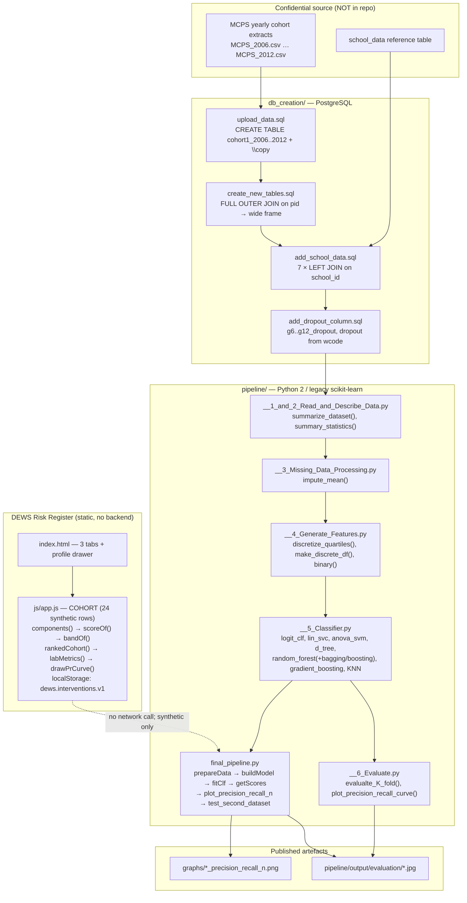
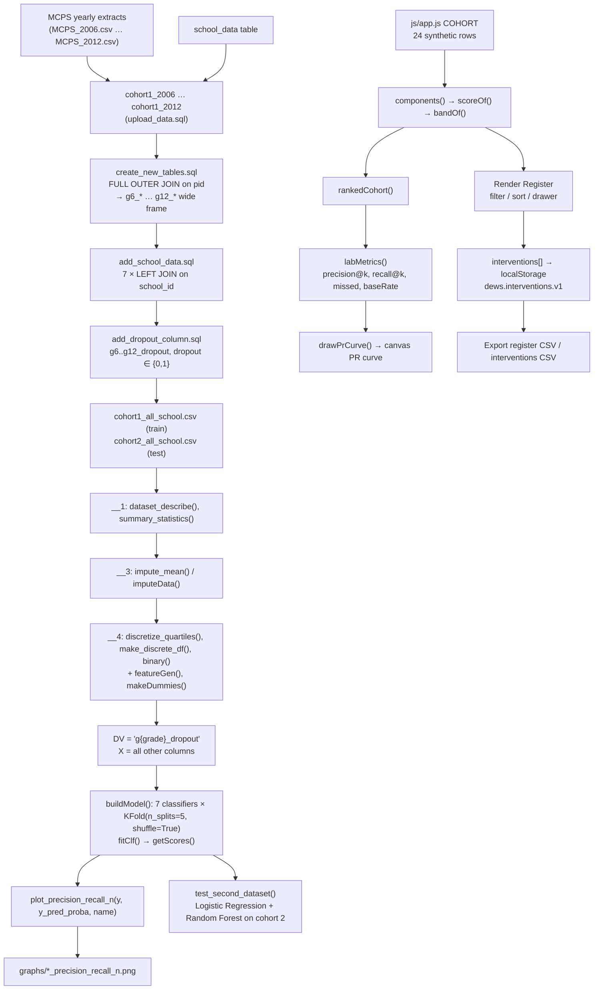

# Project Overview — student-dropout-risk-prediction (DEWS Risk Register)

## Project Summary

| Field | Value |
| --- | --- |
| **Folder id** | `student-dropout-risk-prediction` |
| **Upstream project** | "Predicting High School Dropouts" — UChicago *Machine Learning in Public Policy* course, in partnership with the Center for Data Science in Public Policy |
| **Authors** | Bridgit Donnelly, Christine Cook, Joshua Mausolf (per the module docstrings) |
| **UI display name** | DEWS Risk Register (`index.html`, `css/style.css`, `js/app.js`) |
| **Problem** | The U.S. Department of Education estimates that over 1.2 million American students drop out of high school every year, with long-run consequences for employment, health and family stability. School districts have finite advisory capacity and need to know *which* students to reach first, not merely *whether* someone is at risk. |
| **Objective** | "Develop a scalable ranking system that will allow a school system to target their interventions to individuals who are most immediately at risk for dropping out of high school." (upstream README, verbatim) |
| **Users** | District and school administrators allocating advisor time; counselors triaging caseloads; policy analysts evaluating whether a targeted program beats a universal one. |
| **Expected output** | (a) A ranked list of students by drop-out risk for a target grade; (b) a precision–recall-versus-population-share curve so a district can choose an operating point that matches its intervention capacity; (c) evaluation of several classifiers against the baseline rate. |

**Two deliverables live side by side in this folder.** The upstream research project is a *SQL + Python* pipeline over confidential MCPS student records, whose results are published as precision–recall figures in `graphs/`. The DEWS Risk Register is a **static front-end** that demonstrates the ranking-and-capacity concept on a clearly-labelled **synthetic** cohort, because the real data was withheld for confidentiality.

## Problem Statement

Predicting high-school drop-out is a classic imbalanced-binary problem embedded in a *resource-allocation* problem. Four aspects make it hard:

1. **The data cannot be published.** The upstream project used Chicago Public Schools (MCPS) student-level records, kept on a secure server. `pipeline/data/Data_Readme.md` states plainly: *"Data for this project was stored in this directory on a secure server. To maintain confidentiality, it is not uploaded here."* Only a school-level reference extract ships.
2. **The outcome is defined by administrative codes, not by a clean event.** A student leaves for many reasons. `db_creation/add_dropout_column.sql` encodes the label as a membership test on withdrawal codes: `g*_wcode IN (30,31,32,33,34,35,36,37,38,39,40,44,46,50,71,85)`, and the overall `dropout` flag is the OR across grades 6–12.
3. **The data is longitudinal and ragged.** Each student appears once per grade in separate yearly tables (`cohort1_2006` … `cohort1_2012`), so the pipeline must join grade 6 to grade 12 on `pid` with a `FULL OUTER JOIN`, then attach school-level context with seven `LEFT JOIN`s — producing rows where later-year fields are missing.
4. **The evaluation question is operational, not statistical.** A model with 95 % accuracy that never fires is useless; a model that fires on everyone is useless too. The meaningful artefact is a **precision@k curve against the share of the population flagged**, because k is set by how many students a school can actually serve. That is exactly what `plot_precision_recall_n()` and `graphs/*_precision_recall_n.png` produce, and what the UI's Policy Lab reproduces in the browser.

The upstream project attacked all four: SQL to build a clean longitudinal frame, Python to clean/impute/featurise, a classifier suite with 5-fold cross-validation, and a precision–recall-versus-population evaluation.

## Proposed Solution

**Layer 1 — Database construction (`db_creation/`).**
1. `upload_data.sql` creates one table per grade year with a common schema and bulk-loads the raw MCPS extracts with `\copy … with DELIMITER ',' NULL 'NA' HEADER CSV`.
2. `create_new_tables.sql` pivots the grade tables into a single wide student frame with `FULL OUTER JOIN` on `pid`, prefixing every field with its grade (`g6_absrate`, `g7_absrate`, …).
3. `add_school_data.sql` joins school-level attributes (`school_data`) seven times, once per grade, on `g*_school_id`.
4. `add_dropout_column.sql` adds `g6_dropout … g12_dropout` and the overall `dropout` flag, and back-fills the complement with `UPDATE … SET dropout = 0 WHERE dropout IS NULL`.

**Layer 2 — Python pipeline (`pipeline/`).**
1. `__1_and_2_Read_and_Describe_Data.py` — `dataset_describe()`, `summarize_dataset()`, `summary_statistics()`, `bar()`, `histogram1()`, `histogram2()`, `line_count()`; also the `camel_to_snake()` helper used everywhere to normalise the mixed-case column names.
2. `__3_Missing_Data_Processing.py` — `impute_mean(variable, data_in, data_out)` replaces missing values with the column mean.
3. `__4_Generate_Features.py` — `discretize_quartiles()`, `make_discrete_df()`, `discretize()`, `binary()`: quantile binning and reverse-coded dummy variables.
4. `__5_Classifier.py` — the classifier factory: `logistic_regression_classifier()`, `logistic_regression_table()`, `logit_clf()`, `Build_Data_Set()`, `lin_svc()`, `anova_svm()`, `d_tree()`, `random_forest()`, `random_forest_bagging()`, `random_forest_boosting()`, `gradient_boosting()`, `KNN()`.
5. `__6_Evaluate.py` — `evalualte_base_split()` and `evalualte_K_fold()` (the original spelling) with `plot_precision_recall_curve()`; metrics: accuracy, average precision, precision, recall, F1, ROC-AUC, plus a `Baseline = 1-Mean of DV` reference.
6. `final_pipeline.py` — the consolidated entry point: `getSumStats()`, `cleanData()`, `makeDummies()`, `limitRows()`, `chooseCols()`, `imputeData()`, `imputeConditionalMean()`, `featureGen()`, `prepareData()`, `buildModel()`, `fitClf()`, `getScores()`, `findMisClf()`, `plot_precision_recall_n()`, `test_second_dataset()`.

**Layer 3 — DEWS Risk Register (this repository's addition).**
A static page that makes the *policy* half of the problem tangible: a synthetic risk register, a transparent demo scoring heuristic, a precision@k/recall@k policy lab over a capacity slider, an intervention log kept in `localStorage`, and a Pipeline tab that states exactly what does and does not run.

## Features and Capabilities

**Existing (verified in code)**

| Capability | Implementation |
| --- | --- |
| Yearly cohort table creation + bulk load | `db_creation/upload_data.sql` |
| Grade 6→12 longitudinal join | `db_creation/create_new_tables.sql` (`FULL OUTER JOIN … ON g6.pid = g7.pid`) |
| School-context enrichment | `db_creation/add_school_data.sql` (7 × `LEFT JOIN` on `school_id`) |
| Drop-out label derivation | `db_creation/add_dropout_column.sql` (16 withdrawal codes) |
| Data description / summary statistics | `pipeline/__1_and_2_Read_and_Describe_Data.py` |
| Mean imputation | `pipeline/__3_Missing_Data_Processing.py` → `impute_mean()` |
| Quantile discretisation & dummies | `pipeline/__4_Generate_Features.py` → `discretize_quartiles()`, `make_discrete_df()`, `binary()` |
| Classifier suite (8–10 families) | `pipeline/__5_Classifier.py`, `pipeline/final_pipeline.py:buildModel()` |
| Class-weighted models for imbalance | `RandomForestClassifier(class_weight={0: 1, 1: 10})`, `SGDClassifier(loss="modified_huber", class_weight={0: 1, 1: 10})` |
| 5-fold CV evaluation | `pipeline/__6_Evaluate.py:evalualte_K_fold()`, `final_pipeline.py:buildModel()` |
| Precision–recall vs. population share | `plot_precision_recall_n()`, `precision_recall_population graph.py`, `graphs/*.png` |
| Published figures | `graphs/` — Logistic Regression, Random Forest, Decision Tree, AdaBoost, Bagging, Nearest Neighbors, SGD |
| Synthetic risk register UI | `js/app.js` → `COHORT`, `scoreOf()`, `bandOf()`, `components()`, `visibleRows()`, `renderRegister()` |
| Policy lab (precision@k, recall@k, PR curve) | `js/app.js` → `rankedCohort()`, `labMetrics()`, `renderLab()`, `drawPrCurve()` |
| Intervention logging + history | `js/app.js` → `persistInterventions()`, `renderHistory()`, `storeGet()/storeSave()` |
| CSV export | `js/app.js` → `initExports()` → `dews-register.csv`, `dews-interventions.csv` |
| Pipeline honesty panel | `index.html` → `panel-pipeline` (SQL steps, Python steps, models evaluated, outputs, FERPA notes) |

**Future / not present**

- **A deployed scoring service.** No API, no scheduled refresh, no model registry.
- **A modern, installable pipeline.** No `requirements.txt`, no package metadata, no tests.
- **A walk-forward or time-ordered validation.** The upstream evaluation uses `KFold(n_folds=5, shuffle=True)` — random folds, not temporal folds — which is a genuine methodological weakness for a longitudinal cohort.
- **A live data feed** from MCPS. The data is static and confidential; `update_data.py` does not exist here.
- **Causal evaluation of interventions.** The project ranks risk; it never estimates the effect of acting on the ranking.
- **Multi-district generalisation.** Every path is MCPS-specific.

## System Architecture

Three layers, only the last of which is interactive. Critically, **there is no arrow from the UI to the pipeline** — the browser layer is a self-contained, explicitly synthetic preview.



## Complete Project Workflow

**Upstream pipeline (requires the withheld data)**

1. **Acquire** the MCPS extracts and the `school_data` table on the secure server.
2. **Build the database**: run `upload_data.sql` → `create_new_tables.sql` → `add_school_data.sql` → `add_dropout_column.sql` against PostgreSQL. Errors surface immediately as psql errors (missing relation, missing `\copy` file).
3. **Export** the wide cohort frame to `cohort1_all_school.csv` (training) and `cohort2_all_school.csv` (test) and place it where the scripts expect (`/mnt/data2/education_data/mcps/DATA_DO_NOT_UPLOAD/`).
4. **Describe**: `__1_and_2_Read_and_Describe_Data.py` reads the CSV, normalises column names with `camel_to_snake()`, and emits summary statistics, histograms and line counts.
5. **Impute**: `__3_Missing_Data_Processing.py` → `impute_mean()` fills missing values with the column mean; `final_pipeline.py:imputeData()` / `imputeConditionalMean()` do the same inside the consolidated run.
6. **Featurise**: `__4_Generate_Features.py` bins continuous variables into quartiles (`discretize_quartiles()`) and encodes categoricals as reverse-coded dummies (`binary()`); `final_pipeline.py:featureGen()` and `makeDummies()` do this in the consolidated run.
7. **Model**: `final_pipeline.py:buildModel(data, x, y)` iterates seven classifiers — `KNeighborsClassifier(3)`, `DecisionTreeClassifier(max_depth=5)`, `RandomForestClassifier(max_depth=5, n_estimators=10, max_features=1, class_weight={0: 1, 1: 10})`, `AdaBoostClassifier()`, `BaggingClassifier()`, `linear_model.LogisticRegression()`, `SGDClassifier(loss="modified_huber", penalty="l2", class_weight={0: 1, 1: 10})` — each over `KFold(len(y), n_folds=5, shuffle=True)`, with mean imputation inside each fold.
8. **Score**: `getScores()` records accuracy, precision, recall, F1 and train/test time; `plot_precision_recall_n(y, y_pred_proba, name)` writes the precision–recall-versus-population figure; `findMisClf()` builds the mis-classified-student tree.
9. **Generalise**: `python pipeline/final_pipeline.py 9 True` applies the two best classifiers (`logistic regression`, `random forest`) to the held-out cohort via `test_second_dataset()`.
10. **Error handling** in the code is minimal: `evalualte_base_split()` and `evalualte_K_fold()` wrap only the PR-curve call in a bare `try/except: pass`. Everything else raises.

**Browser flow (DEWS Risk Register)**

1. Open the page → `init()` → `renderKpis()`, `renderRegister()`, `initFilters()`, `initExports()`, `initDrawerChrome()`, `initInterventionForm()`, `initLab()`, `initTabs()`, `initCopy()`.
2. `COHORT` (24 hard-coded synthetic rows) is scored at load time: `COHORT.forEach(row => { row.score = scoreOf(row); row.band = bandOf(row.score); })`.
3. The register renders the filtered/sorted rows; clicking a row opens the drawer with the risk-factor breakdown.
4. Interventions are appended to the `interventions` array and persisted to `localStorage['dews.interventions.v1']`; `persistInterventions()` reports failure if storage is blocked.
5. The Policy Lab recomputes `labMetrics()` whenever the capacity slider changes: the cohort is ranked (`rankedCohort()` sorts by score desc, then absences desc, then id), `k = max(1, round(n × pct / 100))`, and precision@k / recall@k / missed are derived; `drawPrCurve()` paints the curve, the base-rate baseline and the operating point on a `<canvas>`.
6. Exports build a CSV with `toCsv()` / `csvCell()` and download it via `downloadBlob()`.

## Machine Learning or Algorithm Explanation

**Label construction (not ML, but the foundation)**

`db_creation/add_dropout_column.sql` defines a student as having dropped out in grade *g* if their withdrawal code for that grade is in a fixed 16-value set; the overall `dropout` flag is the OR across grades 6–12, and any student not matching is set to `0`. This is a **rule-based label**, not an outcome inferred from data — an important point, because it means the "ground truth" is an administrative definition, and the evaluation measures how well features predict that definition.

**Preprocessing**

- `camel_to_snake()` — a two-step regex (`(.)([A-Z][a-z]+)` then `([a-z0-9])([A-Z])`) that turns the raw MCPS headers into snake_case, and the reverse in `__1_and_2_Read_and_Describe_Data.py` for readability. It is re-implemented in five separate modules.
- `impute_mean()` / `imputeData()` — mean imputation. In `buildModel()` the imputation is recomputed **inside each fold** from the training rows only, which is the correct procedure and a genuinely good detail in otherwise legacy code.
- `discretize_quartiles()` — `pd.qcut(..., 4, labels=['1','2','3','4'])`; `binary()` — reverse-coded dummies for a categorical variable.

**Model suite (`buildModel()` in `final_pipeline.py`)**

| Classifier | Configuration | Class-imbalance handling |
| --- | --- | --- |
| Nearest Neighbors | `KNeighborsClassifier(3)` | none |
| Decision Tree | `DecisionTreeClassifier(max_depth=5)` | none |
| Random Forest | `RandomForestClassifier(max_depth=5, n_estimators=10, max_features=1, class_weight={0:1, 1:10})` | class weights 1 : 10 |
| AdaBoost | `AdaBoostClassifier()` | none |
| Bagging | `BaggingClassifier()` | none |
| Logistic Regression | `linear_model.LogisticRegression()` | none |
| SGD | `SGDClassifier(loss="modified_huber", penalty="l2", class_weight={0:1, 1:10})` | class weights 1 : 10 |
| *(also in `__5_Classifier.py`)* | `lin_svc()`, `anova_svm()`, `random_forest_bagging()`, `random_forest_boosting()`, `gradient_boosting()` | — |

The 1:10 class weight is the project’s answer to a roughly 10 % drop-out rate: it buys recall on the positive class at the cost of precision, which is the right trade for a *ranking* system that will be cut off at capacity anyway.

**Validation**

`KFold(len(y), n_folds=5, shuffle=True)` — five **random** folds. `getScores()` then reports accuracy, precision, recall and F1 on the out-of-fold predictions, plus a `Baseline = 1-Mean of DV` reference line so the reader can see whether a model beats "always predict the majority class". `__6_Evaluate.py:evalualte_K_fold()` adds `average_precision` and `roc_auc` to the metric list.

**The evaluation artefact that matters: precision–recall vs. population share**

`plot_precision_recall_n(y_actual, y_prob, model_name)` (and its MCPS twin) plots precision and recall as a function of the fraction of the population flagged. This is the correct framing for the operational question: *given a budget of k outreach slots, how many true cases do I capture and how many false alarms do I generate?* The published PNGs in `graphs/` are exactly these curves for the seven classifiers, and the upstream README names `graphs/` as "the final precision-recall v. population graphs".

**The browser's demo heuristic (not the upstream model)**

```js
var WEIGHTS = { absence: 0.30, gpa: 0.25, credits: 0.25, behavior: 0.20 };
var SCALE  = { absMax: 35, gpaDrop: 1.2, creditGap: 38, behaviorMax: 4 };

components(row) = {
  absence:  clamp(row.absences / 35, 0, 1),
  gpa:      clamp(-row.gpa / 1.2, 0, 1),
  credits:  clamp((100 - row.credits) / 38, 0, 1),
  behavior: clamp(row.behavior / 4, 0, 1)
};
scoreOf(row) = round(100 * Σ weight_i · component_i)
bandOf(score) = score >= 65 ? 'HIGH' : score >= 40 ? 'MED' : 'LOW'
```

Each component is a **min-max normalisation against a fixed demo scale**, then a weighted sum. It is deterministic, transparent, and entirely synthetic — it is a teaching device, not a model.

**The browser's policy-lab metrics**

```js
ranked = COHORT sorted by score desc, absences desc, id asc
k      = max(1, round(n · pct / 100))          // pct from the capacity slider
tp     = Σ outcome over the top k rows
precision = tp / k
recall    = tp / positives
missed    = positives - tp
baseRate  = positives / n
```

The PR series is then the running precision/recall at every cutoff, which `drawPrCurve()` renders on a canvas together with a dashed **baseline** at `baseRate` (the precision of random targeting) and a marker at the current operating point.

## File-by-File Code Guide

| File | Key symbols | Role |
| --- | --- | --- |
| `db_creation/upload_data.sql` | `CREATE TABLE cohort1_2006` … `cohort1_2012`, `\copy mcps.cohort1_2006 from 'MCPS_2006.csv'` | Schema + bulk load of the raw yearly extracts. |
| `db_creation/create_new_tables.sql` | `CREATE TABLE temp6_7 AS SELECT … FROM cohort1_2006 AS g6 FULL OUTER JOIN cohort1_2007 AS g7 ON g6.pid = g7.pid` | Pivots grade tables into one wide row per student. |
| `db_creation/add_school_data.sql` | 7 × `LEFT JOIN school_data AS g6 ON cohort.g6_school_id = g6.school` | Attaches school-level context per grade. |
| `db_creation/add_dropout_column.sql` | `ADD COLUMN dropout int, g6_dropout … g12_dropout`; `UPDATE … WHERE g*_wcode IN (30,…,85)` | Derives the outcome labels. |
| `db_creation/school_data_small.csv` | `school_data` DDL + one row (`SENECA VALLY HS`, school 104) | Schema reference for the school table. |
| `pipeline/__1_and_2_Read_and_Describe_Data.py` | `camel_to_snake()`, `bar()`, `histogram1()`, `histogram2()`, `line_count()`, `dataset_describe()`, `summarize_dataset()`, `summary_statistics()` | Ingest + exploratory description. |
| `pipeline/__3_Missing_Data_Processing.py` | `camel_to_snake()`, `impute_mean()` | Mean imputation. |
| `pipeline/__4_Generate_Features.py` | `camel_to_snake()`, `discretize_quartiles()`, `make_discrete_df()`, `discretize()`, `binary()` | Quantile binning and dummy encoding. |
| `pipeline/__5_Classifier.py` | `logistic_regression_classifier()`, `logistic_regression_table()`, `logit_clf()`, `Build_Data_Set()`, `lin_svc()`, `anova_svm()`, `d_tree()`, `random_forest()`, `random_forest_bagging()`, `random_forest_boosting()`, `gradient_boosting()`, `KNN()` | The classifier factory (non-final variant). |
| `pipeline/__5_MCPS_Classifier.py` | same family, MCPS cohort | MCPS-specific classifier variants. |
| `pipeline/__6_Evaluate.py` | `plot_precision_recall_curve()`, `evalualte_base_split()`, `evalualte_K_fold()`, `EVAL()`, `classifiers = [...]` | Metric computation, K-fold CV, PR curves. |
| `pipeline/__6_MCPS__Evaluate.py` | `plot_precision_recall_curve()`, `evalualte_base_split()`, `evalualte_K_fold()`, `EVAL()` | MCPS evaluation variant. |
| `pipeline/final_pipeline.py` | `getSumStats()`, `cleanData()`, `makeDummies()`, `limitRows()`, `chooseCols()`, `imputeData()`, `imputeConditionalMean()`, `featureGen()`, `prepareData()`, `buildModel()`, `fitClf()`, `getScores()`, `findMisClf()`, `plot_precision_recall_n()`, `test_second_dataset()` | **The consolidated entry point.** `buildModel()` is the 7-classifier × 5-fold loop; `findMisClf()` builds a mis-classified-student tree. |
| `pipeline/mcps_pipeline.py` | `summarize_data()`, `clean_data()`, `KFold` loop | Earlier MCPS pipeline (Bridgit Donnelly). |
| `pipeline/cook-pipeline.py`, `-2`, `-3` | `getSumStats()`, `cleanData()` | Earlier pipeline versions (Christine Cook). |
| `pipeline/pipeline.py` | shared ML helpers | Earliest pipeline version. |
| `pipeline/precision_recall_population graph.py` | `plot_precision_recall_n(y_true, y_prob, model_name)` | Standalone PR-vs-population plotting. |
| `pipeline/data/Data_Readme.md` | — | States the real data is withheld. |
| `graphs/*.png` | 7 files | Published precision–recall vs. population figures. |
| `index.html` | `panel-register`, `panel-lab`, `panel-pipeline`; `#capSlider`; `#exportRegisterCsv`, `#exportInterventionsCsv`; drawer `#drawer`, `#intervForm` | The DEWS markup. |
| `js/app.js` | `COHORT`, `WEIGHTS`, `SCALE`, `components()`, `scoreOf()`, `bandOf()`, `SUGGESTIONS`, `STORE_KEY`, `renderKpis()`, `visibleRows()`, `renderRegister()`, `initFilters()`, `initExports()`, `openDrawer()`, `renderDrawer()`, `renderHistory()`, `persistInterventions()`, `initInterventionForm()`, `rankedCohort()`, `labMetrics()`, `renderLab()`, `drawPrCurve()`, `initLab()`, `initTabs()`, `initCopy()` | All client behaviour. |
| `css/style.css` | — | UI styling. |

## Data Flow



**The label/data boundary.** Everything above the dashed line is upstream and depends on the withheld MCPS data. Everything below it is the browser preview, which never leaves the page and never touches the pipeline.

## Example Execution

**Illustrative — Policy Lab, synthetic cohort (24 rows, 9 illustrative dropouts)**

Move the capacity slider to 25 %:

1. `labMetrics()` sets `pct = 25`, `k = max(1, round(24 × 0.25)) = 6`.
2. The six highest-ranked rows are taken. From the hard-coded `COHORT`, the top scorers by the demo heuristic are the chronic-absence, negative-GPA, low-credit rows (`SYN-4104`, `SYN-4118`, `SYN-4111`, `SYN-4101`, `SYN-4108`, `SYN-4114`).
3. `tp` counts how many of those six have `outcome === 1`; `precision = tp / 6`, `recall = tp / 9`, `missed = 9 - tp`.
4. The interpretation line reads, in the form: *"Flagging the top 6 of 24 rows (capacity 25%): N of 9 illustrative dropouts captured — precision@k X.XX, recall@k X.XX. Serving everyone would raise recall to 1.00 but dilute precision to the base rate of 0.38."*
5. `drawPrCurve()` paints precision (blue) and recall (amber) against the share of the cohort flagged, with a dashed baseline at `baseRate = 9/24 = 0.375` and a marker at `k = 6`.

*Illustrative only: the specific values above are computed at runtime from the embedded cohort; the arithmetic shown is the exact code path, but the numerals are not a stored result.*

**Illustrative — logging an intervention**

1. Open the drawer for `SYN-4118` (highest risk in the synthetic cohort).
2. The Risk factors panel shows Absence rate (weight 30 %) at 100 % of its scale, GPA decline (25 %) at 100 %, Credit shortfall (25 %) at ~86 % and Behaviour flags (20 %) at 100 %, with a total score of 100 and band `HIGH`.
3. Click **Use** on "Mentor assignment" → the form's type select switches to `Mentor assignment` and the note field is pre-filled with the template rationale.
4. Set a date (today or earlier) and an owner such as `Counselor Reyes` → **Save intervention**.
5. `persistInterventions()` writes `{id: 'SYN-4118', type: 'Mentor assignment', date: 'YYYY-MM-DD', owner: 'Counselor Reyes', note: '…', ts: <epoch ms>}` to `localStorage['dews.interventions.v1']`; the register's "Last intervention" cell and the drawer's History list update.
6. **Export interventions CSV** writes `dews-interventions.csv` with header `enrollment, type, date, owner, note, logged_at`.

*Illustrative only: the scores above come from the demo heuristic on synthetic rows and are not predictions about any real student.*

**Illustrative — upstream evaluation run**

```powershell
.\.venv27\Scripts\Activate.ps1
python pipeline\final_pipeline.py 9 False
```

Expected console output: per classifier, the name, then `Model score:`, `Baseline = Mean of DV:`, `Prediction - null:`, the cross-validation line for each of `['accuracy', 'average_precision', 'precision', 'recall', 'f1', 'roc_auc']`, and a runtime; finally the `clf_results` dict and `End`. PR-curve JPGs are written to `output/evaluation/`.

*Illustrative only: this requires the withheld data and a legacy environment; the numeric metric values are not reproduced here because no trained results are committed.*

## Dependencies and External Services

| Dependency | Why it matters |
| --- | --- |
| **PostgreSQL** | The data-construction layer assumes it: `CREATE TABLE`, `\copy … with DELIMITER ',' NULL 'NA' HEADER CSV`, `FULL OUTER JOIN`, `UPDATE … SET`. The SQL is not portable to MySQL without edits. |
| **MCPS cohort extracts** | The training data. Not redistributable; not in the repo. |
| `pandas` | Every module: `read_csv`, `describe()`, `mode()`, `qcut`, `fillna`, `merge`. |
| `numpy` | `np.arange`, array maths in the feature and evaluation modules. |
| `scikit-learn` (legacy) | `KFold`, `cross_val_score`, `train_test_split`, and the eight classifier families. The `sklearn.cross_validation` import pins the project to ≤ 0.19. |
| `statsmodels` (`sm`) + `patsy` (`dmatrices`) | Only for `logistic_regression_table()` — formatted logistic-regression coefficient tables. |
| `matplotlib` (+ `pylab`) | Histograms, PR curves, miss-classification trees. `final_pipeline.py` forces `matplotlib.use('Agg')` (headless). |
| `IPython` (`from IPython import embed`) | Interactive debugging hook in `final_pipeline.py`. |
| **Browser `localStorage`** | The UI's only persistence. No server, no sync. |
| **No external APIs, no cloud services, no credentials.** | The whole project is self-contained once the data is in place. |

## Current Limitations and Future Improvements

**Current limitations**

- **The data is withheld.** The project cannot be run or reproduced end to end from this repository.
- **Legacy runtime.** Python 2 `print` statements, `sklearn.cross_validation`, `KFold(n_folds=…)` — none of it runs on a current stack without porting.
- **Hard-coded absolute paths** (`/mnt/data2/education_data/mcps/DATA_DO_NOT_UPLOAD/…`) and hard-coded relative dataset names in every module.
- **No dependency manifest.** No `requirements.txt`, no `setup.py`, no lockfile — the environment is unreproducible.
- **Random K-fold on a longitudinal cohort.** `shuffle=True` mixes a student's grade-6 rows with their grade-12 rows across folds, so the same student can appear in both train and test. For a student-level prediction task this inflates the apparent performance. A `GroupKFold` on `pid` (or a time-ordered split) would be the correct fix.
- **Label is an administrative code set**, not a validated outcome; the 16 withdrawal codes encode the district's definitions.
- **Mean imputation** discards the missingness signal, which in education data (a chronic absentee, say) is often itself predictive.
- **No calibration analysis.** A ranking system used to allocate scarce human contact needs calibrated probabilities, and the upstream work reports only threshold-style metrics.
- **No intervention-effect estimate.** The project identifies risk; it never validates that targeting the ranking improves outcomes.
- **The UI is a preview.** Its 24-row synthetic cohort and its transparent demo heuristic are not the upstream model, and its precision@k figures describe the demo, not a real district.
- **Interventions live only in `localStorage`** — no audit trail, no multi-user support, no export-to-system.
- **No access control, no FERPA-compliant deployment story** beyond the notes in the Pipeline tab.

**Future improvements**

- Port the pipeline to Python 3 and current scikit-learn (`sklearn.model_selection`, `KFold(n_splits=…)`), and add a `requirements.txt` with pinned versions.
- Replace the random K-fold with `GroupKFold(pid=…)` or a time-ordered split, and report the difference — the current numbers are likely optimistic.
- Move imputation and feature engineering into a `Pipeline` so that fold-local statistics are guaranteed by construction.
- Add probability calibration (isotonic / Platt) and report calibration curves alongside the PR curves.
- Add a persistence layer for interventions with role-based access, audit logging and a FERPA-compliant data-governance workflow.
- Ship a real model artefact (joblib) plus a small scoring service, so districts can score a live roster rather than a demo cohort.
- Extend the school-level context (`school_data` has dropout rate, graduation rate, attendance rate, average class size, staff ratio) into the model and evaluate how much *school* context adds relative to *student* context — a genuinely policy-relevant question.
- Turn `findMisClf()` into a per-student explainability view ("this student was missed because …"), which is what advisors need in practice.

## Learning Outcomes

Working through this repository should build the following understanding:

- **The full arc of a real applied-ML project** — schema design, bulk loading, longitudinal joins, imputation, feature engineering, model comparison, and publication of the evaluation artefact.
- **Why the evaluation metric is a policy choice.** Precision–recall versus *population share* reframes the question from "is the model accurate?" to "given k outreach slots, what do I get?" — the single most transferable idea in this repository.
- **Class imbalance in practice** and the 1:10 class-weight trade-off: buying recall on a ~10 % positive class at the cost of precision, which is acceptable for a ranking system and unacceptable for a yes/no alert.
- **The danger of random cross-validation on longitudinal data**, and how `GroupKFold` on a student identifier fixes it. Seeing a pipeline that quietly leaks is instructive precisely because it looks correct.
- **Label engineering as an administrative act** — a 16-code withdrawal list is the definition of "dropout" for an entire district, and every downstream metric inherits it.
- **Honest UI design for a confidential-data project**: how to show the *shape* of a system without the data, using a transparent synthetic cohort, an explicit heuristic, and a Pipeline tab that states exactly what does not run.
- **Human-in-the-loop design** — risk bands as triage prompts, intervention templates, and the FERPA-conscious separation between "what the model says" and "what a person decides".
- **Reading legacy research code** — Python 2 syntax, `sklearn.cross_validation`, duplicated `camel_to_snake()` across five modules, and the value of extracting the *intent* (a ranking pipeline for scarce intervention capacity) from the *implementation* (a script that will not run today).
